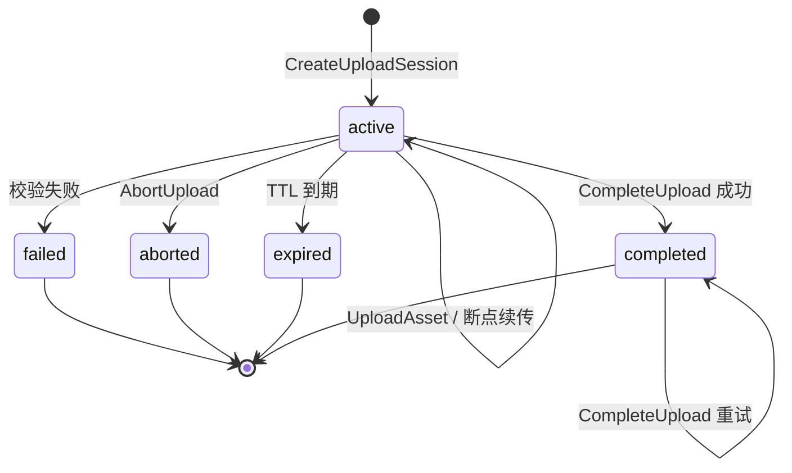

# Asset 后端：私有上传与过审作品文件读取

日期：2026-09-28，按 2026-10-16 Asset 阶段 3 收尾验收更新。本文同时记录 Asset 第二阶段的实现方案和当前本地实现状态：已实现登录用户的私有上传、完成校验、元数据、私有下载和 Content 草稿绑定；已实现 S3-compatible adapter，并把 Asset 登记到本分支的 `services.json` 和 kind lab 声明。3A/3B/3C 已完成本地实现与验收，审查修复后的已提交代码已重新通过完整隔离 kind 验证（见第 15 节）；尚未合入 dev、更未公网部署。3C 增加过审作品文件的公开读取和 Content 权限检查，仍未实现 Moderation 审核工作流、公开任务详情、投票、推荐或云端挑战。

## 1. 依据与归属

### 项目已有约束

- `AGENTS.md` 规定 Asset 是独立业务服务，不是 `platform` 进程；服务各自拥有 schema 和数据库账号，不能跨 schema 查询或写表。
- `docs/backend-architecture.md` 规定 Content 唯一拥有任务、作品、投稿快照和可见性；Asset 唯一拥有上传会话、文件元数据、对象和文件可用状态。Asset 下载需要在必要时调用 Content 做内容权限检查，但不能形成递归调用。
- Identity 的断言按 `audience + FullMethod` 白名单验证，Content 当前只接受有效网站会话，不接受 MCP token 作为私有草稿身份。
- 当前 Content 草稿已有 `asset_id` 字段；本阶段已解除旧的 `asset_service_not_ready` 拒绝，但仍由 Content 持有任务草稿事实。
- 文件二进制不进入 PostgreSQL；网关使用同源 `/api/*`，后端服务之间使用 mTLS gRPC。
- 现有部署方式使用 `cmd/<module>`、独立迁移和 `<module>_owner` / `<module>_runtime`；双副本要求共享的外部持久化存储。

### Agent Self-Claimed 实现方案

以下是为完成首阶段而提出的技术选择，不是人类已经确认的产品参数：

- Asset ID 使用 `ast_` 加 32 个小写十六进制字符；上传会话 ID 使用 `upl_` 加同样长度。ID 是引用标识，不是访问凭据。
- 首阶段建议最大文件 32 MiB，单个上传 chunk 不超过 256 KiB；允许的检测类型先取 `image/png`、`image/jpeg`、`image/webp`、`application/pdf`、`text/plain`。不接受 SVG、可执行文件和压缩包，后续按真实需求扩展。
- 生产/双副本存储使用 S3-compatible 共享对象存储；`FileStorage` 仅用于单进程单元测试与临时 FileStorage 集成夹具。配置为 filesystem 时必须显式设置测试开关，禁止以双副本生产模式启动。
- 完成上传要求创建会话时提供 64 个小写十六进制字符的 SHA-256 期望值，由 Asset 读取对象后重新计算；客户端 `Content-Type` 只作为未信任提示。
- 采用上传会话创建幂等键、连续 offset 和不透明分页 cursor。控制面调用的目标超时 2 秒，哈希校验和对象复制目标超时 30 秒，文件传输由 HTTP 请求的 15 分钟上限控制。
- Asset 3A 的数据库夹具采用“随机 PostgreSQL 数据库 + 随机 owner/runtime 角色 + 临时 FileStorage + 进程内真实 mTLS gRPC server”；3B 另以 SeaweedFS 4.13 作为隔离 S3-compatible test store，验证两个 adapter/服务实例共享 bucket。这些都是 Agent Self-Claimed 测试方案：不代表 kind rollout、独立 OS 进程部署或生产 HA。
- 3B kind 业务验收另复用真实 Deployment 模板创建临时 Gateway probe Pod，仅把 `ASSET_TARGET` 固定到不同 worker 上的 Asset Pod IP，保留证书与 NetworkPolicy；未满足的 readiness gate 阻止 probe 被普通 Gateway Service 选为就绪端点。数据库和 S3 对象观察只在随机验证 namespace 内进行。该方案为 Agent Self-Claimed，不扩大产品权限或公网范围。
- Challenge 内部文件访问采用固定 purpose 白名单；浏览器流只允许 gateway 服务身份，Challenge 流只允许 challenge 服务身份。Asset 不复制 Challenge 的 Attempt 状态，也不跨 schema 查询其数据库。

这些选择应在实现前由实际文件类型、对象存储和容量测试复核；文档中的 `32 MiB` 和类型白名单不是 PRD 产品承诺。

## 2. 职责边界

### Asset 拥有

Asset 只负责以下事实：

- 上传会话、会话过期时间、已接收字节数和对象存储 multipart/staging 状态。
- 文件所有者 `owner_id`，来源只能是 Asset 对 Identity assertion 的重新验证结果。
- 原始文件名的清洗值、声明媒体类型、服务端 sniff 得出的媒体类型、字节数和 SHA-256。
- 随机对象存储键。对象键不由文件名、账号 ID 或客户端路径拼接而来。
- 上传和文件状态：session 的 `active`、`completed`、`aborted`、`expired`，asset 的 `staging`、`ready`、`failed`、`deleted`。
- 私有元数据读取、私有下载和上传失败/取消/过期后的对象清理。

Asset 不负责任务、作品、作者关系、审核决定或公开状态，也不读取 Identity/Content 表。Asset 不因“上传成功”就认定文件已经绑定到任务。

### Content 拥有

Content 仍负责：

- 任务草稿、作品值对象、`asset_id` 引用及草稿版本并发控制。
- “这个资产是否被该草稿/作品引用”以及任务、作品的 draft/review/public 可见性。
- 创建或替换草稿时要求 Asset 返回 `ready` 且归属当前已验证账号。

Asset 的可用文件不能反向改变 Content 状态；Content 的草稿修改也不调用 Asset 删除旧文件。首阶段旧文件保留为该用户的可管理资产，避免没有分布式事务时误删仍被其他草稿引用的对象。

### Gateway 拥有

Gateway 只做 HTTP、Cookie/CSRF、请求体限制、gRPC 流转换和稳定 Problem 映射。它不解析文件内容、不写 Asset 数据库、不接受 `owner_id`、角色或权限字段，也不把对象存储 URL暴露给客户端。

## 3. 数据库与对象存储

### 角色和 schema

迁移目录建议为 `backend/internal/asset/migrations/`，首个文件为 `001_asset.sql`；迁移程序以 `asset_owner` 连接，运行服务只用 `asset_runtime`：

```sql
CREATE SCHEMA asset AUTHORIZATION asset_owner;

CREATE TABLE asset.assets (
    id                    text PRIMARY KEY,
    owner_id              text NOT NULL,
    state                 text NOT NULL CHECK (state IN
      ('staging', 'ready', 'failed', 'deleted')),
    original_filename     text NOT NULL,
    declared_media_type   text NOT NULL,
    detected_media_type   text,
    expected_bytes        bigint NOT NULL CHECK (expected_bytes > 0 AND expected_bytes <= 33554432),
    received_bytes        bigint NOT NULL DEFAULT 0 CHECK (received_bytes >= 0),
    expected_sha256       bytea NOT NULL CHECK (octet_length(expected_sha256) = 32),
    actual_sha256         bytea CHECK (actual_sha256 IS NULL OR octet_length(actual_sha256) = 32),
    staging_key           text NOT NULL UNIQUE,
    final_key             text NOT NULL UNIQUE,
    created_at            timestamptz NOT NULL DEFAULT clock_timestamp(),
    updated_at            timestamptz NOT NULL DEFAULT clock_timestamp(),
    completed_at          timestamptz
);

CREATE TABLE asset.upload_sessions (
    id                    text PRIMARY KEY,
    asset_id              text NOT NULL UNIQUE REFERENCES asset.assets(id),
    owner_id              text NOT NULL,
    idempotency_key       text NOT NULL,
    request_fingerprint   bytea NOT NULL CHECK (octet_length(request_fingerprint) = 32),
    received_bytes        bigint NOT NULL DEFAULT 0 CHECK (received_bytes >= 0),
    state                 text NOT NULL CHECK (state IN
      ('active', 'completed', 'aborted', 'expired')),
    expires_at            timestamptz NOT NULL,
    created_at            timestamptz NOT NULL DEFAULT clock_timestamp(),
    updated_at            timestamptz NOT NULL DEFAULT clock_timestamp(),
    UNIQUE (owner_id, idempotency_key)
);

CREATE INDEX assets_owner_created_id
  ON asset.assets (owner_id, created_at DESC, id DESC);
CREATE INDEX upload_sessions_expiry
  ON asset.upload_sessions (expires_at)
  WHERE state = 'active';
```

上面的 `REFERENCES` 只在 Asset schema 内建立；`owner_id` 是跨服务稳定账号 ID，不是跨 schema 外键。实现时迁移还需要授予最小权限：runtime 只能对上述两张表执行必要的 `SELECT`、会话状态 `INSERT/UPDATE` 和清理字段更新，不能 DDL、不能访问 `identity` 或 `content` schema。对象存储删除不在 PostgreSQL 事务中执行。

`request_fingerprint` 覆盖大小、期望 SHA-256、清洗后的文件名和声明媒体类型。相同 `(owner_id, idempotency_key)` 且 fingerprint 相同的创建重试返回原会话；fingerprint 不同返回 `idempotency_conflict`，不能覆盖原会话。

### 对象键与状态

对象键由服务端随机生成，例如：

```text
assets/<asset_id>/staging/<upload_session_id>
assets/<asset_id>/content
```

上传期间只写 staging key。`CompleteUpload` 先确认对象字节数，再计算 SHA-256、检测媒体类型，成功后将对象提升/复制为 content key，最后在数据库中提交 `ready`。任何 `ready` 之前的状态都不能被 Content 引用。

对象存储请求和数据库更新采用可重试状态机而不是分布式事务：

1. 创建会话只写数据库和生成对象键，不创建可下载对象。
2. chunk 写入先取得会话锁，要求 `offset == received_bytes`；对象存储成功后更新 offset。
3. 完成时锁定 active 会话，再做对象读/哈希/提升；数据库提交前超时可安全重试同一会话。
4. 如果服务在对象成功、数据库提交前超时，重复 `CompleteUpload` 检查 staging/final 对象并继续提交同一资产；不能重新生成另一个资产。
5. 取消或过期先把数据库标为终态，再幂等删除 staging 对象。删除失败由后续清理重试，不恢复为 ready。

定时清理任务只处理已过期且仍未完成的上传会话。首阶段不提供删除 `ready` 资产的 API，因而不会把 Content 的绑定关系偷偷当作 Asset 本地事实。

## 4. 状态图与不变量



不变量：

- `ready` 必须有服务端计算的 SHA-256、检测媒体类型、完整字节数和存在的 final object。
- Asset 行在上传期间是 `staging`；只有 CompleteUpload 成功后才变为 `ready`。
- 上传流和完成请求都必须通过 Asset 对 Identity assertion 的实时验证；MCP token 和管理员角色都不能绕过网站会话要求。
- 客户端不能指定 `owner_id`、Asset state、对象键、检测媒体类型、公开 URL 或 Content 可见性。
- 同一会话的 offset 单调增加；同一会话不能有两个不同对象或两个成功完成结果。
- `asset_id` 只有在 `ready` 后才允许进入 Content 草稿；Content 的更新失败不会令 Asset 变为不可用。

## 5. Asset Proto

正式 Proto 位于 [`backend/proto/humanworth/asset/v1/asset.proto`](../backend/proto/humanworth/asset/v1/asset.proto)，生成代码位于 `backend/gen/humanworth/asset/v1/`；`docs/backend-asset.proto` 已删除，不再是 Buf 输入。Content 创建/替换请求新增服务间 `asset_actor_assertion` 字段，Gateway 不从外部 JSON 暴露该字段。

### RPC 选择

| RPC | 调用方 | 选择与原因 |
| --- | --- | --- |
| `CreateUploadSession` | Gateway | unary；网站会话 assertion、幂等键、大小、SHA-256、原始名和声明类型；写入 `active`/`staging`；2 秒控制面超时；同 fingerprint 可重试，不同 fingerprint 拒绝 |
| `UploadAsset` | Gateway | client-streaming；首消息带 session、offset 和 assertion，后续消息为连续 chunk；单 chunk 256 KiB；请求断开后以返回/元数据中的 offset 恢复；15 分钟 HTTP deadline；不以重试整条流代替断点续传 |
| `CompleteUpload` | Gateway | unary；Asset 重新验证 assertion，读取对象并计算 SHA-256；已完成重试返回同一结果；30 秒控制面/对象校验预算 |
| `AbortUpload` | Gateway | unary，网站会话；active 会话转 `aborted`；已完成资产不接受；2 秒 |
| `GetUploadSession` | Gateway | unary，网站会话；返回当前 offset 和状态，供断点续传及超时恢复；2 秒 |
| `GetAssetMetadata` | Gateway 或 Content | 网站会话只返回本人资产；Content 使用带 Asset audience 的 assertion 做绑定校验；不返回对象 URL；2 秒 |
| `ListMyAssets` | Gateway | 网站会话，仅本人元数据，keyset cursor；默认 20、最大 100；2 秒，不取二进制 |
| `CheckAssetOwnership` | Content | Content 通过 gateway 取得的 Asset method assertion 调用；请求只有 `actor_assertion + asset_ids`，不含 owner_id；Asset 返回每个可用资产的权威 owner/metadata；批量 unary，避免每个 artifact 一个 RPC；2 秒 |
| `DownloadAsset` | Gateway | server-streaming；Asset 验证网站会话、owner 和 `ready` 状态后流式读对象；首阶段只允许本人私有下载，不调用尚未实现的 Content `CheckAssetAccess`；15 分钟 |
| `DownloadPublicAsset` | Gateway | 3C：带 task/entry/asset 上下文；Asset 查询 Content 当前审核状态，打开对象后再次复核，再发送 metadata 首帧及连续 data 帧；15 分钟流上限，单次授权 2 秒，无 grant/URL |
| `AuthorizeDownload` | 未实现 | 继续代理流；不引入可重放授权、签名 URL 或 CDN 绕过即时撤销 |

`GetAssetMetadata` 给 Content 的专用调用不能退化为“传入 owner_id 就返回”；应复用 `CheckAssetOwnership` 的 assertion 验证。Asset 的所有用户 RPC 都在 Identity `policies` 增加精确的 Asset audience/method 白名单；`VerifyActor` 的调用方仍由 mTLS peer 限制为预期服务。

### Challenge 内部访问边界

正式 Proto 复用 `GetAsset`、`ReadAsset` 和 `UploadAsset` 服务间方法。当前实现要求：

- `GetAsset` / `ReadAsset` / Challenge 形态的 `UploadAsset` 只接受 mTLS `challenge` 服务身份；gateway 不能通过构造内部 `Access` 或流首帧冒充 Challenge。
- `Access.task_id`、`run_id`、`attempt_id`、`purpose` 必须全部非空；purpose 只接受当前 WorkKind 名称和产物确认使用的 `output`，Challenge 上传进一步只接受 `WORK_KIND_EXECUTE_PACKAGE`。
- Challenge 产物将 `run_id + attempt_id + upload_id` 持久化并唯一约束；同一 upload ID、大小和 SHA-256 的完成重试返回原 Asset，不同摘要或大小返回冲突。
- **Agent Self-Claimed（2026-10-16 审查修复）**：同一 `run_id + attempt_id + upload_id` 在专用 PostgreSQL 连接上持有 session advisory lock，覆盖首次建行、整条上传流、final 恢复、校验、对象提升和 ready 提交；不能只在开始时短暂锁行。并发流立即返回 gRPC `Aborted upload_in_progress`，不会修改对象，调用方可在原流结束后重试；已 ready 的同参数重试仍返回原 Asset。锁随流结束释放，取消时用独立 2 秒上下文解锁；无法确认解锁则关闭连接，不把带锁连接归还池。每个进行中的 Challenge 流占用一个数据库连接，受现有连接池与流 deadline 约束；不在收流期间保持长数据库事务，不改变普通 RPC 超时。
- **Agent Self-Claimed（同轮修复）**：Challenge 与本人 `CompleteUpload` 共用对实际存储对象的有界 SHA-256/长度/前 512 字节媒体类型检测；不把流元数据中的类型写成检测结果。新上传在提升前校验，final 已存在但数据库尚未提交时也重新校验；不在白名单返回 `InvalidArgument unsupported_media_type`，白名单内但声明不符返回 `FailedPrecondition media_type_mismatch`，失败资产不能读取，并尝试删除拒绝的 staging/final 对象。媒体检测沿用 HTTP sniff，不等于完整文件格式解析、恶意内容扫描或审核。

- Asset 按持久化的 `run_id + attempt_id` 隔离 Challenge 产物；不同 attempt 不能读取。`task_id` 当前不写入 Asset 表，Asset 因而不能独立证明 `task_id` 与 run 的关系。
- `task_id ↔ run_id` 关系、Attempt 当前租约以及完成/取消状态由 Challenge 在调用前、每个上传块和关闭上传流前通过自身持久化状态的 `live` 检查保证。完成或取消的 Attempt 再上传返回 `FailedPrecondition`。
- 这是现有服务间信任边界：若 challenge 服务身份本身失陷，Asset 不能仅凭 `Access.task_id` 识别伪造关系。后续若需要缩小该边界，应增加由 Challenge 签发且绑定 run/attempt/purpose 的短期授权，而不是让 Asset 查询 Challenge 数据库或形成递归调用。

## 6. Content 与 Asset 协作

### 创建和替换草稿

现有 Content 的 `CreateTaskDraftRequest` / `ReplaceTaskDraftRequest` 由 gateway 内部扩展一个仅服务间使用的 `asset_actor_assertion`（或等价的受保护字段），客户端 JSON 不可填写。处理顺序如下：

1. Gateway 从同一个网站会话分别向 Identity 请求 Content method assertion 和 Asset `CheckAssetOwnership` method assertion。两者都绑定同一会话、账号版本和 method，MCP token 没有这两个权限。
2. Content 先验证自己的 Content assertion，得到当前账号 `A`。
3. Content 从草稿中提取去重后的 `asset_id`，批量调用 Asset `CheckAssetOwnership`，Asset 自己验证 Asset assertion，返回 `owner_id`、`state`、大小、SHA 和检测类型。
4. Content 要求每个引用都是 `ready` 且 `owner_id == A`；对不存在、未完成、已过期、其他账号或服务不可用都拒绝整个写入。请求体不能覆盖返回元数据。
5. 所有外部校验完成后，Content 在自己的数据库事务中写入完整草稿。Asset 不参与该事务，也不写 Content 表。

这会产生“校验成功但 Content 事务失败”的未绑定可用资产。首阶段这是可接受且不丢文件的结果：资产仍是当前用户的可用私有资产，后续可以重新绑定；不在没有 Content 事实的情况下自动删除。

### 下载和可见性

首阶段 `/api/me/assets/{assetId}/content` 只允许网站会话。Asset 验证当前账号是 owner 且资产为 `ready`，然后流式返回私有文件：

- 本人管理路由不接受或解释 `taskId`；3C 的公开读取使用另一个带 task/entry/asset 上下文的路由。
- 3C 公开下载：Asset 调用 Content `CheckAssetAccess`；Asset 不复制“公开”状态，也不接受客户端 `public=true`。

3C 调用方向为 `Asset -> Content.CheckAssetAccess`，后者只查自己的审核快照，不再调用 Asset，因此不会递归。私有 owner 管理下载仍只检查本人和 ready；作品撤销展示不删除作者自己的文件。

### 绑定并发

Content 每次创建/替换都重新校验新增引用；旧引用由 Content 版本替换处理。Asset 不锁 Content 行，也不维护绑定计数。两个请求同时绑定同一个可用资产是安全的，因为 owner 检查是只读的；同一个草稿的版本冲突仍由 Content 现有 `expected_revision` 控制。

## 7. HTTP 与 OpenAPI 对照

OpenAPI 已将旧的 `POST /api/assets` planned multipart 草案替换为本阶段实际路由，并标记为 `implemented-local`；这不表示公网已发布。

| HTTP | Auth / CSRF | RPC | 成功响应 |
| --- | --- | --- | --- |
| `POST /api/me/assets/upload-sessions` | 网站会话 + 写操作 CSRF；`Idempotency-Key` 必须恰好一个 | `CreateUploadSession` | `201`：`{asset, uploadSession}`，不含 URL |
| `PUT /api/me/assets/upload-sessions/{uploadSessionId}/content` | 网站会话 + CSRF；`Content-Range` 必须连续，单段不超过 256 KiB | `UploadAsset` client stream | `200`：`receivedBytes`、`nextOffset`、`state`；未完成仍为 `active` |
| `POST /api/me/assets/{assetId}/complete`（JSON 携带 `uploadSessionId`） | 网站会话 + CSRF | `CompleteUpload` | `200`：`Asset`，只有 `state=ready` 才能引用 |
| `DELETE /api/me/assets/upload-sessions/{uploadSessionId}` | 网站会话 + CSRF | `AbortUpload` | `204`；重复取消仍返回 `204` |
| `GET /api/me/upload-sessions/{uploadSessionId}` | 网站会话 | `GetUploadSession` | `200`：当前 `receivedBytes`、`expectedBytes`、`state`、`expiresAt` |
| `GET /api/me/assets?limit=&cursor=` | 网站会话；GET 无 CSRF 写副作用 | `ListMyAssets` | `200`：`{items, nextCursor}`，不含内容 |
| `GET /api/me/assets/{assetId}` | 网站会话 | `GetAssetMetadata` | `200`：本人资产元数据 |
| `GET /api/me/assets/{assetId}/content` | 网站会话；首阶段不支持 MCP | `DownloadAsset` server stream | 二进制流；服务端设置检测后的 `Content-Type`、清洗后的下载文件名和 `Content-Disposition: attachment` |

HTTP 的 `Asset` 字段为 `id`、`filename`、`mediaType`、`bytes`、`sha256`、`state`、`createdAt`、`completedAt`；不返回 object key、数据库 owner、存储供应商信息或永久下载 URL。Content 的 `TaskSubmission.content.entries[].artifacts[]` 继续使用 `{kind:"file", assetId}`，详情响应不把 file 改写成二进制或公开链接。

建议同步到 OpenAPI 的 schema/错误码：

| 情况 | HTTP | Problem `code` |
| --- | ---: | --- |
| 无会话、会话撤销、MCP Bearer | 401 | `unauthenticated` |
| CSRF、服务身份或用途不允许 | 403 | `forbidden` |
| 资产/会话不存在或不属于本人 | 404 | `asset_not_found` |
| 重复幂等键但内容不同 | 409 | `idempotency_conflict` |
| offset 与服务端不一致 | 409 | `upload_offset_conflict` |
| 未上传完整就完成 | 409 | `upload_incomplete` |
| 资产尚未 `ready` 或 Content 引用检查失败 | 409 | `asset_not_ready` |
| 超过文件或请求体上限 | 413 | `file_too_large` / `request_too_large` |
| 声明或检测类型不在白名单 | 415 | `unsupported_media_type` |
| SHA-256 不匹配 | 422 | `checksum_mismatch` |
| Asset、Content、对象存储或 Identity 不可用 | 503 | `asset_unavailable` |

重复 query/header 参数、未知 query 参数、空 cursor、非法 cursor、非法 ID 和重复 `Content-Range` 头都返回 400 `invalid_request`；不得把无效 cursor 当第一页。对象存储过大、流中断或服务超时不能映射成 429 `too_many_requests`。

## 8. 安全限制

- owner 只从 Identity assertion 取得；请求中不接受 `owner_id`、账号、角色、管理员标记或公开标记。管理员也只能以自己的 web session 管理自己的资产。
- Asset 的 Identity method policy 首阶段只允许 `CLIENT_KIND_WEB_SESSION`；MCP token 没有上传、私有元数据或下载权限。
- Gateway 限制请求体为 `32 MiB + 协议余量`，Asset 对每个 chunk 限制 256 KiB，对 session 总字节数和对象存储实际长度再次限制；gRPC server/client send/receive 上限必须包含 protobuf wrapper 并留余量。
- 文件名去除 `\`、`/` 路径部分，拒绝 NUL 和控制字符，限制 255 UTF-8 字节，空名使用固定 `upload`；文件名只用于 `Content-Disposition`，不参与对象键和权限。
- 先检查声明类型，再读取文件头进行服务端检测；最终 allowlist 以检测结果为准。不要把客户端 `Content-Type`、扩展名或文件名当作安全判断。
- SHA-256 由 Asset 对对象内容计算；客户端提供的期望摘要只是比较值，不是证明。摘要错误不生成 `ready` 状态。
- 未完成上传的 staging object 不返回、不允许 Content 引用；数据库状态和对象存在性都必须满足才可下载。
- 绝不返回永久公开 URL。首阶段由 gateway 代理 server stream；未来短期签名地址必须有短 TTL、单资产、单用途并在生成前完成 Content 权限核实。
- 日志只记录 asset/session ID、状态、字节数和 request/trace ID，不记录文件名原文、摘要以外的内容、Cookie、assertion 或对象存储凭据。

## 9. 并发、重试和失败恢复矩阵

| 场景 | 服务端规则 | 客户端动作 |
| --- | --- | --- |
| 创建会话超时但数据库已提交 | `(owner_id, idempotency_key)` + fingerprint 找回原会话 | 原样重试同一 `Idempotency-Key`；不要换 key |
| 同 key 不同大小/SHA/元数据 | 返回 409 `idempotency_conflict`，不修改旧会话 | 生成新 key，先确认旧会话是否取消/过期 |
| 上传流中断 | 已提交 offset 保留；未提交 chunk 不计入 | 获取当前 offset，从该 offset 继续；不要从 0 覆盖 |
| 两个流同时上传 | 会话行锁只允许一个连续 offset；另一请求返回 409 `upload_offset_conflict` | 串行化同一 session |
| chunk 重试 | 当前不实现“相同 chunk ID 自动成功”的重放语义；已提交 offset 的重复发送返回 409，不会再次追加或覆盖 | 先读 `GetUploadSession`，只从权威 `nextOffset` 继续；不要盲重发已确认 chunk |
| 收齐字节但未 Complete | session 仍为 `active`、asset 仍为 `staging`，不可引用/下载 | 调用 CompleteUpload |
| SHA-256 错误 | 状态 `failed`，删除 staging best effort；不进入 `ready` | 重新创建会话并重新传输 |
| Complete 并发两次 | 会话行锁保证一个稳定结果；另一个返回同一最终结果或冲突 | 可安全重试，不创建第二个 asset |
| Complete 超时但对象已复制 | 重试读取同一 session 和 staging/final 对象，完成数据库提交 | 使用同 asset/session 重试 |
| Abort 与 Complete 竞争 | 先取得会话锁；已完成的 session 不可 Abort | 读取最终状态，不猜测 |
| 会话到期 | 事务标 `expired`，不再接受流或完成；清理任务异步删除对象 | 新建会话 |
| Content 校验成功但草稿提交失败 | Asset 保持 `ready` 私有资产，不回滚对象 | 重试 Content 草稿写入；后续由资产管理/GC 清理未引用项 |
| 已绑定资产再次修改草稿 | Content 用 revision 控制引用集合；Asset 不删除旧资产 | 成功后旧资产仍可管理，不能假设自动删除 |
| 下载时 Content/Identity/对象存储超时 | fail closed，不发送部分成功的权限结果；HTTP 503 或断流 | 重试 GET；不使用缓存 URL |
| 重启或切换副本 | 所有会话状态在 Asset DB，对象在共享 storage | 可到任一副本继续；本地 filesystem adapter 不得用于双副本 |

## 10. 3B 存储与 kind lab 状态

### 已实现（当前工作分支，未发布）

- `S3Storage` 使用 AWS SDK Go v2，配置为 `ASSET_STORAGE_BACKEND=s3`、`ASSET_S3_ENDPOINT`、`ASSET_S3_BUCKET`、`ASSET_S3_REGION`、`ASSET_S3_ACCESS_KEY_FILE`、`ASSET_S3_SECRET_KEY_FILE` 与 `ASSET_S3_FORCE_PATH_STYLE`。缺任一必要配置、bucket 不可达或对象存储异常时，Asset 不会悄悄降级，`/readyz` 失败。
- staging 到 final 使用 `CopyObject` 后核对大小再删除 staging；这不是原子 rename。重复完成或崩溃恢复以数据库状态、对象大小和摘要复核决定，未完成/过期对象可由清理任务重试删除，`ready` final 不进入过期清理。
- 现有 `Storage` 五方法保持不变。为了兼容它，S3 `WriteAt` 按已确认 offset 重写前缀；在 32 MiB/256 KiB 上限下可用，但写放大明显。它是 Agent Self-Claimed 的临时实现选择；文件上限提高前应改 multipart。
- `ops/lab/asset-store.yaml` 定义仅集群内可访问的单实例 SeaweedFS 4.13 + PVC。`ops/lab/object_store.py` 生成仓库外、权限 `0600` 的 lab S3 配置，创建并确认带 `asset-runtime` IAM owner 的 bucket；`app.main` 在 Asset 模块激活前幂等调和该私有存储。它不开放 NodePort/Ingress。
- `ops/lab/services.json` 已登记 `asset`（依赖 Identity）；Content 和 gateway 也声明 Asset 依赖，并配置 `ASSET_TARGET` 和到 Asset 的受限 egress。Asset 为两个副本、独立 schema owner/runtime、迁移 Job、mTLS、PDB、探针、非 root、只读根文件系统及无 ServiceAccount token。

### 验证边界

| 层次 | 状态 | 覆盖与限制 |
| --- | --- | --- |
| 单元测试 | PASS（本地） | 文件名/媒体类型、FileStorage 生命周期、S3 SigV4 wire/recovery 和 fail-closed 配置；不把 HTTP fake 当对象存储。 |
| PostgreSQL + FileStorage 集成 | PASS（本地） | `internal/asset/integration_test.go`：随机数据库、真实 migration、受限 owner/runtime、分块恢复、完成、下载、重建 Server、A/B 隔离、幂等、并发、过期/取消/摘要失败和最小权限。 |
| PostgreSQL + S3-compatible 集成 | PASS（本地） | `internal/asset/s3_integration_test.go` 使用 SeaweedFS 4.13、随机 bucket、两个 S3 adapter/Asset Server 实例，验证共享读写、staging/final、copy+delete 恢复、过期清理不误删 ready final、重启后读取。 |
| HTTP → Identity → Asset/Content → PostgreSQL → S3 | PASS（本地进程内） | `internal/identity/asset_s3_integration_test.go` 使用真实 HTTP、Identity assertion、mTLS、两 Gateway/Asset 实例、PostgreSQL 和 SeaweedFS；验证本人上传/下载、A/B 隔离、Content 私有草稿绑定及退出后拒绝。服务在测试进程内，不是 OS 进程或 kind 验收。 |
| kind lab YAML/控制器静态检查 | PASS（本地） | `asset.yaml`、`asset-store.yaml`、catalog、依赖、私有 Secret 和 NetworkPolicy 进入现有校验。 |
| kind lab 存储初始化 | PASS（2026-10-16，本地） | 在临时 namespace 使用真实 SeaweedFS 4.13 Pod/PVC 执行 `object_store.install` 两次，验证创建 bucket、确认 `asset-runtime` owner 和重复执行；两次均通过，临时 namespace 已清理。修复 piped `weed shell` 的 `> ` 提示符导致确认误判的问题，回归测试使用实测输出。此项是 Agent Self-Claimed 验证方案。 |
| kind lab 模块 rollout 与重复部署 | PASS（2026-10-16，用户本地执行） | 用户反馈完整 `validate_modules.py` 退出 0：Identity、Asset、Content、gateway 均 rollout 成功，重复完整部署通过，临时 namespace `human-worth-verify-a615b6a6` 已清理。Asset 声明为双副本；此项不证明文件实际跨 Pod 读写。 |
| kind lab Asset 跨 Pod 业务验收 | PASS（2026-10-16，本地实跑） | `TestKindAssetDeployment` 在不同 worker 的真实 Asset Pod 上验证定向上传、续传、完成、下载、SHA-256/数据库状态、A/B 隔离、幂等冲突、非 ready 拒绝绑定、Content 创建/读取/替换与 revision、私有性、注销撤销、Pod 重建、S3 copy+delete 后数据库未提交恢复、真实清理 ticker 及 S3 暂停后的 fail-closed/恢复；非 FileStorage、非进程内 fake。 |
| kind lab 网络/部署回归 | PASS（2026-10-16，本地实跑） | 完整脚本退出 0；Asset 与 Content 两个 lab 测试通过，五类 caller 的 TCP 允许/拒绝、部署失败回滚、迁移失败后同版本重试和重复部署通过。临时 namespace `human-worth-verify-88a374d6` 已清理，不修改默认业务 namespace。 |
| 公网/生产部署 | 未进行 | 本分支没有 push、PR、合并或公网部署；上述部署仅发生于本地隔离测试 namespace。单实例 SeaweedFS/PVC 不是生产 HA S3；真实生产供应商、区域、加密、备份和生命周期仍待确认。 |

`FileStorage` 继续保留，但仅可在显式 `ASSET_ALLOW_LOCAL_STORAGE=true` 且设置 `ASSET_STORAGE_DIR` 时启动，目的限于单进程测试。它绝不能代替共享对象存储，也不能使双副本/kind/公网验收成立。

本地 kind 验证命令（Agent Self-Claimed 验证方案）：

```sh
DOCKER_CONFIG="$HOME/.config/human-worth/lab/docker" \
  python3 -u ops/lab/validate_modules.py
echo "validation-exit=$?"
```

2026-10-16 用户反馈 `validation-exit=0`，耗时约 4 分 21 秒。构建标识 `f989598f67b49ea6ffde2fb9842de7fb946a462f` 是验证脚本生成的工作区快照标识，不是新增 Git 提交或远端 CI 结果。该脚本使用临时 namespace 并在结束时删除，因此不表示默认业务 namespace 留有运行中的 Asset 部署。

### 2026-10-16 补充业务验收证据

本轮没有改动 Proto、生成文件、生产 RPC 或前端。新增 `internal/identity/asset_lab_test.go`，并把 Content lab 的合成账号、会话、CA、私有 SQL 输入与 loopback port-forward 提取到共享 `kind_lab_test.go`；`validate_modules.py` 对代码快照执行两项 lab 测试，不再只跑 Content。新增网络探针覆盖 gateway/content 到 Asset、Asset 到 Identity/PostgreSQL/S3，以及其余拒绝路径；不为测试放宽业务 NetworkPolicy。

| 实际命令（除特别标注外在 backend） | 退出码 / 结果 |
| --- | --- |
| `buf lint` | 0 |
| `buf generate`（正式 `buf.gen.yaml` 的本地 Go 插件） | 0；没有临时插件或生成配置 |
| `git diff --exit-code -- gen` | 0；Proto/生成文件无变化 |
| `gofmt -l cmd internal`（检查输出为空） | 0 |
| `go vet ./...` | 0 |
| `go test -race -json ./... -count=1` | 重跑退出 0；120 个通过（含子用例），0 失败/跳过 |
| `go build ./cmd/...` | 0 |
| 根目录 `DOCKER_CONFIG="$HOME/.config/human-worth/lab/docker" python3 -u ops/lab/validate_modules.py` | 重跑退出 0；脚本内 `go test -race -tags=lab ./internal/identity -run '^TestKind(Content\|Asset)Deployment$' -count=1 -timeout=480s -v` 两项通过，Asset 132.98 秒、Content 16.39 秒；无跳过 |
| 根目录 `python3 -m py_compile ops/lab/*.py` | 0 |
| 根目录 `npm run ci` | 0；其内 `check`、`build:docs`、`npm test` 和 Python unittest 均完整退出；最终 5 个 Node + 26 个 Python 测试通过 |
| 根目录 `git diff --check` | 0 |

本地完整日志目录：`/tmp/human-worth-3b-acceptance-otvEKy`（权限 0700；临时证据，不是仓库交付物或永久存档）。`kind-retry.log` 记录最终通过；`kind.log` 保留首次未通过记录。Go 使用现有 `/home/cherry/.cache/go-build`，没有临时 GOCACHE，也没有使用临时生成插件；本轮未重新运行全部 `integration` tag 测试，3A/进程内 S3 测试沿用上表此前证据，新增真实多进程验证由 kind 套件完成。

首次未通过与修复不计为 PASS：首次完整脚本在业务测试通过后，网络 probe 因私有 `umask=077` 下构建产物不可被容器非 root 用户执行而失败（退出 1）；已显式设置 probe 为 0755、公开 CA 为 0644，加入权限回归用例，并在同样 `umask=077` 下完整重跑退出 0。首次普通 Go race 检查也因该 umask 让既有 Challenge 测试预期的 0644 fixture 实际成为 0600 而退出 1；不修改无关业务或放宽密钥检查，恢复通常的 `umask=022` 后全部 120 项通过。

验收结论：3B 的本地共享存储、双副本业务链路和模块部署范围达到可提交审查标准；不表示已提交、远端 CI 通过、生产 HA 或公网已发布。FileStorage 仍仅为显式测试 adapter；生产供应商、备份/加密、故障域与大文件吞吐另行验收。

## 11. 最小实现范围与后续

### 推荐首个实现切片

1. Asset schema、owner/runtime 角色、迁移、最小授权和独立数据库实现。
2. 已提供 S3-compatible adapter 和显式 opt-in 的 filesystem test adapter；真实 S3-compatible 共享读写、本地 kind 模块 rollout、跨 Pod 文件业务和单实例存储重启恢复已验证；生产 HA 仍未验证。
3. 已实现 `CreateUploadSession`、`UploadAsset`、`CompleteUpload`、`AbortUpload`、`GetUploadSession`、`GetAssetMetadata`、`ListMyAssets`、`CheckAssetOwnership`、`DownloadAsset`。
4. 已接入 Identity method policy、Asset mTLS peer 校验和私有 Gateway 路由。
5. 已接入 Content assertion 传递、批量 ownership 检查和 `file` artifact；不改变草稿状态模型。
6. 已完成 3A 的真实 PostgreSQL/FileStorage/mTLS/Identity/Challenge 测试及 3B 的 SeaweedFS S3 共享存储、进程内 HTTP 全链路和真实 kind 跨 Pod 文件业务验收；本地 kind 模块部署、网络允许/拒绝、失败恢复及重复部署通过，生产部署尚未验收。

### 3A/3B 排除项（3C 更新见下节）

- 3A/3B 未实现公开文件或匿名下载；3C 已增加过审作品文件读取，仍不实现审核工作流或自动恶意内容扫描。
- 内容转码、缩略图、预览、全文提取、压缩包解压、病毒扫描服务。
- 独立删除/回收已完成资产、跨服务绑定计数、Asset 到 Content 的事件总线。
- 直接对象存储 URL、CDN、浏览器直传、批量导入、MCP 文件访问。
- Moderation 服务、Voting、Discovery 或公开任务完整流程；3C 仅实现 Content 对受信审核决定的应用与文件读取，不冒充审核产品闭环。Challenge 保持已有内部 RPC 范围。

### 后续阶段

- 3C 已落地带资源上下文的 `CheckAssetAccess` 与代理下载；后续接真正 Moderation 决定投递，不从 Asset 复制公开状态，也不引入长期下载 URL。
- 若需要回收未引用资产，Content 通过 outbox/事件发布引用变更，Asset 以幂等消费并保留延迟删除窗口；不靠跨 schema SQL 查询引用。
- 若文件类型和规模扩大，再单独评估扫描、转码、分片 multipart provider 和断点清理，不把这些提前塞入首个上传闭环。

## 12. 仍需确认的关键问题

这些问题不阻塞本设计落档，但在实现前必须有明确答案：

1. 首阶段 32 MiB 上限和五种媒体类型是否符合实际文件场景；特别是是否要支持音视频、SVG 或压缩包。
2. 生产采用哪一种高可用 S3-compatible 对象存储、保留期、区域、加密、备份和生命周期策略；当前实现已提供客户端与 Secret-file 配置，但 lab 单实例 SeaweedFS 不能替代这些决定。
3. Content 是否接受为每个请求增加一个由 gateway 生成的 `asset_actor_assertion` 字段，还是先实现一个 Identity 的受控 assertion exchange RPC；本设计推荐前者以减少新 RPC。
4. 私有下载是否需要强制携带 `taskId`，以便 Content 在每次绑定上下文中复核引用；本设计允许无 `taskId` 的本人资产管理下载。
5. 已完成但未被任何草稿引用的资产保留多久；首阶段不删除，避免没有引用投影时误删。

本设计的完成判据是：边界、唯一写入者、身份路径、状态转换、错误语义和恢复责任均可直接转成实现与测试；3B 已补真实 PostgreSQL、mTLS、HTTP、S3-compatible、本地 kind 模块部署及 Asset 跨 Pod 文件业务证据，但不替代生产对象存储或公网验收。


## 13. 3C：Content 权威授权与过审作品文件（Agent Self-Claimed 实现方案）

### 范围与已有模型缺口

人类本轮要求是 `Content.CheckAssetAccess → 审核作品公开读取 → 下架/撤销即时拒绝 → 真实 HTTP 链路`，作为 Asset 第三阶段的最终切片。以下表结构、RPC 命名、快照和测试安排为 **Agent Self-Claimed**，不是新增产品审核规则。

原 Content 只有 `task_drafts`，没有独立作品 ID、待审提交或 Moderation 实现。3C 因而增加最小 Content 审核决定应用端，而不是让 Asset 自己维护公开 ACL，也不把作者上传/绑定当成审核通过。只信任 mTLS `moderation` 服务的 `ApplyAssetReview`；没有浏览器、管理员直批或测试开关 HTTP 接口。Moderation 工作流、案件、管理员认证、可靠投递/outbox 及 Voting 目录协调仍未实现，不将它们描述为已完成。

### 权威数据与决定协议

新增校验和保护迁移 `003_reviewed_assets.sql`，不改 001/002：

- `content.reviewed_tasks`：来源 task ID/确切草稿 revision、完整不可变审核 snapshot、任务级审核应用 revision、`published/taken_down`；没有 public/private 开关。
- `content.reviewed_entries`：服务端随机稳定 `ent_` ID、快照 position、`approved/approval_revoked`。position 只是冻结快照的内部索引，绝不当作可重排草稿的稳定 ID。
- `content.asset_review_receipts`：全局 decision ID、请求摘要、稳定响应。同 ID 同内容只找回回执，同 ID 异内容冲突；任务级 expected revision 防止旧决定重开资源。重放旧批准不会恢复已撤销/下架的状态。

`ApplyAssetReview` 首次批准需 `expected_revision=0`，精确匹配当前 `submission_revision`，并验证已存在的人类+agent 初始包；引用只能从已校验的草稿复制，请求不能传资产、作者或对象键。首批作品一起批准；之后按 task 或稳定 entry ID 应用下架/撤销/显式新批准，每次递增同一审核 revision。DB 事务串行化全局 decision ID 及任务行，并在同一事务存决定结果和回执；并发、超时原样重试安全，不使用分布式事务。

冻结审核副本与可编辑的私有草稿是不同数据：当前 `TaskSubmission` 仍按已有 draft 契约返回。修改私有工作副本不会自动更新或公开审核快照；这个切片不支持把新版草稿重新送审/替换已冻结快照。后续完整投稿生命周期应接管这些过渡行为，但不能让旧审核自动覆盖新内容。公开任务/作品详情仍未实现，不能用此文件入口替代它们。

runtime 只获得新表必要 SELECT/INSERT、任务 state/revision/updated_at、作品 state 的列级 UPDATE；不能改 snapshot、source revision、entry 身份/位置或重写回执，不能 DDL/DELETE/跨 schema。Asset 不读 Content 表。

### HTTP / RPC 对照与拒绝规则

| 入口 | 内部链路 | 语义 |
| --- | --- | --- |
| `GET /api/tasks/{taskId}/entries/{entryId}/assets/{assetId}/content` | Gateway → Asset `DownloadPublicAsset` → Content `CheckAssetAccess` → Asset PostgreSQL → Storage | 匿名、安全只读；必须是当前 published 任务的 approved 作品快照中确切 file 引用，且资产 ready |
| 受信审核决定（无 HTTP） | mTLS moderation → Content `ApplyAssetReview` | typed oneof task/entry 决定；2 秒，decision ID + expected revision；不调用 Asset，不是审核 UI |
| 私有下载（原入口不变） | Gateway → Identity → Asset `DownloadAsset` | 本人 web session + ready；撤销作品展示不剥夺本人管理下载 |

公开请求不信任 Cookie/MCP/owner/admin 头；它们不会获得私有访问权。没有新的 Identity actor 白名单，因为公开读取没有用户凭据，内部授权只允许 mTLS `asset` 查询 Content，审核应用只允许 `moderation`。Gateway、Content、Challenge 身份不能调用这些专用方法越权；Content 检查不回调 Asset，草稿绑定仍是另一条 Content → Asset 单向链。

未知、未审核、任务下架、作品撤销、不同 task/entry/asset、link 而非 file、非 ready 均为 HTTP 404 `asset_not_found`，不区分存在性。query 一律 400；缺 Asset/Content target、必要数据库/存储/权限检查故障为 503（超时按现有映射），绝不使用缓存授权或返回公开 URL。返回 `Cache-Control: no-store`、`Content-Disposition: attachment`、检测后的媒体类型和 `nosniff`；不提供 ETag/304、重定向或短期 grant。

Asset 打开对象后再复核 Content，权限通过后才发送 metadata 首帧；Gateway 收到该首帧后才设置文件头，后续只接受连续 offset/data，异常断流，不追加 Problem JSON 或伪造完整成功。

### “即时”边界与部署依赖

收紧事务提交之后开始的新授权检查拒绝，不存在正向权限缓存。打开存储后再次检查用于消除慢 open 的旧授权窗口。与普通网络读取一样，已发送字节无法撤回；检查后已开始的下载不承诺逐 chunk 立即中止。没有承诺跨 HTTP 请求快照或撤销前字节回收。

Asset 增加可选 `CONTENT_TARGET`（mTLS content 身份校验、关闭重试、round robin）。未配置时私有上传仍可用，公开读 503。lab 配置目标和双向 NetworkPolicy；Asset **不把 Content 健康列入自身启动/readiness**，否则会与 Content 已有的 Asset readiness 形成循环。`services.json` 仍是 Asset → Identity，Content → Asset：这是启动顺序，不隐藏公开请求对 Content 的必需运行时依赖。公开拒绝路径也纳入发布检查。

### 3C 验证记录

以下记录来自本轮最终实跑；不能由静态 YAML 或历史 3B 结果代替 3C 证据。`TestReviewedAssetHTTPAccess` 使用真实隔离 PostgreSQL、受限 runtime、真实 Identity/HTTPS/mTLS 及 FileStorage（仅测试）；`TestKindPublicAssetDeployment` 使用真实部署的 Gateway/Content/Asset、PostgreSQL 和共享 SeaweedFS，覆盖双 Asset Pod、批准/撤销/下架/旧批准重放及 Content 真停机/恢复。受信 Moderation 调用方由隔离测试 CA 签发证书，实际经 mTLS RPC 投递，不是实现或部署 Moderation 服务。kind 的测试调用方通过 loopback port-forward 到 Content，不声称已验证未来 Moderation Pod 的 NetworkPolicy。

本节不声称已合入、远端 CI 成功、部署公网、生产 S3 HA、完整审核工作流或公开任务展示。Asset 阶段 3 的可验收边界是私有上传/绑定 + 共享对象存储/双副本 + Content 当前审核状态控制的文件读取，仍有生产容量/备份/加密与后续审核产品工作。

### 2026-10-16 最终代码验证（本地，Agent Self-Claimed）

以下为本轮实际执行记录；测试数按 Go JSON 输出中带 Test 的 pass 事件计，包含子用例，不把包数或 SKIP 当成功数。工具使用仓库固定 Buf 1.72.0、Go 1.27.1 及正式 `buf.gen.yaml` 的固定版本本地 Go plugins；没有临时生成配置、插件二进制或临时 GOCACHE 入库。

| 命令（backend 中，除非注明） | 退出码 | 实际结果 |
| --- | --- | --- |
| `buf lint` | 0 | Proto lint 通过 |
| `buf generate`（连续两次） | 0 / 0 | 正式配置生成通过；全部生成文件 SHA-256 前后比较一致，检查退出 0 |
| `git diff --exit-code -- gen` | 1 | 新增 RPC 及其生成代码尚未提交，存在预期 diff；不是相对 HEAD 无变化通过。再生成一致性由上一行验证 |
| `buf breaking proto --against <HEAD归档>/backend/proto` | 0 | 与本地 HEAD Proto 基线兼容；不冒充远端最新基线 |
| `gofmt -l cmd internal` | 0 | 无输出 |
| `go vet ./...` | 0 | 通过 |
| `go test -json ./... -count=1` | 0 | 129 PASS，0 FAIL / SKIP |
| `go test -race -json ./... -count=1` | 0 | 129 PASS，0 FAIL / SKIP |
| `go build ./cmd/...` | 0 | 所有正式入口构建通过 |
| `go test -race -json -tags=integration -p=1 ./... -count=1 -timeout=120s` | 0 | 217 PASS，0 FAIL / SKIP；已配置三个专用数据库 DSN 文件变量与 `ASSET_S3_TEST_CONFIG_FILE`，真实 PostgreSQL/S3，不连接产品库 |

集成环境是独立一次性 PostgreSQL 18 与 SeaweedFS 4.13 容器，固定镜像来自仓库，loopback 随机端口、随机数据库/角色/bucket、临时凭据。`TestReviewedAssetHTTPAccess` 另覆盖受控慢 Open：实际 Content 撤销事务提交后才释放对象打开，最终 HTTP 404，文件字节不发送。FileStorage 测试与真实 S3 测试分别记录，不互相替代。

**保留失败与重跑原因**：最初测试 SeaweedFS 使用过小的 4-volume 配额，真实 S3 PutObject 失败，首轮集成退出 1；增加临时测试容量后，多个新 bucket 并发初始化时仍曾因 writable volume 尚不可用退出 1。就绪后以 `-p=1` 串行包执行，完整集成两轮均退出 0、各 217 PASS，没有跳过用例、隐藏失败或给生产客户端增加自动重试。存储故障时接口正确拒绝，并非假的上传成功。

kind 首轮退出 1：Content 停机后新的公共请求正确 503，但恢复测试只等待 20 秒，未覆盖 headless gRPC DNS 客户端重新解析地址的周期，随后相邻 Content 用例也遇到 503。最终测试将**恢复观测窗口**改为有界 90 秒；没有放宽每次 Content 授权的 2 秒预算，也不缓存过审状态。依据为当前固定 gRPC v1.84.0 依赖源码的 DNS resolver 最短重新解析间隔 30 秒；Pod readiness 与已有客户端发现新 IP 是不同条件。

kind 最终代码快照中的三个真实业务测试已通过：`TestKindAssetDeployment` 123.52 秒、`TestKindPublicAssetDeployment` 49.45 秒、`TestKindContentDeployment` 3.05 秒。后两项覆盖 3C 授权与既有草稿回归；公共读取使用真实 HTTPS → Gateway → mTLS Asset → mTLS Content → PostgreSQL/SeaweedFS，两个 Asset 实例不是 mock。网络探针验证 identity/content/asset/gateway/untrusted 五类调用方的允许及拒绝，包含新增 Asset → Content 方向。


| 根目录命令 | 退出码 | 实际结果 |
| --- | --- | --- |
| `DOCKER_CONFIG=<私有lab配置目录> python3 -u ops/lab/validate_modules.py` | 0 | 最终代码快照 `ab0b0ebf488be607dc77bc4354227450961a36dc`；四模块 rollout / HTTPS、三个 lab 业务测试、五类网络探针、坏镜像回滚、故意坏凭据迁移同版本重试、完整重复部署通过 |
| `npm run ci` | 0 | `npm run check`、`npm run build:docs`、`npm test`（5 PASS）及 Python unittest（27 PASS）全部退出成功，无卡住或跳过 |
| `python3 -m py_compile ops/lab/*.py` | 0 | lab Python 编译通过 |
| `git diff --check` | 0 | 无空白错误 |

最终 kind 临时 namespace `human-worth-verify-ba786c84` 已清理；本轮单独创建的 PostgreSQL/S3 测试容器及临时凭据已删除，不动用户已有 lab 集群或公网 namespace。源码、Proto、生成代码和测试进入最终部署快照；此后仅追加验收文档，并重新执行根目录检查。

**阶段 3 初次验收结论**：3A 权限/持久化、3B 共享存储/双副本、3C Content 权威授权/过审文件/撤销拒绝已达到本地可提交审查的切片验收标准。尚未完成真正 Moderation 工作流、其 Pod 网络投递验收、新版草稿重新送审、公开任务/作品详情、生产 S3 HA/备份/加密容量验收、远端 GitHub CI 或公网发布。受信测试证书不是审核产品授权入口；当轮尚未 commit、push、PR、合并或公网部署。后续审查修复与已提交代码的收尾验收见第 14、15 节。


## 14. 2026-10-16 审查缺陷修复（Agent Self-Claimed）

本轮只修复三项审查发现，不追加产品范围：

1. 清理 `openapi.yaml` 在上游合并后出现的损坏片段和重复 auth/Content 路径，保留完整上传、本人资产和 3C 公开文件契约；没有删除有效业务接口。新增 `gateway.TestOpenAPIContract` 对实际源文件严格解析 YAML、拒绝重复键、核对本地 `$ref`、operation ID 和关键路由。测试复用现有依赖图/校验和已固定的 `go.yaml.in/yaml/v3 v3.0.5`，显式声明为测试直接依赖；不增加运行服务的解析逻辑。
2. 修复 Challenge 并发重试在另一实例上从 offset 0 覆写共享 staging 的缺陷。增加整流 session advisory lock 和对象实际摘要复核；没有用进程内 mutex 冒充跨副本锁，也未修改 Storage/Proto/数据库迁移。
3. Challenge 新上传与 final 恢复不再信任声明媒体类型；共用本人完成上传的实际对象校验。

新增 `internal/asset/challenge_upload_integration_test.go` 覆盖真实受限 PostgreSQL、正式 mTLS gRPC、两实例/S3 adapter 并发上传、取消释放锁、完成重试及 split-chunk 媒体检测；拒绝路径核对数据库 failed、对象删除和读取拒绝。另保留 FileStorage 正常/恢复双路径的 PNG、文本、HTML 与声明不符样例，不把它标为共享存储验收。

实际验证：针对性 `go test -race -json -tags=integration ./internal/asset -run '^TestChallenge(UploadPostgresRegression|ConcurrentS3Retry)$' -count=5 -timeout=120s` 退出 0，60 个测试/子测试 PASS、0 FAIL、0 SKIP。随后以私有临时 DSN/S3 配置执行 `go test -race -json -tags=integration -p=1 ./... -count=1 -timeout=120s` 退出 0，最终重跑 231 个测试/子测试 PASS、0 FAIL、0 SKIP；使用一次性 PostgreSQL 18 和 SeaweedFS 4.13，不连接产品库。测试容器、临时凭据已清理。原审查复现失败保留在 `/tmp/hw-asset-review-20261016/regression.log`；本轮原始日志位于 `/tmp/hw-asset-review-fix-PVbKlsYm/`。本次修复验证时尚未重新部署 kind；后续已补齐第 15 节的完整实跑，不能用历史 kind 结果替代该记录。


本轮最终附加检查：`buf lint`、官方 `buf generate`、`gofmt -l cmd internal`（无输出）、`go vet ./...`、`go test -json ./... -count=1`、`go test -race -json ./... -count=1`、`go build ./cmd/...`、`npm run ci`、`git diff --check` 均退出 0；普通/race 各 131 个测试/子测试 PASS，根 CI 为 5 个 Node + 27 个 Python PASS。`git diff --exit-code -- gen` 退出 **1**，原因是本分支前轮 Proto/生成代码尚未提交；本轮未改 Proto，生成前后所有生成文件 SHA-256 完全一致，不将其误报为退出 0。未使用临时 GOCACHE、临时生成配置或手改 pb.go；使用官方固定本地生成插件。最初缺少专用环境的快速编译检查跳过 Asset integration，不能计作真实验收；后续两轮完整独立环境集成无跳过（先 230，补入对象检测单元测试后 231）。以上保留修复时的验证状态；之后代码已提交并推送，最新 kind 与剩余边界见下节，不将本地检查描述为远端 CI 或公网验证。

## 15. 2026-10-16 阶段 3 收尾：审查修复后完整 kind 重跑（Agent Self-Claimed）

### 验证对象与执行方式

- 代码提交：`bedffc35fdd475812356dcb12b6bafefbad0f7b0`（`feat(asset): complete shared storage and reviewed downloads`），已推送到 `origin/backend/feat-asset-service`。
- 本次在工作区干净时启动验证；脚本复制不可变源码快照，构建标识为 `1ca86745f42cf2b7fa63c1c50a62d1c1dd14da9d`。该标识不是 Git SHA，也不是远端发布版本。
- 使用既有 `kind-lab` 集群，全部测试资源位于一次性 namespace `human-worth-verify-c521387b`；HTTPS 通过 loopback port-forward，不切换公网入口。
- 2026-10-16 19:35（Asia/Shanghai）完成结果与清理核对。以下是最新实跑，不以第 13 节较早的 kind 快照代替。

根目录执行命令（本机用户通过 `sg docker` 取得 Docker 组访问；私有 Docker 配置目录按本机设置替换）：

```sh
sg docker -c 'umask 022; DOCKER_CONFIG="$HOME/.config/human-worth/lab/docker" python3 -u ops/lab/validate_modules.py'
```

| 检查 | 结果 | 本次证据 |
| --- | --- | --- |
| 完整 `validate_modules.py` | PASS，退出 0 | Identity、Asset、Content、Gateway 四模块迁移/rollout、HTTPS 与完成标记检查通过 |
| `TestKindAssetDeployment` | PASS，155.82 秒 | 不同 worker 的两个真实 Asset Pod 上传/续传/完成/下载、摘要与状态、A/B 隔离、Content 私有绑定与并发 revision、清理、Pod 重建、对象提升后 DB 未提交恢复、S3 停机拒绝与同 PVC 恢复、会话撤销 |
| `TestKindPublicAssetDeployment` | PASS，37.92 秒 | 真实 HTTPS/mTLS/PostgreSQL/S3；双 Asset Pod 的过审文件读取、撤销/下架拒绝、旧决定重放拒绝、Content 停机拒绝与恢复 |
| `TestKindContentDeployment` | PASS，4.13 秒 | 既有本人草稿及分页链路回归 |
| NetworkPolicy | PASS | identity/content/asset/gateway/untrusted 五类调用方的预期允许与拒绝，包含 Asset → Content；不表示每个目标均可连通 |
| 失败与恢复 | PASS | 故意坏镜像后恢复所有模块模板/策略；故意错误迁移凭据失败后，恢复凭据并以同一镜像版本重试成功 |
| 重复完整部署 | PASS | 依赖、迁移、服务重复协调后保持健康 |
| 清理与影响范围 | PASS | 临时 namespace、源码/凭据目录及 port-forward 已删除；默认 `human-worth` namespace 的 Deployment/StatefulSet/Service UID、generation、spec 快照前后一致；验证后代码 SHA 未变且工作区干净 |

三个业务测试由脚本执行 `go test -race -tags=lab ./internal/identity -run '^TestKind(Content|Asset|PublicAsset)Deployment$' -count=1 -timeout=480s -v`，包执行退出 0。其中 Challenge 上传并发锁与媒体类型缺陷的专项验收仍以第 14 节真实 PostgreSQL/S3/mTLS 集成测试为依据；本次没有部署 Challenge，也没有用 kind 结果冒充其专项覆盖。

本机原始日志：`/tmp/hw-asset-kind-final-20261016/kind.log`；结果与清理核对：同目录 `result.json`、`shared-before.json`、`shared-after.json`。日志 SHA-256 为 `d230cacda33f68ce37083fb4076aed0bed3fa537fc6c7400dc2a78b4108583ce`。这些是机器本地临时证据，不随 Git 分发，可能被系统清理；上表在仓库中保留验收摘要与代码/构建标识，不提交凭据或大体积日志。

### 收尾结论与下一阶段边界

阶段 3（3A/3B/3C）可按**本地实现与验收完成**收尾。第 14 节“修复后未重跑 kind”的缺口已补齐；本次之后仅更新验收文档，不修改业务代码、Proto、生成代码或部署配置。

后续仍需通过 PR/远端 CI 进入 dev，发布与公网验收另行执行，本地验证不替代这些门槛。下一阶段优先推进真正的 Moderation 最小闭环：送审、管理员审核、决定的可靠投递与 Content 幂等应用；这是后续建议，不是本阶段已实现能力。新版草稿重新送审、公开任务/作品详情、Moderation Pod 网络投递，以及生产对象存储 HA/备份/加密/容量均不在本次完成声明内。已开始下载的字节仍无法追回，撤销拒绝针对提交后的新授权检查。本次未创建 PR、合并 dev 或部署公网。

## 16. 阶段4的待审材料读取增量（Agent Self-Claimed，本地未发布）

正式审核由 [Moderation](backend-moderation.md) 与 Content 拥有。Asset 不增加审核状态/案件表，也不访问其他schema。新增 `DownloadReviewAsset`（仅gateway mTLS＋专用管理员网站断言），HTTP为 `GET /api/admin/reviews/{reviewId}/assets/{assetId}/content`；Content专用断言由Content复核，确切pending快照绑定且ready才允许。打开存储后再次复核管理员会话与Content，不缓存、不发长期URL、不能通过owner/admin头绕过；终审后待审入口404，过审文件仍使用原公开入口。两种受控流复用长度/offset/首帧校验；普通本人上传/下载及Challenge协议不变。

旧ApplyAssetReview新草稿首次批准关闭，历史回执/展示收紧保留；新批准必须正式送审并由真实Moderation流程产生执行回执。旧3C验收记录为历史，不自动证明这一增量已验证或已部署；新测试结果见Moderation设计文档的实际验收节。
