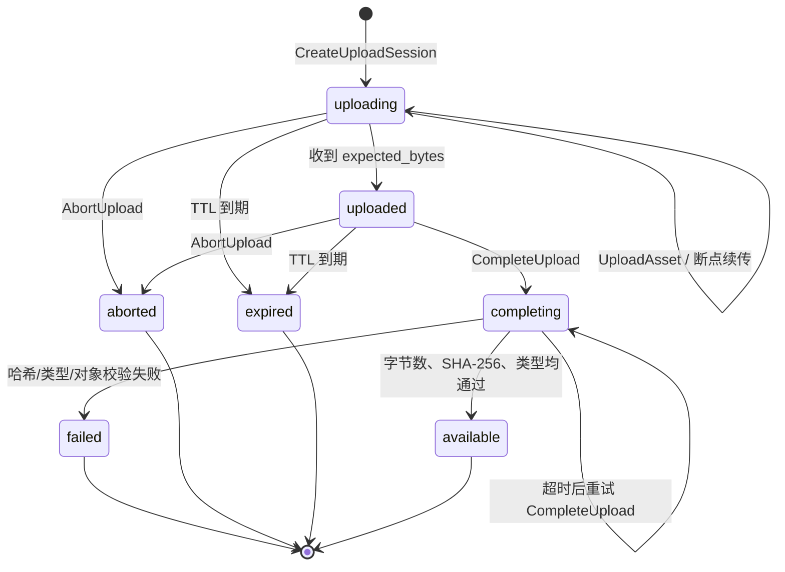

# Asset 后端设计：私有任务草稿文件

日期：2026-09-28。本文是 Asset 首阶段的设计制品，不表示 Asset 已实现、已部署或已进入 `services.json`。本阶段只支持登录用户上传文件，并把已经验证可用的文件引用到该用户的私有任务草稿；不公开文件、不公开任务、不实现审核、投票、推荐或云端挑战。

## 1. 依据与归属

### 项目已有约束

- `AGENTS.md` 规定 Asset 是独立业务服务，不是 `platform` 进程；服务各自拥有 schema 和数据库账号，不能跨 schema 查询或写表。
- `docs/backend-architecture.md` 规定 Content 唯一拥有任务、作品、投稿快照和可见性；Asset 唯一拥有上传会话、文件元数据、对象和文件可用状态。Asset 下载需要在必要时调用 Content 做内容权限检查，但不能形成递归调用。
- Identity 的断言按 `audience + FullMethod` 白名单验证，Content 当前只接受有效网站会话，不接受 MCP token 作为私有草稿身份。
- 当前 Content 只把 `file` 视为未就绪，现有任务草稿的 `asset_id` 已有字段；本设计不改变任务草稿仍由 Content 持有的事实。
- 文件二进制不进入 PostgreSQL；网关使用同源 `/api/*`，后端服务之间使用 mTLS gRPC。
- 现有部署方式使用 `cmd/<module>`、独立迁移和 `<module>_owner` / `<module>_runtime`；双副本要求共享的外部持久化存储。

### Agent Self-Claimed 实现方案

以下是为完成首阶段而提出的技术选择，不是人类已经确认的产品参数：

- Asset ID 使用 `ast_` 加 32 个小写十六进制字符；上传会话 ID 使用 `upl_` 加同样长度。ID 是引用标识，不是访问凭据。
- 首阶段建议最大文件 32 MiB，单个上传 chunk 不超过 256 KiB；允许的检测类型先取 `image/png`、`image/jpeg`、`image/webp`、`application/pdf`、`text/plain`。不接受 SVG、可执行文件和压缩包，后续按真实需求扩展。
- 生产存储使用 S3 兼容的共享对象存储；本地只提供测试用 filesystem adapter。配置为 filesystem 时，禁止以双副本生产模式启动。
- 完成上传要求创建会话时提供 64 个小写十六进制字符的 SHA-256 期望值，由 Asset 读取对象后重新计算；客户端 `Content-Type` 只作为未信任提示。
- 采用上传会话创建幂等键、连续 offset 和不透明分页 cursor。控制面调用的目标超时 2 秒，哈希校验和对象复制目标超时 30 秒，文件传输由 HTTP 请求的 15 分钟上限控制。

这些选择应在实现前由实际文件类型、对象存储和容量测试复核；文档中的 `32 MiB` 和类型白名单不是 PRD 产品承诺。

## 2. 职责边界

### Asset 拥有

Asset 只负责以下事实：

- 上传会话、会话过期时间、已接收字节数和对象存储 multipart/staging 状态。
- 文件所有者 `owner_id`，来源只能是 Asset 对 Identity assertion 的重新验证结果。
- 原始文件名的清洗值、声明媒体类型、服务端 sniff 得出的媒体类型、字节数和 SHA-256。
- 随机对象存储键。对象键不由文件名、账号 ID 或客户端路径拼接而来。
- 上传和文件状态：`uploading`、`uploaded`、`available`、`failed`、`aborted`、`expired`。
- 私有元数据读取、私有下载和上传失败/取消/过期后的对象清理。

Asset 不负责任务、作品、作者关系、审核决定或公开状态，也不读取 Identity/Content 表。Asset 不因“上传成功”就认定文件已经绑定到任务。

### Content 拥有

Content 仍负责：

- 任务草稿、作品值对象、`asset_id` 引用及草稿版本并发控制。
- “这个资产是否被该草稿/作品引用”以及任务、作品的 draft/review/public 可见性。
- 创建或替换草稿时要求 Asset 返回 `available` 且归属当前已验证账号。

Asset 的可用文件不能反向改变 Content 状态；Content 的草稿修改也不调用 Asset 删除旧文件。首阶段旧文件保留为该用户的可管理资产，避免没有分布式事务时误删仍被其他草稿引用的对象。

### Gateway 拥有

Gateway 只做 HTTP、Cookie/CSRF、请求体限制、gRPC 流转换和稳定 Problem 映射。它不解析文件内容、不写 Asset 数据库、不接受 `owner_id`、角色或权限字段，也不把对象存储 URL暴露给客户端。

## 3. 数据库与对象存储

### 角色和 schema

迁移目录建议为 `backend/internal/asset/migrations/`，首个文件为 `001_asset.sql`；迁移程序以 `asset_owner` 连接，运行服务只用 `asset_runtime`：

```sql
CREATE SCHEMA asset AUTHORIZATION asset_owner;

CREATE TABLE asset.assets (
    id                    text PRIMARY KEY,
    owner_id              text NOT NULL,
    state                 text NOT NULL CHECK (state IN
      ('uploading', 'uploaded', 'available', 'failed', 'aborted', 'expired')),
    original_filename     text NOT NULL,
    declared_media_type   text NOT NULL,
    detected_media_type   text,
    expected_bytes        bigint NOT NULL CHECK (expected_bytes > 0 AND expected_bytes <= 33554432),
    received_bytes        bigint NOT NULL DEFAULT 0 CHECK (received_bytes >= 0),
    expected_sha256       bytea NOT NULL CHECK (octet_length(expected_sha256) = 32),
    actual_sha256         bytea CHECK (actual_sha256 IS NULL OR octet_length(actual_sha256) = 32),
    object_key            text NOT NULL UNIQUE,
    cleanup_after         timestamptz,
    cleanup_attempts      integer NOT NULL DEFAULT 0,
    created_at            timestamptz NOT NULL DEFAULT clock_timestamp(),
    updated_at            timestamptz NOT NULL DEFAULT clock_timestamp(),
    completed_at          timestamptz
);

CREATE TABLE asset.upload_sessions (
    id                    text PRIMARY KEY,
    asset_id              text NOT NULL UNIQUE REFERENCES asset.assets(id),
    owner_id              text NOT NULL,
    idempotency_key       text NOT NULL,
    request_fingerprint   bytea NOT NULL CHECK (octet_length(request_fingerprint) = 32),
    state                 text NOT NULL CHECK (state IN
      ('uploading', 'uploaded', 'completing', 'completed', 'failed', 'aborted', 'expired')),
    expires_at            timestamptz NOT NULL,
    complete_attempt_id   text,
    created_at            timestamptz NOT NULL DEFAULT clock_timestamp(),
    updated_at            timestamptz NOT NULL DEFAULT clock_timestamp(),
    UNIQUE (owner_id, idempotency_key)
);

CREATE INDEX assets_owner_created_id
  ON asset.assets (owner_id, created_at DESC, id DESC);
CREATE INDEX upload_sessions_expiry
  ON asset.upload_sessions (expires_at)
  WHERE state IN ('uploading', 'uploaded', 'completing');
```

上面的 `REFERENCES` 只在 Asset schema 内建立；`owner_id` 是跨服务稳定账号 ID，不是跨 schema 外键。实现时迁移还需要授予最小权限：runtime 只能对上述两张表执行必要的 `SELECT`、会话状态 `INSERT/UPDATE` 和清理字段更新，不能 DDL、不能访问 `identity` 或 `content` schema。对象存储删除不在 PostgreSQL 事务中执行。

`request_fingerprint` 覆盖大小、期望 SHA-256、清洗后的文件名和声明媒体类型。相同 `(owner_id, idempotency_key)` 且 fingerprint 相同的创建重试返回原会话；fingerprint 不同返回 `idempotency_conflict`，不能覆盖原会话。

### 对象键与状态

对象键由服务端随机生成，例如：

```text
assets/<asset_id>/staging/<upload_session_id>
assets/<asset_id>/content
```

上传期间只写 staging key。`CompleteUpload` 先确认对象字节数，再计算 SHA-256、检测媒体类型，成功后将对象提升/复制为 content key，最后在数据库中提交 `available`。任何 `available` 之前的状态都不能被 Content 引用。

对象存储请求和数据库更新采用可重试状态机而不是分布式事务：

1. 创建会话只写数据库和生成对象键，不创建可下载对象。
2. chunk 写入先取得会话锁，要求 `offset == received_bytes`；对象存储成功后更新 offset。
3. 完成时将会话置为 `completing` 并保存 `complete_attempt_id`，再做对象读/哈希/提升。
4. 如果服务在对象成功、数据库提交前超时，重复 `CompleteUpload` 读取 `completing` 状态和对象校验结果，继续提交同一结果；不能重新生成另一个资产。
5. 取消或过期先把数据库标为终态，再异步幂等删除 staging/content 临时对象。删除失败只增加 `cleanup_attempts`，不恢复为可用。

定时清理任务只处理已过期且仍未 `available` 的上传会话。首阶段不提供删除 `available` 资产的 API，因而不会把 Content 的绑定关系偷偷当作 Asset 本地事实。

## 4. 状态图与不变量



不变量：

- `available` 必须有服务端计算的 SHA-256、检测媒体类型、完整字节数和存在的 final object。
- `uploaded` 只是字节已齐，不代表可以引用或下载；必须完成校验。
- 上传流和完成请求都必须通过 Asset 对 Identity assertion 的实时验证；MCP token 和管理员角色都不能绕过网站会话要求。
- 客户端不能指定 `owner_id`、Asset state、对象键、检测媒体类型、公开 URL 或 Content 可见性。
- 同一会话的 offset 单调增加；同一会话不能有两个不同对象或两个成功完成结果。
- `asset_id` 只有在 `available` 后才允许进入 Content 草稿；Content 的更新失败不会令 Asset 变为不可用。

## 5. Asset Proto

Proto 草案见 [`backend-asset.proto`](backend-asset.proto)。它是设计阶段的非 Buf 输入文件；本轮不生成 Go 文件、不注册服务、不修改现有 Content Proto。Asset 开始实现时，应将草案迁入 `backend/proto/humanworth/asset/v1/asset.proto`，按仓库 Buf 工具链生成代码，并在同一变更中补齐实现、测试和发布登记。

### RPC 选择

| RPC | 调用方 | 选择与原因 |
| --- | --- | --- |
| `CreateUploadSession` | Gateway | unary；网站会话 assertion、幂等键、大小、SHA-256、原始名和声明类型；写入 `uploading`；2 秒控制面超时；同 fingerprint 可重试，不同 fingerprint 拒绝 |
| `UploadAsset` | Gateway | client-streaming；首消息带 session、offset 和 assertion，后续消息为连续 chunk；单 chunk 256 KiB；请求断开后以返回/元数据中的 offset 恢复；15 分钟 HTTP deadline；不以重试整条流代替断点续传 |
| `CompleteUpload` | Gateway | unary；Asset 重新验证 assertion，读取对象并计算 SHA-256；`uploaded`/`completing` 可重试，已 `available` 返回同一结果；30 秒控制面/对象校验预算 |
| `AbortUpload` | Gateway | unary，网站会话；`uploading`/`uploaded` 幂等转 `aborted`；已 `available` 不接受；2 秒 |
| `GetUploadSession` | Gateway | unary，网站会话；返回当前 offset 和状态，供断点续传及超时恢复；2 秒 |
| `GetAssetMetadata` | Gateway 或 Content | 网站会话只返回本人资产；Content 使用带 Asset audience 的 assertion 做绑定校验；不返回对象 URL；2 秒 |
| `ListMyAssets` | Gateway | 网站会话，仅本人元数据，keyset cursor；默认 20、最大 100；2 秒，不取二进制 |
| `CheckAssetOwnership` | Content | Content 通过 gateway 取得的 Asset method assertion 调用；请求只有 `actor_assertion + asset_ids`，不含 owner_id；Asset 返回每个可用资产的权威 owner/metadata；批量 unary，避免每个 artifact 一个 RPC；2 秒 |
| `DownloadAsset` | Gateway | server-streaming；Asset 验证网站会话和可用状态，必要时调用 Content 的 `CheckAssetAccess` 后流式读对象；不生成永久 URL；首阶段只允许本人私有下载；15 分钟，按流量/大小限制 |
| `AuthorizeDownload` | 未选入首阶段 | 可在未来需要浏览器直连对象存储时增加短期 grant；当前 gateway 代理流式下载，增加 grant 会产生额外 TOCTOU 和存储签名状态，不提前实现 |

`GetAssetMetadata` 给 Content 的专用调用不能退化为“传入 owner_id 就返回”；应复用 `CheckAssetOwnership` 的 assertion 验证。Asset 的所有用户 RPC 都在 Identity `policies` 增加精确的 Asset audience/method 白名单；`VerifyActor` 的调用方仍由 mTLS peer 限制为预期服务。

## 6. Content 与 Asset 协作

### 创建和替换草稿

现有 Content 的 `CreateTaskDraftRequest` / `ReplaceTaskDraftRequest` 由 gateway 内部扩展一个仅服务间使用的 `asset_actor_assertion`（或等价的受保护字段），客户端 JSON 不可填写。处理顺序如下：

1. Gateway 从同一个网站会话分别向 Identity 请求 Content method assertion 和 Asset `CheckAssetOwnership` method assertion。两者都绑定同一会话、账号版本和 method，MCP token 没有这两个权限。
2. Content 先验证自己的 Content assertion，得到当前账号 `A`。
3. Content 从草稿中提取去重后的 `asset_id`，批量调用 Asset `CheckAssetOwnership`，Asset 自己验证 Asset assertion，返回 `owner_id`、`state`、大小、SHA 和检测类型。
4. Content 要求每个引用都是 `available` 且 `owner_id == A`；对不存在、未完成、已过期、其他账号或服务不可用都拒绝整个写入。请求体不能覆盖返回元数据。
5. 所有外部校验完成后，Content 在自己的数据库事务中写入完整草稿。Asset 不参与该事务，也不写 Content 表。

这会产生“校验成功但 Content 事务失败”的未绑定可用资产。首阶段这是可接受且不丢文件的结果：资产仍是当前用户的可用私有资产，后续可以重新绑定；不在没有 Content 事实的情况下自动删除。

### 下载和可见性

首阶段 `/api/me/assets/{assetId}/content` 只允许网站会话。Asset 先验证当前账号是 owner，再按请求中可选的 `taskId` 调用 Content `CheckAssetAccess`：

- 没有 `taskId`：只做本人资产管理下载，Asset ownership 足够。
- 有 `taskId`：Content 在自己的表中确认该任务仍为当前账号的私有草稿且确实引用该 `asset_id`；不存在或状态不允许就拒绝。
- 未来公开下载：调用方带受控的公开资源上下文，Asset 仍必须调用 Content，Content 依据任务/作品审核和可见性决定；Asset 不复制“公开”状态，也不接受客户端 `public=true`。

调用方向固定为 `Asset -> Content.CheckAssetAccess`。该 Content RPC 只读自己的关系和状态，不再调用 Asset，因此不会递归。Asset 下载发生在权限检查之后；检查失败、Content 超时或对象存储异常都 fail closed，不返回数据或 URL。

### 绑定并发

Content 每次创建/替换都重新校验新增引用；旧引用由 Content 版本替换处理。Asset 不锁 Content 行，也不维护绑定计数。两个请求同时绑定同一个可用资产是安全的，因为 owner 检查是只读的；同一个草稿的版本冲突仍由 Content 现有 `expected_revision` 控制。

## 7. HTTP 与 OpenAPI 对照

当前 `openapi.yaml` 的 `POST /api/assets` 是没有实现的旧 multipart 草案。本设计建议在实现 Asset 时替换该 planned operation，而不是同时保留两套上传用途；本轮不修改 OpenAPI，也不把任何 Asset path 标为 implemented。

| HTTP | Auth / CSRF | RPC | 成功响应 |
| --- | --- | --- | --- |
| `POST /api/me/assets/upload-sessions` | 网站会话 + 写操作 CSRF；`Idempotency-Key` 必须恰好一个 | `CreateUploadSession` | `201`：`{asset, uploadSession}`，不含 URL |
| `PUT /api/me/assets/upload-sessions/{uploadSessionId}/content` | 网站会话 + CSRF；`Content-Range` 必须连续 | `UploadAsset` client stream | `200`：`receivedBytes`、`nextOffset`、`state`；未完成仍为 `uploading` |
| `POST /api/me/assets/{assetId}/complete` | 网站会话 + CSRF | `CompleteUpload` | `200`：`Asset`，只有此响应的 `state=available` 才能引用 |
| `DELETE /api/me/assets/upload-sessions/{uploadSessionId}` | 网站会话 + CSRF | `AbortUpload` | `204`；重复取消仍返回 `204` |
| `GET /api/me/assets/upload-sessions/{uploadSessionId}` | 网站会话 | `GetUploadSession` | `200`：当前 `receivedBytes`、`expectedBytes`、`state`、`expiresAt` |
| `GET /api/me/assets?limit=&cursor=` | 网站会话；GET 无 CSRF 写副作用 | `ListMyAssets` | `200`：`{items, nextCursor}`，不含内容 |
| `GET /api/me/assets/{assetId}` | 网站会话 | `GetAssetMetadata` | `200`：本人资产元数据 |
| `GET /api/me/assets/{assetId}/content[?taskId=]` | 网站会话；首阶段不支持 MCP | `DownloadAsset` server stream | 二进制流；服务端设置检测后的 `Content-Type`、清洗后的下载文件名和 `Content-Disposition: attachment` |

HTTP 的 `Asset` 字段为 `id`、`filename`、`mediaType`、`bytes`、`sha256`、`state`、`createdAt`、`completedAt`；不返回 object key、数据库 owner、存储供应商信息或永久下载 URL。Content 的 `TaskSubmission.content.entries[].artifacts[]` 继续使用 `{kind:"file", assetId}`，详情响应不把 file 改写成二进制或公开链接。

建议同步到 OpenAPI 的 schema/错误码：

| 情况 | HTTP | Problem `code` |
| --- | ---: | --- |
| 无会话、会话撤销、MCP Bearer | 401 | `unauthenticated` |
| CSRF、服务身份或用途不允许 | 403 | `forbidden` |
| 资产/会话不存在或不属于本人 | 404 | `asset_not_found` |
| 重复幂等键但内容不同 | 409 | `idempotency_conflict` |
| offset 与服务端不一致 | 409 | `upload_offset_conflict` |
| 未上传完整就完成 | 409 | `upload_incomplete` |
| 资产尚未 `available` 或 Content 引用检查失败 | 409 | `asset_not_available` / `asset_access_denied` |
| 超过文件或请求体上限 | 413 | `file_too_large` / `request_too_large` |
| 声明或检测类型不在白名单 | 415 | `unsupported_media_type` |
| SHA-256 不匹配 | 422 | `checksum_mismatch` |
| Asset、Content、对象存储或 Identity 不可用 | 503 | `asset_unavailable` |

重复 query/header 参数、未知 query 参数、空 cursor、非法 cursor、非法 ID 和重复 `Content-Range` 头都返回 400 `invalid_request`；不得把无效 cursor 当第一页。对象存储过大、流中断或服务超时不能映射成 429 `too_many_requests`。

## 8. 安全限制

- owner 只从 Identity assertion 取得；请求中不接受 `owner_id`、账号、角色、管理员标记或公开标记。管理员也只能以自己的 web session 管理自己的资产。
- Asset 的 Identity method policy 首阶段只允许 `CLIENT_KIND_WEB_SESSION`；MCP token 没有上传、私有元数据或下载权限。
- Gateway 限制请求体为 `32 MiB + 协议余量`，Asset 对每个 chunk 限制 256 KiB，对 session 总字节数和对象存储实际长度再次限制；gRPC server/client send/receive 上限必须包含 protobuf wrapper 并留余量。
- 文件名去除 `\`、`/` 路径部分，拒绝 NUL 和控制字符，限制 255 UTF-8 字节，空名使用固定 `upload`；文件名只用于 `Content-Disposition`，不参与对象键和权限。
- 先检查声明类型，再读取文件头进行服务端检测；最终 allowlist 以检测结果为准。不要把客户端 `Content-Type`、扩展名或文件名当作安全判断。
- SHA-256 由 Asset 对对象内容计算；客户端提供的期望摘要只是比较值，不是证明。摘要错误不生成 `available` 状态。
- 未完成上传的 staging object 不返回、不允许 Content 引用；数据库状态和对象存在性都必须满足才可下载。
- 绝不返回永久公开 URL。首阶段由 gateway 代理 server stream；未来短期签名地址必须有短 TTL、单资产、单用途并在生成前完成 Content 权限核实。
- 日志只记录 asset/session ID、状态、字节数和 request/trace ID，不记录文件名原文、摘要以外的内容、Cookie、assertion 或对象存储凭据。

## 9. 并发、重试和失败恢复矩阵

| 场景 | 服务端规则 | 客户端动作 |
| --- | --- | --- |
| 创建会话超时但数据库已提交 | `(owner_id, idempotency_key)` + fingerprint 找回原会话 | 原样重试同一 `Idempotency-Key`；不要换 key |
| 同 key 不同大小/SHA/元数据 | 返回 409 `idempotency_conflict`，不修改旧会话 | 生成新 key，先确认旧会话是否取消/过期 |
| 上传流中断 | 已提交 offset 保留；未提交 chunk 不计入 | 获取当前 offset，从该 offset 继续；不要从 0 覆盖 |
| 两个流同时上传 | 会话行锁只允许一个连续 offset；另一请求返回 409 `upload_offset_conflict` | 串行化同一 session |
| chunk 重试 | 相同已确认 offset 不重复追加；请求必须带同一 upload attempt/chunk identity | 先读元数据，再从 nextOffset 继续 |
| 收齐字节但未 Complete | 状态 `uploaded`，仍不可引用/下载 | 调用 CompleteUpload |
| SHA-256 错误 | 状态 `failed`，删除 staging best effort；不进入 `available` | 重新创建会话并重新传输 |
| Complete 并发两次 | `completing` + attempt ID；一个提交，另一个返回同一最终结果或等待后重读 | 可安全重试，不创建第二个 asset |
| Complete 超时但对象已复制 | 重试读取 `completing` 和对象校验，完成数据库提交 | 使用同 asset/session 重试 |
| Abort 与 Complete 竞争 | 先取得会话锁；终态优先级由已提交状态决定，`available` 不可 Abort | 读取最终状态，不猜测 |
| 会话到期 | 事务标 `expired`，不再接受流或完成；清理任务异步删除对象 | 新建会话 |
| Content 校验成功但草稿提交失败 | Asset 保持 `available` 私有资产，不回滚对象 | 重试 Content 草稿写入；后续由资产管理/GC 清理未引用项 |
| 已绑定资产再次修改草稿 | Content 用 revision 控制引用集合；Asset 不删除旧资产 | 成功后旧资产仍可管理，不能假设自动删除 |
| 下载时 Content/Identity/对象存储超时 | fail closed，不发送部分成功的权限结果；HTTP 503 或断流 | 重试 GET；不使用缓存 URL |
| 重启或切换副本 | 所有会话状态在 Asset DB，对象在共享 storage | 可到任一副本继续；本地 filesystem adapter 不得用于双副本 |

## 10. 部署设计

### 进程与配置

实现阶段增加：

- `backend/cmd/asset/main.go`：mTLS gRPC `:8443`、内部 health/metrics `:8081`。
- `backend/internal/asset/`：server、object store adapter、迁移、状态和测试；不导入 Identity/Content 的数据库实现。
- `ASSET_TARGET`：gateway 复用现有服务证书配置连接 Asset；不创建第二个 gateway client 连接到其他服务。
- Asset 的 `ASSET_DATABASE_URL_FILE`：运行时使用 `asset_runtime`；迁移命令使用 `asset_owner` 的 DSN。
- `ASSET_OBJECT_STORE`、endpoint、bucket、prefix 和凭据文件：生产必须显式配置。缺失或使用不支持共享语义的配置时 Asset 不 ready，不返回“上传成功”。
- Asset 服务器证书 URI 为 `spiffe://human-worth/services/asset`，客户端验证 DNS SAN 和 SPIFFE service name；Asset 接受 gateway、Content（只接受明确的内部 RPC）等已声明 peer，不能只依赖 NetworkPolicy。

`platform.certificateService` 已有 `asset` 身份名，但这只是证书基座允许该名字，不代表 Asset 已实现或已发布。

### 存储和双副本

生产两个 Asset 副本必须共享同一个对象存储 bucket/prefix，并使用相同的数据库；不能把容器 `/tmp` 或 Pod 本地目录当持久文件系统。上传流可落到 provider 的 multipart 临时对象，副本重启后由 DB 的 offset 和对象 multipart 状态恢复。

本地单元测试可使用内存/临时 filesystem adapter；真实集成测试应启动隔离的 S3-compatible test store，或使用明确实现了 range/multipart/etag 语义的临时服务。没有对象存储配置时，`/readyz` 失败，不能切换成 PostgreSQL blob、内存成功响应或永久本地 URL来伪装生产可用。

Asset 加入统一部署前必须新增自己的 `ops/lab/asset.yaml`、`services.json` 条目、grants SQL、迁移 Job、证书和网络策略；本轮不新增这些发布配置，避免在服务尚未实现时把它纳入自动部署。

## 11. 最小实现范围与后续

### 推荐首个实现切片

1. Asset schema、owner/runtime 角色、迁移和受限数据库测试。
2. 共享对象存储接口的 filesystem test adapter 与生产 S3-compatible adapter；只实现 staging/final object、range/stream、删除和 SHA 读取。
3. `CreateUploadSession`、`UploadAsset`、`CompleteUpload`、`AbortUpload`、`GetAssetMetadata`、`ListMyAssets`、`CheckAssetOwnership`、`DownloadAsset`。
4. Identity method policy、Asset mTLS peer 校验和 gateway 的七条私有 `/api/me/assets*` 路由。
5. Content 请求中的 Asset assertion 传递、批量 ownership 检查和 `file` artifact 解锁；不改变 Content 的任务/草稿状态模型。
6. 真实 HTTP → gateway → Asset → Identity → PostgreSQL/对象存储测试，覆盖双副本恢复、断点续传、哈希错误、越权、撤销会话和完成竞争。

### 本阶段不实现

- 公开文件、匿名下载、审核或自动恶意内容扫描。
- 内容转码、缩略图、预览、全文提取、压缩包解压、病毒扫描服务。
- 独立删除/回收已完成资产、跨服务绑定计数、Asset 到 Content 的事件总线。
- 直接对象存储 URL、CDN、浏览器直传、批量导入、MCP 文件访问。
- Moderation、Voting、Discovery、Challenge 或任何公开任务流程。

### 后续阶段

- 若需要公开展示，先定义 Content 的资源上下文和 `CheckAssetAccess` 版本，再增加 Asset `AuthorizeDownload` 或短期签名 grant；不从 Asset 复制公开状态。
- 若需要回收未引用资产，Content 通过 outbox/事件发布引用变更，Asset 以幂等消费并保留延迟删除窗口；不靠跨 schema SQL 查询引用。
- 若文件类型和规模扩大，再单独评估扫描、转码、分片 multipart provider 和断点清理，不把这些提前塞入首个上传闭环。

## 12. 仍需确认的关键问题

这些问题不阻塞本设计落档，但在实现前必须有明确答案：

1. 首阶段 32 MiB 上限和五种媒体类型是否符合实际文件场景；特别是是否要支持音视频、SVG 或压缩包。
2. 生产采用哪一种 S3-compatible 对象存储、保留期、区域和加密策略；当前仓库没有可复用的对象存储客户端或凭据配置。
3. Content 是否接受为每个请求增加一个由 gateway 生成的 `asset_actor_assertion` 字段，还是先实现一个 Identity 的受控 assertion exchange RPC；本设计推荐前者以减少新 RPC。
4. 私有下载是否需要强制携带 `taskId`，以便 Content 在每次绑定上下文中复核引用；本设计允许无 `taskId` 的本人资产管理下载。
5. 已完成但未被任何草稿引用的资产保留多久；首阶段不删除，避免没有引用投影时误删。

本设计的完成判据是：边界、唯一写入者、身份路径、状态转换、错误语义和恢复责任均可直接转成实现与测试；它不替代后续真实对象存储、数据库、mTLS 和 HTTP 集成验收。
