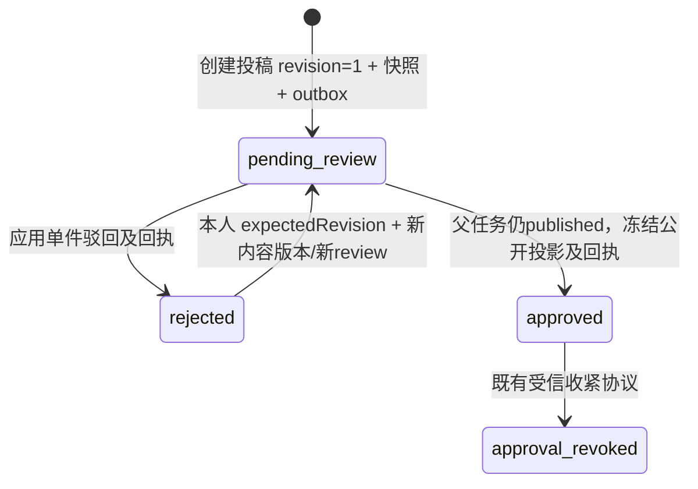

# Content 首阶段：作者私有任务草稿

日期：2026-09-20。行为来源为 [PRD S2](prd.md#trusted-scenarios)、H1 及本轮用户列出的八项验收目标。具体数据结构、幂等键、上限与事务方案为 **Agent Self-Claimed**。

本阶段实现“创建 → 本人分页找回/读取 → 整体替换草稿”。不送审、不公开、不追加公开作品、不改变投票资格、不触发云端挑战。**作者私有草稿是审核前阶段，不是给过审作品新增公开/私有开关。** 未实现服务不以空壳替代。

## 1. 数据与状态

| 数据 | 归属与规则 |
| --- | --- |
| `content.task_drafts.id` | 服务端生成 `tsk_` + 128 位随机十六进制 ID；不是权限凭据 |
| `author_id` | 创建时取自 Identity `VerifyActor` 的稳定账号；创建后不可变；没有跨 schema 外键 |
| `content` | JSONB 任务聚合：title、summary、description、可选 category、按顺序的 entries；由具体 Proto 类型与服务端校验限制，不是任意 JSON 存储 API |
| 初始 `entries` | `content.entries` 中的作品草稿值对象，与任务同作者、同版本、同事务；不独立分配作品 ID；整体替换可增加、删除、重排，不保留数组索引作为稳定作品标识 |
| 作品来源与授权 | `source` 是署名/来源说明，不能决定账号；human 禁止 agentConfiguration，agent 要求 model；cloudUse 必须显式 true/false，与展示状态无关 |
| `revision` | 创建为 1；每次成功替换加一，含内容相同的有效版本替换；只按同一任务串行检查 |
| `state` | 唯一可写状态为 `draft`，数据库 CHECK 也阻止公开/送审；初始作品处于同一个草稿阶段 |
| `create_key` / `create_hash` | 同作者创建幂等键与规范化初始内容 SHA-256；唯一约束 `(author_id, create_key)`；后续替换不修改 |
| 时间 | 数据库记录创建、最后替换时间；目前 HTTP TaskSubmission 不扩展时间字段 |

草稿允许 entries 为空或仅一方。已填写的一件作品仍须符合现有 EntryInput 的完整字段约束；“任务未凑齐双方”不等于允许无来源、无授权或空交付物。当前最多 32 件、每件最多 32 个交付物，规范化 content 不超过 12000 字节；HTTP 总请求体不超过 16384 字节。限制是首阶段可调整的技术选择。

目前只支持 HTTP(S) 外链，不抓取、不执行、不自动访问 URL；拒绝带用户凭据的 URL。`file` 明确返回 409 `asset_service_not_ready`，不忽略资产归属校验，也不访问未实现的 Asset。Agent parameters 只作为惰性草稿元数据存储，不代表模型配置已获运行许可；未来云端使用须验证支持的模型、参数、来源及用途授权。

后续审核阶段再迁移状态约束、引入作品稳定 ID 与投稿快照，使审核结果绑定确切版本。未来 rejected 可改回 draft，pending_review/published/taken_down 不允许此编辑操作；本阶段不存在这些状态，也没有审核历史可覆盖。

## 2. HTTP / Proto 对齐

[OpenAPI](../openapi.yaml) 是 HTTP 字段依据；[Content Proto](../backend/proto/humanworth/content/v1/content.proto) 是真实进程契约，生成代码位于 `backend/gen/humanworth/content/v1/`。Identity 既有 RPC 不改字段与包名。

| HTTP | RPC | 输入与响应 |
| --- | --- | --- |
| `POST /api/tasks` | `CreateTaskDraft` | TaskDraftInput，必需 `Idempotency-Key`；201 TaskSubmission |
| `GET /api/me/submissions` | `ListMySubmissions` | 可选 kind/state/category、cursor、limit；200 SubmissionPage，首阶段 items 仅含完整 TaskSubmission |
| `GET /api/me/tasks/{taskId}` | `GetMyTaskSubmission` | 路径 ID；200 TaskSubmission |
| `PUT /api/me/tasks/{taskId}` | `ReplaceTaskDraft` | `{expectedRevision, content}`；200 TaskSubmission |

HTTP 单项及列表元素都保持 `kind: task`、`authorId`、数值 revision、`state: draft`、完整 content、`reviewId: null`、`rejectionReason: null`；不以摘要替换已有 TaskSubmission 契约。Proto 内部不重复传常量 kind/空审核字段，由 gateway 构造；不直接用 Proto JSON 代替 HTTP 响应（int64 等表示不同）。作品结构、可选值与参数对象均有对应 Proto 字段。

私有详情和本人列表只允许网站会话，不放入 MCP 白名单。没有登录 401；无权账号/不存在 ID 统一 404（管理员也不例外）；无效输入 400；Origin/CSRF/MCP 用途拒绝 403；重复键异内容或陈旧版本 409；依赖不可用 503；现有中间件容量限制 429。错误不返回数据库文本、断言或凭据。

公网列表、公开详情、送审、审核结果和独立作品投稿列表仍未实现；`GET /api/me/submissions` 首阶段只查询本人 task/draft 聚合，不把草稿读成公开任务，也不伪造 EntrySubmission。

### 2026-09-28 本地分页复验

本轮仅完成本地验证，没有访问公网 Nginx、执行发布或使用真实登录会话。测试使用从 PostgreSQL 官方源码校验并构建的 PostgreSQL 18.0 临时实例，仅监听 `127.0.0.1`；实例和测试结束后已停止。以下命令均退出 0：

- `cd backend && env CC=/usr/bin/gcc go vet ./...`、`env CC=/usr/bin/gcc go build ./cmd/...`。
- `cd backend && go test -race ./... -count=1`。
- `cd backend && IDENTITY_TEST_DATABASE_URL='postgres://cherry@127.0.0.1:25439/postgres?sslmode=disable' go test -race -tags=integration ./... -count=1 -timeout=120s`：真实 HTTP → gateway → gRPC → PostgreSQL 链路通过，包含 Content 双进程、重启和权限隔离验证。
- `cd backend && IDENTITY_TEST_DATABASE_URL='postgres://cherry@127.0.0.1:25439/postgres?sslmode=disable' go test -race -tags=integration ./internal/identity -run '^TestContentDraftHTTPGRPCPersistence$' -count=3 -timeout=120s`：分页主测试连续三次通过。
- 根目录 `npm run ci`：5 个 Node 测试和 19 个 Python 测试通过。

这些结果证明本地分页实现和服务间链路正常，不证明公网代理已接受长 Request-URI，也不证明新版本已经发布。后续发布后仍需使用真实会话从公网跨页读取，检查游标、本人隔离和分类筛选。

### 请求示例

在已有本地 HTTPS gateway 和登录会话下，创建正文：

```json
{"title":"我的比较任务","summary":"暂存说明","description":"任务正文","entries":[]}
```

带 Cookie、正确 Origin、`X-CSRF-Token` 和 `Idempotency-Key: draft-create-example-0001` POST 到 `/api/tasks`。记录响应 id 与 revision，再 GET `/api/me/tasks/<id>`。替换正文：

```json
{"expectedRevision":1,"content":{"title":"修改后的任务","summary":"","description":"新的正文","entries":[]}}
```

PUT 到同一本人路径；成功后 revision 为 2。不要在 JSON 中填写 authorId、role、actorAssertion、state 或 publish。写入成功仅保存，不改变展示资格。

列表第一页：

```http
GET /api/me/submissions?limit=20
```

下一页把响应中的非空 `nextCursor` 原样放回；分类精确筛选示例为 `GET /api/me/submissions?kind=task&state=draft&category=%E7%BB%98%E7%94%BB&limit=20`。点击列表项后继续使用 `GET /api/me/tasks/{taskId}`，修改仍使用原 `PUT`。省略 cursor 或显式 `cursor=` 都是第一页；category 显式空值非法。

## 3. 身份链路与通信成本

```text
浏览器 Cookie +（写操作 Origin/CSRF）
  → gateway：固定路由决定 content audience 与完整 RPC 方法
  → Identity.ResolvePrincipal：检查会话/账号/用途/CSRF，签发短期断言
  → Content RPC（gateway 服务证书）：验证调用服务为 gateway
  → Identity.VerifyActor（content 服务证书）：方法/audience/签名/当前凭据复核
  → Content：只用 Principal.account_id 查/写自己的行
  → Content PostgreSQL 事务 → 返回本人快照
```

每个请求有三次内部 RPC（两次 Identity、一次 Content）。列表在一次 VerifyActor 后执行一次批量数据库查询，不对每条草稿调用 Identity、Asset 或详情 RPC，也没有跨库查询。暂不缓存鉴权结果、不为了减少通信去掉撤销复核。Content 不接收原始网站 Cookie/MCP token，不持有 Identity 签名密钥，不信任 HTTP 请求提供的作者。

会话撤销后发起的新认证不能放行；即便 gateway 在撤销前拿到了尚未过期的断言，Content 后续 VerifyActor 也拒绝。**已在撤销前完成 VerifyActor 的在途操作仍可能提交**；这里不承诺跨 Identity/Content 事务的全局瞬时撤销，这是避免跨服务数据库事务的明确边界。

mTLS 客户端同时验证证书 DNS 和 SPIFFE URI 的预期服务名称，不能只改连接地址而跳过服务身份。gateway 的 CONTENT_TARGET 未配置时草稿操作 503，不影响旧 Identity-only 启动；配置后就绪检测包含 Content。

<a id="database"></a>
## 4. 独立数据库权限与迁移

源码入口：`cmd/content`、`internal/content/server.go`、`internal/content/migrate.go`、`internal/content/migrations/001_content.sql` 与新增 `002_task_draft_list.sql`。一个 PostgreSQL 数据库可承载多个 schema，但权限分离，不跨 schema 查询，不做 Identity join。

1. 数据库管理员在选定的应用数据库执行 [bootstrap.sql](../ops/content/bootstrap.sql)。运行前通过 `CONTENT_OWNER_PASSWORD`、`CONTENT_RUNTIME_PASSWORD` 环境变量提供不同随机密码；脚本用 psql `\getenv`，不要把密码写进仓库或命令行。
2. 给 `content_owner` 单独的 DSN 文件（权限 600），用 `CONTENT_DATABASE_URL_FILE=<owner DSN 文件> go run ./cmd/content migrate` 迁移。
3. 用 owner/管理员执行 [grants.sql](../ops/content/grants.sql)。运行账号只有 Content schema USAGE、迁移版本/草稿 SELECT、草稿 INSERT，以及 content/revision/updated_at 三列 UPDATE；不能改 author/state/key，不能 DELETE 或 DDL，也不授予 Identity 权限。
4. 运行 `cmd/content` 改用 `content_runtime` DSN 文件，不与迁移进程共用权限。Identity 运行账号也不能读 Content。

初始化脚本明确是一次性管理员动作；角色已存在时失败，不隐式覆盖密码或扩大既有权限。应用数据库及 public schema 不应向 PUBLIC 授予 CREATE（PG18 新库默认如此，旧库须管理员核对）。迁移使用独立 advisory transaction lock、文件摘要与版本记录，可重复执行、拒绝修改已应用文件；不修改已应用的 001。002 只增加 `(author_id, created_at DESC, id DESC)` 且限定 `state = 'draft'` 的 partial index。category 仍在数据库 WHERE 中过滤，但不把完整分类值放入 B-tree：001 曾允许仅受草稿整体 12000 字节约束的长分类，表达式索引会让这类旧数据因 PostgreSQL 索引项上限而阻塞升级。升级测试同时保存重复中文和确定性摘要串组成的难压缩长分类，并先确认旧完整分类索引以 SQLSTATE 54000 失败，再执行当前迁移。服务运行时不执行迁移。

服务配置和构建命令见 [Go README](../backend/README.md)。已有 Dockerfile 的 SERVICE 参数可构建 content，不必复制镜像脚本。2026-09-20 首阶段没有接入部署；2026-09-21 已通过 [统一模块自动部署](deployment.md#module-deployment)发布到 `https://worth.oopsbox.cn`。三个本人草稿接口已验证真实公网 HTTPS、Identity、Content 和 PostgreSQL 链路，仍须网站会话及写操作 CSRF 校验。

## 5. 分页、并发、超时与重试

### 本人列表

- 固定排序 `created_at DESC, id DESC`；边界条件为 `(created_at, id) < (cursor.created_at, cursor.id)`，查询 `limit + 1`，最多返回 limit 条。相同创建时间由 ID 确定顺序；编辑只更新 `updated_at`，不改变 `created_at`。
- category 在 SQL 的 WHERE 中精确筛选，不 trim、不改变大小写、不做 Unicode 归一化；缺省不筛选。为兼容 001 已允许的数据，category 不增加独立字符数限制，继续受有效 UTF-8、禁止 NUL 和草稿整体 12000 字节上限约束；筛选参数最多 12000 个 UTF-8 字节，因此覆盖所有合法既有分类。不新增枚举、分类表或服务。既有显式空 category 草稿仍可在未筛选列表中找回，但 HTTP 的 `category=` 不作为筛选值。为容纳合法 UTF-8 值的 percent-encoding，只有该列表路由的 Request-URI 上限为 40 KiB，gateway HTTP header 上限为 48 KiB；其他路由仍保留 8 KiB Request-URI 上限。
- kind/state 缺省归一为当前唯一支持的 task/draft；明确传入其他值或空值返回 400 `unsupported_submission_filter`。category 非法返回 `invalid_category`，损坏/版本错误/跨 scope/超过 2048 字符的游标返回 `invalid_cursor`；未知参数、重复参数和非法 limit 返回 `invalid_request`。非法游标不退化为第一页。
- 游标为版本化 Base64URL JSON，保存精确 RFC3339Nano 排序时间、ID 和账号/有效筛选/排序的 scope 摘要。它没有签名，不能作为授权凭据；Content 始终用 VerifyActor 的 author_id 形成 SQL 条件，并复核 scope，因此跨账号或换筛选复用会被拒绝。若未来需要隐藏或抵抗主动改写边界，再引入多副本共享的独立游标签名密钥。
- 不查询 totalCount，也不跨 HTTP 请求保持数据库快照。静态数据可连续翻页且无重复遗漏；翻页期间改变 category 会按新筛选成员关系影响后续页，客户端改变 category/kind/state 时必须从第一页开始。
- `limit` 是条数上限，不保证每个非末页都填满。Content 逐行读取并把当前 JSONB 解码为完整 Proto 后立即用 `proto.Size` 检查 2 MiB 单页预算；达到条数或字节预算即停止并关闭结果集，不再先解码整批 `limit + 1`。字节边界最多额外解码第一条放不下的记录，`nextCursor` 指向最后一条实际返回记录，后续记录由下一页继续读取，不截断单条对象或字段。Content 发送与 gateway 接收上限一致为 4 MiB，给应用预算留出一倍传输余量；单条草稿仍受 12000 字节 JSON 上限约束。

### 创建

- 键由客户端生成，16～128 个 ASCII 字母、数字、下划线或连字符；同一逻辑创建必须复用键。
- 内容经过 Proto 字段校验、默认数组及 JSON 对象键规范化后计算摘要。ActorAssertion、会话和 HTTP request ID 不参与指纹。
- 事务 INSERT ... ON CONFLICT DO NOTHING，再按作者+键读取；唯一约束处理跨进程竞争，不依赖内存互斥。
- 相同键+内容：201 返回同一任务的**当前**快照；即使已编辑也不覆盖。键相同但初始内容不同：409，不新建。
- 没有单独 TTL 清理，键随草稿持久存在；之后增加删除功能时必须再定义幂等记录保留策略。

### 替换

- 先 VerifyActor，再打开本地事务，以 `id + author_id` 查询并 `FOR UPDATE` 锁住任务；检查状态和 expectedRevision，原子替换整个聚合，revision+1。
- 同版本并发编辑恰有一个成功，其余 409；作品与任务不会部分写入。没有数据库锁内的外部 RPC。
- 重复 PUT 的旧 revision 返回 409，不悄悄当作新编辑，也不伪称可以精确找回历史编辑响应。超时后 GET 当前快照核对；并发编辑已发生时需客户端明确合并，不能盲目更新 expectedRevision 后覆盖。
- gateway 和 Content 的 gRPC 客户端关闭自动应用重试；`ListMySubmissions` 在 gateway HTTP 操作层和 Content gRPC 中间件均使用方法级 5 秒 deadline，其他普通操作仍为 2 秒，Google 回调为 15 秒。数据库仍保留 5 秒 statement timeout、2 秒 lock timeout 等更窄的资源保护子预算；5 秒不是取消这些数据库限制。超时不等于事务一定未提交。

## 6. 验收与证据范围

运行 `backend` 下的 `go test -race -tags=integration ./... -count=1 -timeout=120s`，必须提供专用 `IDENTITY_TEST_DATABASE_URL[_FILE]`。测试建临时数据库、Identity 与 Content 各自受限角色，结束清理；不连接产品库。Content 测试复用现有 OIDC HTTP 供应方，不调用真实 Google。

| 目标 | 检查入口与判据 |
| --- | --- |
| 本人创建/分页找回/读/改 | HTTPS gateway → mTLS Content OS 进程 → 真 Identity.VerifyActor → PostgreSQL；验证作者、内容、版本与状态 |
| 未登录/CSRF/伪造作者 | HTTP 拒绝；数据库行数不增加 |
| B 不能访问 A | GET/PUT 均 404；列表只返回各自作者行，管理员也不能借“我的列表”读取他人；同键不同账号不串数据 |
| 撤销立即影响后续认证 | 真实 logout 后 HTTP 401；撤销前已签发的读/写断言也不能通过新的 VerifyActor |
| 持久化 | 停止实际 Content 进程，启动新的进程，重新 HTTP 读取相同内容、revision 与列表 |
| 分页/筛选 | 空页、limit 前后边界、多页静态数据、同 created_at、末页 null、category 精确/未命中/变更、非法参数和跨账号/跨筛选游标均走真实 HTTP→gRPC→PostgreSQL；数字 Struct 触发字节分页，预算边界后的坏存储行不污染当前页 |
| 超时预算 | 临时 PostgreSQL RLS 测试函数把真实列表 SQL 稳定延迟 2.5 秒；列表经 gateway 与 Content 后仍成功，普通 RPC 的 2 秒中间件预算由单元测试保持 |
| 并发/重试 | 两个进程同键创建只有一行；竞争版本只有一个200；旧版本重试409；创建重试不回滚编辑；真实锁等待超时不部分写入，释放锁后可继续编辑 |
| 不自动公开 | state 数据库约束；无公开读取路由；公开 ID 访问不泄露草稿 |
| 信任边界 | 错误服务、错误 CA、跨方法断言、直接 RPC 非法输入拒绝；Identity 依赖中断时不放行 |
| 数据隔离 | Content owner/runtime 不能读 Identity；Identity runtime 不能读 Content；runtime 不能 DDL/改作者/改状态/删除 |

本次实际执行结果与未完成的环境门槛在任务交付报告记录；只有运行测试后才能标 PASS。HTTP/OIDC 测试供应方不能证明真实 Google 控制台配置；本地进程重启不是 Kubernetes 滚动发布、主备切换或公网验收。

## 7. 下一阶段

先对接 Asset 的上传/归属/授权检查，再设计提交审核的版本快照、稳定作品 ID、Content 与 Moderation 决定应用协议。随后才能打通公开可见性；投票与统计仍归 Voting。不要复用草稿读取方法实现公开查询，也不要在 Content 内直接读取身份数据库来省 RPC。

### 本地草稿与列表阶段验收记录（2026-09-20 起）

本机 Go 1.27.1、Buf 1.72.0、PostgreSQL 18.0。Docker socket 无权访问；复用 `/tmp` 中既有的 PostgreSQL 18 本地构建，每次 `initdb` 新建隔离数据目录，本次优化复验仅监听 `127.0.0.1:25434`，测试结束自动停止并删除数据目录与权限 600 的 DSN 文件。它不是产品数据库。以下结果不代表远端 GitHub CI 已运行或服务已上线：

| 实际命令 / 动作 | 结果 |
| --- | --- |
| `cd backend && /tmp/hw-submissions-buf lint` | 退出 0 |
| `cd backend && /tmp/hw-submissions-buf generate`；生成前复制 `gen/`，生成后 `diff -ru` | 退出 0；生成代码与 Proto 一致 |
| `cd backend && test -z "$(gofmt -l cmd internal)" && go vet ./... && go build ./cmd/... && node --check internal/gateway/web/account.js` | 退出 0；四个程序入口可构建 |
| `cd backend && go test -race ./... -count=1` | 退出 0；Content、Gateway、Identity 及 platform 单元/回归测试通过；受控 2.5 秒 handler 延迟确认仅列表使用 5 秒 Content 中间件预算，普通 RPC 仍为 2 秒 |
| `cd backend && IDENTITY_TEST_DATABASE_URL_FILE=<临时文件> go test -race -tags=integration ./... -count=1 -timeout=120s` | 退出 0；Identity 包 23.383 秒，覆盖真实 HTTPS→gateway→mTLS Content 进程→VerifyActor→受限 PostgreSQL、列表 SQL 受控延迟 2.5 秒、3000 数字嵌套 Struct 的 100 条逐行按字节分页、预算边界后坏存储行隔离、长分类写入/幂等重试/精确筛选、重启与依赖故障拒绝 |
| 集成夹具从 001 schema 与 6300 UTF-8 字节重复中文、6400 字节确定性摘要串分类升级，再重复执行 `content.Migrate` 并检查 schema 版本、排序索引、owner/runtime 权限与跨 schema 拒绝 | 退出 0；旧完整 category B-tree 探针以 SQLSTATE 54000 失败；001 未修改，002 可重复执行且不建该索引，两种旧值均保持不变 |
| 根目录 `npm run ci` | 退出 0；可信场景/链接、Swagger 构建、5 个 Node HTTP 测试、11 个 Python 测试通过 |
| `git diff --check` | 退出 0 |

必要说明：第一次一次性 PostgreSQL 初始化沿用了操作系统用户名，测试 DSN 指定的 `postgres` 角色不存在，因此测试立即失败；改为 `initdb --username=postgres` 后按 120 秒门槛重跑通过。响应预算修复后的首次集成重跑发现 8 KiB Request-URI 无法承载兼容长分类，调整为列表路由 40 KiB、HTTP header 48 KiB；随后两次重跑发现数字 Struct 大页在 `-race` 下超过原 2 秒 deadline，先将累计大小计算从 O(n²) 改为逐项 O(n)，再为列表设置 5 秒 deadline。此次端到端超时复验最初使用表锁，但被既有 2 秒 `lock_timeout` 先行终止，不能证明 RPC context；改用只在测试期启用、每条 SQL 仅睡眠一次的 RLS 函数后通过。逐行解码夹具第一次写入的数据不满足既有 `entries` 数据库约束，改为“满足 schema 但无法解码为 Proto”的对象后通过。Buf generate 首次在沙箱内不能访问固定版本插件，按正式权限机制联网重跑通过。最终 Go 检查链首次使用默认 `~/.cache/go-build` 时遇到只读缓存，改用隔离的 `GOCACHE=/tmp/hw-go-cache` 后同一命令通过。上述失败实例、进程和临时凭据均已清理，不计为 PASS。没有运行远端 GitHub CI、kind 故障实验、Google 真人授权、公网部署或数据库主备切换。

### 上游保留的首阶段验收与发布记录

本机 Go 1.27.1、Buf 1.72.0、临时 PostgreSQL 18.0。Docker socket 不可用，改用官方源码校验后编译到 `/tmp` 的独立 PostgreSQL，监听仅限本机；不是产品数据库。以下是实际执行结果，不代表 CI 远端已运行或服务已上线：

| 实际命令 / 动作 | 结果 |
| --- | --- |
| `cd backend && /tmp/hw-content-buf lint` | 退出0 |
| `cd backend && /tmp/hw-content-buf generate`；生成前后对全部生成文件做 SHA-256 比对 | 退出0；一致，既有 Identity 生成文件未改变 |
| `cd backend && go vet ./... && go build ./cmd/...` | 退出0；四个程序入口可构建 |
| `cd backend && go test -race ./...` | 退出0 |
| `cd backend && IDENTITY_TEST_DATABASE_URL_FILE=/tmp/hw-content-test-dsn go test -race -tags=integration ./... -count=1 -timeout=120s` | 退出0；包含上述真实链路、双 Content 进程、实际进程重启与数据库隔离检查 |
| 实际执行 bootstrap.sql → `go run ./cmd/content migrate` 两次 → owner 执行 grants.sql → SQL 权限断言 | 退出0；临时数据库及两角色已清理 |
| 根目录 `npm run ci` | 退出0；可信场景/链接、Swagger 构建、5个 Node HTTP 测试、11个 Python 测试通过 |
| `git diff --check` | 退出0 |

首阶段验收说明：第一次在受限沙箱运行 Node HTTP 测试无法完成，已停止该测试进程并在允许本地监听的环境重跑通过；未把受限运行算作 PASS。2026-09-20 的实现验收没有运行 kind 故障实验、Google 真人授权、公网部署或数据库主备切换。2026-09-21 后续发布已由统一控制器配置 Content 数据库账号、服务证书、CONTENT_TARGET 和网络规则，并完成隔离 kind 实验及公网接口验收，证据见[部署记录](deployment.md#module-deployment)。

### 2026-09-23 上游合并范围

本次合并保留上游 `c0ab947` 的模块自动部署、Gateway 部署完成状态、首批三个草稿操作的发布记录，同时保留本地 `208599b` 的本人列表、分类筛选、逐行字节预算分页及 5 秒列表 deadline。两个初始 Content 提交 `a721f1d` 与 `5b9de6c` 的文件树完全一致，冲突按该共同内容核对双方后续改动，而不是整批选择某一侧。

`GET /api/me/submissions` 仅声明本地实现与验证，未因接入部署代码就标为已发布；本次未执行 push、PR、集群发布或公网验收。新环境上线前应执行包含 `002_task_draft_list.sql` 的 Content 迁移，再滚动服务并验证列表；仅检查旧详情接口不能证明新列表已发布。

合并后本地验证（2026-09-23）：

- `gofmt -l cmd internal` 无输出；`go vet ./...`、`go build ./cmd/...`、`go test -race ./... -count=1` 均退出 0。
- 固定版本 Buf 1.72.0 `lint` 与 `generate --output <临时目录>` 均退出 0；所有生成 Go 文件与仓库逐字节一致。
- 专用 PostgreSQL 18.0 上 `go test -race -tags=integration ./... -count=1 -timeout=120s -v` 退出 0；Identity 包 23.978 秒。合并新增断言确认同一个真实 HTTPS Gateway 同时返回部署完成元信息并保留私有分页链路；测试元信息是隔离夹具，不是公网部署证据。
- `go test -race -tags=integration ./internal/identity -run '^TestContentDraftHTTPGRPCPersistence$' -count=3 -timeout=120s -v` 退出 0，三次均通过。
- `npm run ci` 退出 0，包括 5 个 Node 测试和 18 个 Python 测试（含上游模块部署控制器回归）。部署控制器测试中的模拟发布输出不代表本次执行过发布。
- `go test -tags=lab ./internal/identity -run '^$'` 退出 0，仅证明上游 lab 测试可编译，没有执行 kind 测试；`git diff --cached --check` 退出 0。
- 证据保存在本机 `/tmp/hw-merge-validation/`；临时 PostgreSQL 已停止，测试 DSN/密码文件已删除。原临时工具已不存在，Docker 无访问权限，因此本轮重新下载并校验固定版本 Buf 与 PostgreSQL 源码，只在 `/tmp` 构建使用。未连接业务数据库，也未执行远端 CI、Google 真人登录或公网验收。


## 8. Asset 3C 兼容扩展（2026-10-16，Agent Self-Claimed）

首阶段草稿 API 和 `task_drafts` 状态保持不变；`file` 已由 Asset 所有权校验接入，上文首阶段“不支持 file”是历史边界，不再是当前分支行为。

新增 `CheckAssetAccess`（仅 mTLS asset）和 `ApplyAssetReview`（仅 mTLS moderation），以及 `003_reviewed_assets.sql` 的审核快照、稳定作品 ID 和幂等决定回执。Content 唯一持有审核展示状态；Asset 只检查 ready/存储，每次公开读取回查 Content，不跨 schema，也不递归。确切 task/entry/file 引用、published 任务和 approved 作品必须同时满足；下架/撤销提交后新的读取拒绝。旧批准重放只返回原回执，不能复活已收紧状态。

原实现没有审核工作流，本切片只增加受信决定应用端：首次批准冻结指定草稿版本的人类+agent 初始包，之后用审核 revision 处理决定；私有草稿后续编辑不改变冻结内容。未实现 Moderation 服务/案件/投递、公开任务详情、追加作品、Voting 目录与完整投稿状态机。详细技术选择、HTTP-RPC 对照和验收边界见 [Asset 3C](backend-asset.md#13-3ccontent-权威授权与过审作品文件agent-self-claimed-实现方案)。

## 9. 正式送审增量（阶段4，Agent Self-Claimed，本地未发布）

本轮以 [Moderation设计](backend-moderation.md) 覆盖上文历史的“只存在draft”和“审核尚未实现”边界。Content唯一持有作者、不可变送审快照、当前投稿与展示状态；Moderation持有案件/决定/outbox/回执。新迁移004扩展task_drafts状态与review引用，不修改已应用001～003；runtime新增必要列级权限，不可更新快照或作者。

新增 `RequestTaskReview`、`GetReviewSnapshot`、`ApplyReviewDecision`、`CheckReviewAssetAccess`。送审前事务外复核Asset，事务内重查revision，原子保存快照+pending+outbox，绝不在事务里调用其他服务。缺双方可保存草稿但送审422。pending禁止修改（无工作副本）；rejected可PUT回draft且revision+1，再POST生成新快照/案件。相同旧版本重试找回原快照/结果，不覆盖新版本。详情返回reviewId/rejectionReason；本人分页默认仍draft，显式state支持pending_review/rejected/published/taken_down，其余键集/字节预算/隔离规则不变。

正式批准只复制已送审快照及其冻结entry ID，不临时读取可变草稿；决定ID/哈希/回执同事务持久化。旧ApplyAssetReview首次冻结入口停止接受新批准（409 formal_review_required），历史精确回执仍可找回；正式投稿仅允许经旧协议收紧，禁止通过旧批准重放恢复展示。CheckReviewAssetAccess专用管理员网站断言，只读确切待审file关系，不回调Asset。既有公开CheckAssetAccess继续每次查当前权威展示状态。

本轮真实测试/部署证据以Moderation文档为准；不以历史3C测试证书替代真实Moderation Pod，也不包含公开任务/作品浏览或Voting目录协调。

## 10. 阶段五：公开任务详情与过审作品分页（2026-10-17，未发布）

### 基线、范围与归属

**Human Design**：本轮要求的匿名/网站/MCP公开读取、冻结过审正文、当前状态收紧、不泄露配置/审核材料/统计，不改变投票资格；不开发前端、Discovery、Voting、独立追加作品或公网发布。

**Agent Self-Claimed**：以下具体投影、nullable兼容策略、迁移/排序/游标/测试组织。开始时工作区干净；实际 `git fetch origin` / `git fetch upstream` 后两者dev均为 `e2466a3`（阶段四PR #28），与原阶段四任务分支 `317c385` 的树无差异。新分支 `backend/feat-public-task-browse` 从该dev创建，无重复cherry-pick、合并或历史改写。阶段四已合入不等于本轮公网部署。

本节是当前公开读取增量；本文前面“仅草稿、不送审/公开”等表述为历史阶段记录，阶段四送审/审核以 [Moderation](backend-moderation.md) 为准。

### 字段来源与显式草案调整

| HTTP字段 | Proto / Content数据库来源 | 兼容与边界 |
| --- | --- | --- |
| PublicTask.id | PublicTask.id / reviewed_tasks.task_id | 不从草稿路由返回投稿对象 |
| revision | source_revision，已批准冻结正文的来源revision | 不把展示收紧用的reviewed_tasks.revision误当正文版本 |
| title/summary/description/category | reviewed_tasks.snapshot中的同名字段 | 批准时从不可变送审快照生成；不读当前草稿正文 |
| author.id | task_drafts.author_id | 创建时Identity验证、之后runtime不可修改；初始包作品同作者，无Identity表join |
| author.displayName | PublicAuthor可选字段，当前null | 现有断言/Content无可信显示名投影，不假造、不逐作品查Identity；独立PublicAuthor不改已实现Session.Author |
| heat | 可选字段，当前null | Discovery/热度未实现，不以0冒充计算结果、不读具体统计 |
| publishedAt | reviewed_tasks.published_at | 005之后正式批准应用时采集一次数据库clock_timestamp；不受编辑/收紧/旧回执重放影响 |
| taskAttachments | 当前[] | 草稿/冻结任务尚无独立任务附件，不从作品file引用推导任务附件，不扩展本轮上传模型 |
| ApprovedEntry.id | reviewed_entries.id | 送审时预分配稳定entry ID，绝不用数组下标做作品ID |
| taskId/side/title/description/source/artifacts | reviewed_entries关联冻结snapshot的position | description缺省映射空字符串；file保留assetId、link保留url，不抓取外链 |
| ApprovedEntry.author | 同上，初始包作者 | 不逐作品RPC，不从source署名推导账号 |
| approvedAt | reviewed_entries.approved_at | 同次正式批准的数据库时间；旧记录未知为null，不伪造历史 |

原 `PublicTask` / `ApprovedEntry` 是**尚未实现草案**：明确将displayName、heat、publishedAt、approvedAt改为可null；调用方必须处理null，不得当作0/当前时间；已实现私有投稿及Session不改变。旧ApprovedEntry草案要求含text/file，与现有已接受的仅外链稿件不一致；公开读取兼容当前file/link写入契约，移除不满足现有合法数据的contains要求，不补造text、不新增作品材料写入规则。独立文字交付物/更严格送审规则仍需后续单独处理。

### HTTP / RPC、鉴权与通信成本

| HTTP | Content RPC | 运行行为 |
| --- | --- | --- |
| GET `/api/tasks/{taskId}` | GetTask | 2秒端到端操作预算；拒绝任何query，单条SQL查published冻结正文 |
| GET `/api/tasks/{taskId}/entries?limit=20&cursor=...` | ListApprovedEntries | Gateway/Content均5秒方法级预算；单条SQL核对父任务并选approved范围 |
| GET `/api/tasks/{taskId}/entries/{entryId}/assets/{assetId}/content` | 既有Asset.DownloadPublicAsset → Content.CheckAssetAccess | Asset检查ready及真实存储，Content只查确切快照引用/当前展示状态，不回调Asset |

正文/列表每次固定三次内部RPC：Gateway → Identity.ResolvePrincipal → Content.GetTask/ListApprovedEntries → Identity.VerifyActor。首跳匿名也获得绑定content audience/完整method的签名断言；Content只接受gateway mTLS身份并再次复核。Identity新增精确列表方法白名单，沿用匿名/网站/MCP只读用途；不实现MCP工具传输层。携带失效/撤销Cookie或Bearer返回401，不悄悄匿名；混合/重复凭据400，显式空会话401。GET不要求写操作CSRF、不新增写副作用。

公开文件仍沿用既有“完全匿名、Cookie/MCP不授予额外访问权”的独立入口，未改变它忽略凭据的旧语义；正文/列表的可选认证接口则严格验证携带的凭据。两者**展示条件一致**，用户凭据处理策略在契约中分别明确，不用owner/admin绕过任何公开展示状态。

无逐作品Identity/Asset/Moderation RPC，无跨schema查询；不回读Moderation案件，不取票数/占比/统计，不创建Voting资格。SQL仅提取公开作品字段前移除配置/授权，再构造独立typed响应；Gateway再次白名单映射，不直接输出EntryInput/ReviewSnapshot/TaskSubmission。Agent model/prompt/harness/skills/parameters及permissions/statement、reviewer/理由/回执/outbox皆不公开。cloudUse=false照常展示，非公开开关。

### 展示条件、分页与并发语义

- 父任务 `reviewed_tasks.state='published'`，作品 `reviewed_entries.state='approved'`；与公开文件Content判断相同。不返回其他账号私有内容、待审/驳回稿件。任务没有任何approved作品时正文仍可读，列表200空数组；下架任务所有公开入口拒绝。
- 固定 `(position ASC,id ASC)`，position属于冻结快照内部排序键、不是ID。WHERE先过滤approved，再按边界查询limit+1；最多limit条，游标取实际返回末条。不查询totalCount，不使用OFFSET。
- 复用版本化Base64URL/键集惯例，游标包含task ID、source revision、固定排序和末条position/ID；不是签名、更不是授权。严格拒绝损坏/非规范编码、未知/重复游标字段、错误版本、跨任务/来源版本/排序及超过2048字符游标。无论游标内容如何，SQL始终重新限定路径任务和当前published/approved。
- limit默认20，1～100；显式0/空/非数字/越界400。未知/重复query为400 invalid_request；非法游标400 invalid_cursor；空cursor和省略均首页。空结果`items:[]`、末页`nextCursor:null`。新接口不接受category/side/author等额外筛选。
- 不跨请求持数据库快照。每页在**同一SQL语句快照**中检查父任务和作品；收紧事务提交之后开始的新查询不返回已撤销作品，下架404；进行中的读取可能已拿到先前合法结果，发送字节无法撤回。旧游标不固定授权、不恢复撤销状态；当前展示revision变化不让无关作品分页失效，正文source revision变化则拒绝旧游标。
- 当前只有最多32件初始作品；来源聚合规范化JSON上限12000字节，公开投影剔除Struct/内部配置，最坏完整初始包仍远小于既有4MiB gRPC上限，无截断字段或虚构大页。未来新增作品的分配/快照模型由独立追加阶段扩展；新加入项可能落在已过边界前，客户端刷新第一页，不承诺多请求稳定集合，更不能拿分页拼凑Voting ballot。

错误：非公开/不存在/非法ID统一404 task_not_found；参数400；凭据401/用途或服务身份403；Identity/Content必要查询失败503，不缓存放行。Moderation停机不影响已批准内容读取，不放宽Gateway其他现有就绪依赖。

### 迁移、最小权限与升级

新增 `005_public_browse.sql`，只增加 `reviewed_tasks.published_at`、`reviewed_entries.approved_at` 的可空timestamptz，不改001～004/校验和。旧数据统一保留NULL：updated_at会被收紧修改，历史回执时间也不被冒充精确首次发布时间。新正式批准在同事务采集一次数据库时间写入两表；重放只读原回执，不重设时间/状态。Readiness要求005存在，先以Content owner迁移，再滚动Content/Gateway。

现有UNIQUE(task_id,position)已支持最多32条初始作品的范围/顺序，不重复建索引。现有grants的表级SELECT/INSERT涵盖新增列，runtime依旧不能UPDATE时间、快照、作者、作品身份/位置或DDL/跨schema；无需扩大权限。Asset/Moderation无需新迁移、无需新服务/连接/对象存储配置。阶段三旧审核回执与阶段四正式协议均保留。

### 手动调用与验收入口

```sh
# 已批准taskId；匿名即可。私有草稿/送审与管理员审核仍沿用既有Cookie/CSRF流程。
curl "$BASE/api/tasks/$TASK_ID"
curl "$BASE/api/tasks/$TASK_ID/entries?limit=1"
# 将上一页非null nextCursor URL编码并原样传回
curl --get "$BASE/api/tasks/$TASK_ID/entries" --data-urlencode 'limit=1' --data-urlencode "cursor=$NEXT_CURSOR"
# 根据作品artifacts中的file assetId及该作品稳定id使用既有入口
curl "$BASE/api/tasks/$TASK_ID/entries/$ENTRY_ID/assets/$ASSET_ID/content" -o approved-file
```

测试入口：`internal/identity/public_browse_integration_test.go`，复用真实Identity/隔离数据库/PKI及随机S3 bucket夹具；DSN与S3配置缺失时明确SKIP/INCONCLUSIVE，不算PASS。`TestPublicTaskBrowsing`覆盖正式HTTP送审/真实Moderation批准、冻结投影/隐私、凭据/MCP撤销、分页异常/完整性、同批准时间、未知历史时间、只读数据库、Moderation实际gRPC停止、撤销/下架/重放、S3文件一致拒绝、运行账号边界及必要查询失败；`TestPublicBrowseMigrationUpgrade`从001～004和旧数据升级，重复迁移、保留未知时间/旧正文、校验和篡改拒绝。

kind扩展 `TestKindModerationDeployment`：正式双Moderation Pod批准后，从两个真实Content Pod读取正文/分页；定向Content probe仅作跨Pod正向验证，Moderation停机后必须走正常私有NodePort/Service、每请求新TCP连接。受控SQL仅注入收紧状态（没有新增产品写入口），再由真实Moderation outbox worker重放旧批准，确认不能恢复正文/作品/文件。集成测试另经正式mTLS收紧RPC验证同样语义。`services.json`增加公开详情与列表的404发布探针，控制器拒绝503或伪200，不把探针当完整业务验收。

实际执行证据与剩余门槛见后续本轮验收记录；Proto编译、skip或历史测试不替代真实PG/S3/kind。没有公网部署、生产S3 HA、真实Voting或Challenge完整联调；独立追加作品、发现列表及前端均未实现。

### 本轮执行记录（2026-10-17，Agent Self-Claimed）

证据目录：`/tmp/hw-public-browse-20261017/`。使用随机一次性PostgreSQL 18和SeaweedFS 4.13容器、随机数据库/受限角色/bucket及0600临时凭据；不连接产品数据库。普通测试不冒充数据库集成；新公开集成在进程内启动真实TCP/mTLS gRPC及HTTPS服务，kind才是实际多Pod/多进程证据。

| 实际命令（未特别标注时在backend执行） | 退出码 / 结果 |
| --- | --- |
| `buf lint` | 0 |
| `buf generate`（仓库正式buf.gen.yaml） | 0 |
| `buf breaking --against '../.git#ref=e2466a3,subdir=backend'` | 0；基线为本任务开发前、含阶段四的dev |
| `gofmt -l cmd internal` | 0且输出为空 |
| `go vet ./...`；`go vet -tags=integration ./...`；`go vet -tags=lab ./internal/identity` | 各0 |
| `go build ./cmd/...` | 0 |
| `go test -json ./... -count=1` | 0；138测试/子测试PASS，无失败/跳过 |
| `go test -race -json ./... -count=1` | 0；138测试/子测试PASS，无失败/跳过 |
| `go test -race -json -tags=integration ./internal/identity -run '^TestPublic(TaskBrowsing\|BrowseMigrationUpgrade)$' -count=3 -timeout=120s` | 0；三轮合计24测试/子测试PASS，无失败/跳过 |
| `go test -race -json -tags=integration -p=1 ./... -count=1 -timeout=120s` | 0；262测试/子测试PASS，无失败/跳过；专用PG/S3配置均实际提供 |
| `git diff --exit-code -- gen` | **1（预期）**；新增Proto与生成文件尚未提交，相对开发前HEAD有真实差异，不伪装成0 |
| `buf generate --output <独立临时目录>`；`diff -qr gen <独立临时目录>/gen` | 各0；独立重生成逐文件一致，临时目录已清理 |
| 根目录 `npm run ci` | 0；check、build:docs、5个Node测试、28个Python测试通过 |
| 根目录 `python3 -m py_compile ops/lab/*.py`；OpenAPI YAML解析/路由状态断言；`git diff --check` | 各0 |

全量集成同时设置 `IDENTITY_TEST_DATABASE_URL_FILE`、`ASSET_TEST_DATABASE_URL_FILE`、`CHALLENGE_TEST_DATABASE_URL_FILE` 指向同一专用测试管理入口（测试各自创建随机隔离数据库），并设置 `ASSET_S3_TEST_CONFIG_FILE`；缺任一必要环境不能沿用本次PASS。

保留失败及修复证据：首轮专项误将现有错method断言的拒绝码预期为PermissionDenied，按现有Unauthenticated规则修正测试，未放宽鉴权；全量前两次分别因旧夹具迁移数写死4、私自复制的过时runtime grants退出1。现已更新数量并复用仓库正式grants，最终完整重跑退出0，不靠改404为503使其通过。首次npm因原发布探针mock把所有`/api/tasks`路径误当文件入口退出1，已区分文件/正文并补充探针拒绝503/假200回归。

最终kind运行结果单独记录于下方；不以测试开始或个别子项通过替代完整退出。新增公开接口严格拒绝空/畸形/重复会话Cookie及混合凭据，包含net/http丢弃畸形Cookie值时也不能匿名降级的HTTP和单元回归。未设置临时GOCACHE、未替换生成插件、未新增Go依赖。

kind首轮 `kind.log` 退出1：阶段五公开阅读子项通过，但既有3C公开文件回归出现一次503。保留失败，没有将预期200改为503、添加应用自动重试或放宽授权；补充仅含方法/状态的失败诊断。完整重跑 `kind-retry.log` **退出0**（4项真实业务测试、网络允许/拒绝、失败rollout回退、同SHA失败迁移重试、重复部署均通过），namespace `human-worth-verify-688cb124` 已删除。首轮503未稳定复现，不能声称已经证明其根因；保留为瞬态可用性观察项。

最后一次凭据防护变更后，最终源码再次运行 `sg docker -c 'umask 022; DOCKER_CONFIG="$HOME/.config/human-worth/lab/docker" python3 -u ops/lab/validate_modules.py'`，**完整退出0**。`kind-final.log`的4项真实业务测试全部PASS：Asset 128.14秒、公开文件55.17秒、Content 3.09秒、Moderation及公开浏览88.39秒；随后网络允许/拒绝、失败rollout回退、同SHA失败迁移重试和重复完整部署全部通过。最终测试镜像快照标识 `926dc1cdb06feebdc2e657e715ffa2c84c64a2d8` 是工作区内容哈希，不是Git提交；namespace `human-worth-verify-83864585` 已删除。至此两次完整kind重跑通过。

kind是隔离namespace的本地验收，不是常驻环境或公网发布。收紧用例中SQL仅作故障注入，正式批准/决定重放来自真实Moderation Pod；真实收紧RPC由PG/mTLS集成覆盖，不声称已有管理员下架产品界面。S3生产HA、公网验收、远端GitHub CI、完整Challenge依赖及真实Voting均未验证。

本轮必要本地验收为 **PASS，可提交审查**，保留上述未稳定复现503观察项，不把后续通过描述成已证明根因。完成审查/合入后可进入独立追加作品的设计实现；当前只支持冻结初始包，下一阶段需独立处理作者、快照、作品排序及新增作品分页兼容，不能声称已经支持追加。未commit、push、创建PR、合并或公网部署；专用数据库/S3容器、临时凭据和测试namespace已清理。

收尾工作区说明：reflog记录21:49:18从本轮新建分支切回 `backend/feat-moderation-review`（HEAD `317c385`）。已只读核实该HEAD、`origin/dev`的`e2466a3`和本轮新分支的提交树完全相同（`a51ddbfa23452766e7570d59d2e6c8e4e5bd3c2b`），源码验证基线未改变；未擅自切回、合并或改写历史。全部第五阶段修改仍是当前工作区未提交改动，后续提交前需确认使用第五阶段任务分支。


### 本地封存安排（2026-10-18）

用户要求暂停第五阶段后续推进，先将本轮实现、契约、迁移、生成代码和验收记录提交至 `backend/feat-public-task-browse`，仅作为本地留档；不推送、不创建 PR、不合并、不部署。前述“未提交”和切回第四阶段分支的描述是当时的历史状态，本次封存提交时已回到第五阶段任务分支。

封存后的工作区将切回第四阶段 `backend/feat-moderation-review`（`317c385`），用于核对第四阶段交付后的 Issue。该提交与第四阶段 squash 合入 dev 的 `e2466a3` 代码树一致。后续修复应与第五阶段留档隔离，恢复第五阶段时需重新纳入第四阶段修复并复验，不能直接沿用修复前的验收结论。本次仅封存，不宣称重新运行完整测试或已解决任何 Issue。

## 11. 第五阶段恢复整合（2026-10-22，未发布）

### 真实基线与移植边界

**Human Design**：把封存的第五阶段恢复到 Issue 整改后的最新 dev；保留公开读取、冻结快照、即时收紧和既有文件入口的凭据语义，不扩大业务或架构整改，不提交/推送/创建 PR/公网部署。

**Agent Self-Claimed 整合方案**：开始时 `backend/fix-asset-upload-transactions@f04aee42d937ff6726146c42f1ab8227b988c872` 工作区干净、无进行中的 Git 操作。实际分别 fetch origin/upstream 后，双方 dev 均为 `665bf4d9c76fab14e58124594dc1975d4f70a40f`（PR #30），与 f04aee4 的文件树一致。在此最新基线上新建 `backend/feat-public-task-browse-integration`，以 `git cherry-pick --no-commit 15fa65eabb1f52ccfe4be5f646cfe6985b8ea366` 移植封存功能；原第五阶段/Issue 修复分支及提交均不改写。下面是本次重新验收，不沿用第10节历史 PASS。

| 实际冲突 | 解决原则 |
| --- | --- |
| `gateway/http.go` | 保留目录驱动注册、预算、共享技术错误及 request ID；新增操作在 `contract/operations.go` 登记，`gateway/routes.go` 显式绑定，不恢复旧路由/超时分支 |
| `identity/domain/policy.go` | 保留 contract 类型别名和目录策略查询；只新增列表操作别名，不恢复分散权限 switch |
| `identity/transport/grpc/targets.go` | 保留由目录派生目标的方法，不重复维护 Proto 方法列表 |
| `platform/runtime.go` | 保留目录查询方法级预算；列表5秒只由操作目录配置，不放宽所有RPC |
| `backend-asset.md` | 保留 P3 分层、multipart/5MiB、恢复和最新验收记录，追加第五阶段协作历史及本次状态 |
| `backend-moderation.md` | 保留共享 outbox runner、错误记录和历史验收，追加第五阶段衔接，不覆盖投递实现 |

新公开集成夹具复用现有 `layeredAssetServer`，实际执行 Asset 应用/仓储层，不重建旧 Server 上传实现。新 kind 停机断言沿用整改后的严格技术分类：503 必须为 `*_unavailable`，504 必须为 `deadline_exceeded`；两者均不得放行或推进业务，不将 deadline 重新伪装成503。无新增依赖，Asset/Moderation 业务代码及公共 outbox、request ID 传播实现未回退。Content 原有 `taskSubmissionColumns` / mapper 集中投影保留，公开投影单独在 `public_browse.go` 维护，避免返回私有投稿类型。

### 契约、迁移及发布前置条件

- 两个公开 RPC/HTTP、DTO及字段编号来自封存提交；正式 Buf 配置重新生成，现有字段不删除、不重编号。操作目录统一维护匿名/网站/MCP只读策略、RPC及HTTP预算。`GetTask` 进入 descriptor 后删除其 planned 例外；Discovery/Voting 的三条合理例外保留，一致性测试继续严格检查。
- 最新 dev 的 Content 迁移止于004，005未被占用，因此原 `005_public_browse.sql` 可直接追加；001～004内容及校验和不变。新时间列可空、旧数据不回填；新正式批准在同事务写入一次实际数据库时间，幂等回执重放不改状态/时间。
- 先执行 owner 的 Content 迁移（现有 grants 无需扩权），再滚动 Content，最后启用新版 Gateway；Ready要求005。旧Content可运行于已扩展数据库，但旧副本应用的批准可能仍为NULL，不能据此伪造时间；如发布窗口要求所有新批准均有时间，应先暂停决定投递并排空在途调用，全部Content副本升级后恢复。迁移不删除列，不涉及Asset上传协议切换。
- `services.json` 恢复两个未知任务404探针，严格验证 `task_not_found`，不接受503/伪200；这些只是部署检查，不代替正式批准/分页/收紧业务验收。无新服务、Secret、NetworkPolicy或生产配置变更。
- 公开字段来源、三次固定RPC、单SQL、NULL/空附件取舍、分页及现有匿名文件入口语义保持第10节；技术故障额外沿用最新基线的取消503 `request_cancelled`、deadline504 `deadline_exceeded`、不可用503 `*_unavailable`，不缓存放行、不新增自动重试。

### 本次验收矩阵与证据

所有临时凭据均在仓库外权限0600文件，使用一次性隔离 PostgreSQL 18.4 和 SeaweedFS 4.13（镜像固定digest）、随机数据库/受限角色/bucket；没有连接产品数据库。证据目录：`/home/cherry/.local/state/human-worth/validation/public-browse-20261022-WWaof6Lw/`。

| 目标 | 实际检查 |
| --- | --- |
| 正式批准和冻结投影 | 真实HTTPS → Gateway → Identity/mTLS Content/Moderation → PostgreSQL/S3；批准后修改可变草稿的故障注入不改变公开正文，稳定entry ID/实际时间 |
| 私有状态与身份 | 草稿/待审/驳回404；匿名、合法网站/MCP读取；损坏/混合/撤销凭据拒绝；跨方法/audience/服务证书拒绝 |
| 分页与隐私 | 1/2/7/8/100 limit完整跨页、末页/空页、损坏/超长/跨任务/错版本游标；精确字段白名单，无审核/授权/模型配置/统计 |
| 收紧与文件一致 | 真实收紧RPC后旧游标不返回撤销项，下架后正文/列表/文件拒绝；旧正式批准只找回旧回执，不恢复展示 |
| 依赖及只读 | Moderation真正停止仍可读；必要Identity/Content检查失败拒绝；只读runtime连接能浏览，不写资格；不声称Voting联调 |
| 升级及最小权限 | 001～004加旧数据→005、重复迁移、篡改拒绝、历史NULL；runtime不能改时间/作者/快照/DDL或跨schema |
| Issue相邻回归 | 全量integration覆盖上传分层、multipart并发/恢复、真实进程崩溃恢复、技术错误映射、request ID和审核outbox投递 |
| 双副本/Service | 独立namespace真实Moderation批准、两个Content Pod、正常私有NodePort/Service及新TCP下Moderation故障、权限收紧、真实worker重放和恢复；不操作常驻业务namespace |

实际结果见下方本次执行记录；测试编译、mock或SKIP不计真实链路PASS。下一阶段独立追加作品仍需独立作者/不可变送审快照/单件审核案件、分页顺序及新增项边界，并与当前冻结初始包和旧回执兼容；不能把浏览分页作为完整Voting候选集合。


### 本次实际执行记录（不是封存验收结果）

以下命令均真实退出；普通测试与进程内TCP/mTLS组件集成分开计数。全量集成使用三个服务的 `*_TEST_DATABASE_URL_FILE` 指向一次性专用测试入口，各测试另建随机数据库，并提供 `ASSET_S3_TEST_CONFIG_FILE`；不是产品数据库/凭据。基础命令日志为 `static.log`，每条命令单独记录 `EXIT: 0`。

| 实际命令（默认backend目录） | 退出码 / 本次结果 |
| --- | --- |
| `buf lint`；`buf generate`（正式buf.gen.yaml） | 各0 |
| `buf breaking --against ../.git#ref=665bf4d9c76fab14e58124594dc1975d4f70a40f,subdir=backend` | 0；对比本次最新dev，不以已新增Proto的HEAD代替开发前基线 |
| `gofmt -l cmd internal` | 0，输出为空 |
| `go vet ./...`；`go build ./cmd/...` | 各0 |
| `go vet -tags=integration ./...`；`go vet -tags=lab ./internal/identity` | 各0 |
| `go test -tags=integration ./... -run ^$`；`go test -tags=lab ./internal/identity -run ^$` | 各0，**仅编译**，不计集成通过 |
| `go test -json ./... -count=1` | 0；220测试/子测试PASS，0失败、0跳过，20测试包通过 |
| `go test -race -json ./... -count=1` | 0；220测试/子测试PASS，0失败、0跳过，20测试包通过 |
| `go test -race -json -tags=integration ./internal/identity -run '^TestPublic(TaskBrowsing\|BrowseMigrationUpgrade)$' -count=3 -timeout=120s` | 0；三轮共24测试/子测试PASS，0失败、0跳过 |
| `go test -race -json -tags=integration -p=1 ./... -count=1 -timeout=180s` | 0；411测试/子测试PASS，0失败、0跳过，20测试包通过；96.30秒 |
| `buf generate --output <独立临时目录>`；`diff -qr gen <独立临时目录>/gen` | 各0，独立逐文件一致，输出目录已删除 |
| `git diff --exit-code -- gen` | 0；重新生成与无提交移植暂存结果一致 |
| `git diff HEAD --exit-code -- gen` | **1（预期）**；最新dev没有第五阶段生成代码，新增契约真实存在，不以此声称生成不一致 |
| 根目录 `npm run ci` | 0；5个Node测试、28个Python测试通过，含文档检查和构建；最终文档完成后再次执行 |
| 根目录 `python3 -m py_compile ops/lab/*.py` | 0 |

本次使用正常 `/home/cherry/.cache/go-build`，未设置临时GOCACHE、未用临时/本地替代生成插件、未修改Buf生成配置或新增依赖。原始日志及每项命令/退出码/耗时在上述证据目录，`counts-initial.json` / `full-counts.json` 可复核计数。`kind-source-manifest.json` 比较验收快照与工作区代码：kind启动后只有README及模块文档追加，不改变业务/测试/部署输入；镜像快照标识不是Git提交。本次未生成新的提交SHA，最终代码为基线加当前未提交差异。


完整 kind 命令：根目录 `DOCKER_CONFIG="$HOME/.config/human-worth/lab/docker" python3 -u ops/lab/validate_modules.py`，**退出0，678.82秒**，不是仅 rollout 成功。`kind.log` 的四项真实业务测试全部PASS：Asset 132.90秒、旧过审文件兼容40.02秒、Content草稿3.91秒、正式Moderation及第五阶段公开阅读92.60秒。后续实际网络允许/拒绝、失败rollout恢复、同SHA失败迁移重试和重复完整模块部署均通过；故意失败的部署/迁移是受控负向用例，不冒充业务成功。

本次隔离 namespace `human-worth-verify-7e7cffdc` 已删除；没有运行infra、更改常驻namespace或公网端口。正常Service/私有NodePort承担Moderation故障隔离判定，两个Content副本的定向探针仅证明跨Pod数据与收紧一致。镜像快照 `bdccd521bba23d1015c21161a044805ce6e70f28` 是未提交代码内容标识，不是新Git提交。验收后再次 fetch origin/upstream，双方dev仍为 `665bf4d9c76fab14e58124594dc1975d4f70a40f`。外部一次性PG/S3容器及测试凭据已移除，清理记录保留；最终差异和Git引用记录在证据目录，不提交任何临时环境/生成插件/缓存。

**本次结论：必要本地验收PASS，可提交独立审查，无已知阻塞问题。** 本次普通、race、真实PG/S3及kind没有SKIP/INCONCLUSIVE；远端GitHub CI、公网验收、生产S3高可用、Voting和完整Challenge不在本次已验证范围，没有借旧结果宣称这些完成。旧封存验收的瞬态503记录仍保留在第10节，本次未复现，也不据此声称已经证明其历史根因。当前分支全部为未提交改动，未commit/push/PR/合并/公网发布，等待人类决定下一步。

独立追加作品下一阶段必须解决单件作品的作者和送审生命周期、不可变快照/稳定ID、已有任务下新增作品的排序与分页边界、撤销与旧回执兼容；本次不实现这些写路径，不把浏览分页扩充成Voting ballot。


### 安全、事务与恢复补充审查（2026-10-23）

**Human Design**：检查本阶段是否完成，重点审查身份与资源权限、幂等重试、外部 I/O 与事务锁边界、取消/超时及提交结果不确定时的恢复，并核对契约、迁移和部署配置。**Agent Self-Claimed**：追加真实 PostgreSQL 故障注入及恢复测试，修正 OpenAPI 技术错误说明；不改变运行时业务协议，不提交、推送或发布。

本轮 fetch 后 origin/dev、upstream/dev 仍为 `665bf4d9c76fab14e58124594dc1975d4f70a40f`；当前任务分支 `backend/feat-public-task-browse-integration`。以下是对本节恢复整合的补充审查，不替换第10节历史记录，也不表示独立追加作品、Voting 或生产后端全部完成。

| 风险 | 实际检查与结果 |
| --- | --- |
| 身份与资源权限 | Gateway 严格处理损坏、空、重复及混合凭据；Content 检查 Gateway mTLS 服务身份并调用 Identity 验证断言。公开读取同时过滤任务 published 和作品 approved；只输出冻结白名单字段。增加撤销会话后旧网站断言直接调用 Content 被拒绝的验证。未发现可复现的越权路径，不代表穷尽全部攻击面。 |
| 幂等与重试 | 决定 ID 与内容摘要绑定；同决定重放仅找回回执，不重设状态或首次公开时间，变更内容拒绝。真实 Moderation 持久 outbox 重投及六并发同决定重放验证仅一回执、作品无重复、原时间不变。 |
| Content 事务与外部 I/O | 身份及资产检查位于写事务前；决定应用在同一数据库事务内落任务、作品和回执。outbox 的领取与确认是独立持久操作，外部 RPC 不被包在该事务内。公开读取为单条 SQL，无跨外部 RPC 的写事务/行锁。普通 SELECT 仍有语句级读锁，不能称无锁。 |
| Asset 既有边界 | 浏览器分块上传仍在 `WithLockedBrowserUpload` 回调内执行对象存储写入；Challenge 整流仍持 advisory lease/连接。这是既有且已接受的串行化取舍，慢存储会延长锁和连接占用；本轮没有重构，也不声称已通过容量基准。详见 Asset 文档“上传持锁取舍与后续优化”。 |
| 取消与超时 | 真实行锁等待时取消或触发 gRPC deadline，检查连接及决定 advisory lock 释放；真实 HTTPS 读因数据库锁等待返回504，取消请求后连接释放，解锁后详情/列表恢复。不以缓存绕过失败的授权。取消映射503 `request_cancelled`，超时504 `deadline_exceeded`，OpenAPI 描述已对齐。 |
| 提交失败与结果未知 | deferred constraint trigger 令 COMMIT 真实失败，确认没有部分公开状态/回执；另在真实 PostgreSQL 已提交后丢弃 COMMIT 响应，调用方收到失败，后续投递依据持久回执恢复并确认。不能把连接错误理解成必然回滚。 |
| 契约与发布配置 | 正式 Proto/操作目录/权限策略/路由一致，正式 Buf 独立重新生成与当前 Go 代码逐文件相同；相对最新 dev 无 breaking。005为新增迁移，001～004不改；迁移升级及受限账号测试通过。services.json 的两项404探针及迁移顺序保持本节约定，没有新Secret或网络扩权。 |

**提交门槛（尚需处理，不是工作区功能漏洞）**：当前 index 与完整工作区不同。只导出暂存区执行 `go test ./internal/identity/domain ./internal/contract`，退出1：`contract.ListApprovedEntries` 未定义，且 GetTask 的 planned descriptor 例外尚未删除。直接 `git commit` 会封存无法通过编译/契约检查的版本。提交前须把本任务配套的操作目录、路由、测试、契约文案和文档一起完整审阅并暂存，再复核 staged diff；本轮没有擅自改变暂存范围。工作区 PASS 不等于 index PASS。

本轮原始证据目录：`/home/cherry/.local/state/human-worth/validation/public-browse-review-20261023-_az8q9z9/`。使用专用一次性 PostgreSQL/SeaweedFS、随机隔离数据库及受限角色，不连接产品数据库。

| 实际命令（默认backend目录） | 结果 |
| --- | --- |
| `buf lint`；`buf breaking --against ../.git#ref=665bf4d9c76fab14e58124594dc1975d4f70a40f,subdir=backend` | 各退出0 |
| `buf generate --output <独立临时目录>`；与 `gen` 逐文件比较 | 退出0；未修改正式生成代码，临时输出已清理 |
| `go test -race -json ./... -count=1` | 退出0；220测试/子测试PASS，0失败/跳过，20测试包 |
| `go test -race -json -tags=integration ./internal/identity -run '^TestPublic(TaskBrowsing\|BrowseMigrationUpgrade)$' -count=3 -timeout=120s` | 退出0；三轮33测试/子测试PASS，0失败/跳过 |
| `go test -race -json -tags=integration -p=1 ./... -count=1 -timeout=180s` | 退出0；414测试/子测试PASS，0失败/跳过，20测试包；94.55秒 |
| `go vet ./...`；`go vet -tags=integration ./...`；`go vet -tags=lab ./internal/identity`；`go build ./cmd/...` | 各退出0；新增测试后的最终静态复核另存 `final-checks.log` |
| 根目录 `npm run ci` | 退出0；5个Node、28个Python测试；最终文档完成后复跑记录另存 `final-checks.log` |

首次新增提交恢复测试退出1：夹具将其他历史驳回回执计入当前任务的原子性断言。改为按当前 task/review 过滤，保留首轮失败日志，之后专项三轮及全量均通过；没有修改运行时或放宽权限使其通过。

本轮不重复 kind：逐文件核对已有完整 kind 验收的运行时/Proto/生成文件/迁移/部署输入，没有变化；差异仅集成测试、OpenAPI说明和文档。已有完整 kind 结果见上文及 `kind-evidence-comparison.json`，不能称为本轮重新执行。未验证公网、远端 GitHub CI、生产S3 HA/容量、独立追加作品和Voting；这些仍不属于本阶段完成范围。本轮容器及临时凭据在最终检查后清理，保留不含凭据的原始日志与结果。

**结论**：本阶段工作区的必要本地功能与安全恢复验收通过；当前可继续独立代码审查，但直接提交仍被暂存内容不完整阻塞。未发现需在本阶段扩大运行时改造的已复现安全缺陷；保留既有 Asset 持锁 I/O 与历史瞬态503观察项。


### 本阶段 Git 提交收尾（2026-10-23）

**Human Design**：用户明确要求将本阶段进行 Git 提交收尾；仅本地提交，不推送、不创建PR、不合并或部署。**Agent Self-Claimed**：将第五阶段恢复整合、契约/生成代码、005迁移、部署探针、回归测试及对应文档作为一个功能提交封存，保留 Issue 整改后的结构与安全边界。

上节“暂存内容不完整”的描述保留为历史发现，**不再是本次封存的未解决阻塞项**：已完整暂存本任务31个文件，包含操作目录、descriptor例外清理、Gateway路由与新恢复测试；从完整 index 独立导出后执行 `go test ./internal/identity/domain ./internal/contract`，退出0。导出目录已删除，没有带入临时凭据或测试资源。

提交前复跑 `buf lint`、`go test -race -json ./... -count=1`（220测试/子测试PASS）、根目录 `npm run ci`（5个Node、28个Python测试PASS）、`git diff --cached --check` 和 `git diff --exit-code`，均退出0。证据沿用本轮目录中的 `git-closeout-index.log` / `git-closeout-index-result.json` 与 `git-closeout-checks.log` / `git-closeout-checks-result.json`。本次没有重跑真实PG/S3或kind；前述414个集成PASS及核对过的kind证据仍对应相同运行时代码，不冒充重新执行。

本阶段代码整合与必要本地验收完成，Git提交封存不等于远端CI、PR合入或公网发布；后续仍须按授权分别执行。独立追加作品、Voting及生产容量/高可用仍在本阶段之外，Asset持锁I/O和历史瞬态503观察项继续保留。

## 12. 第六阶段：独立追加作品（2026-10-23，本地实现与验收，未发布）

### 依据、真实基线与范围

**Human Design**：本轮第六阶段指令及 PRD S3/FR-03/H1：任何合法网站用户可向任何当前公开任务单方追加；实际投稿者为作者；仅新作品送审；通过即展示；驳回可修改重提；云端授权与展示分离，投稿不改变投票资格。MCP 不允许写入，不实现 Voting、Discovery、Challenge 产物登记、前端或生产发布。

开始工作区干净、没有 merge/rebase/cherry-pick。分别 fetch 后 `origin/dev` 与 `upstream/dev` 均为 `dc8e5758926b685e8bc4152190ddf82fce7abbbd`（第五阶段 PR #31 squash），与封存 `0542df697b05fd5e7165999aec2f1b64671be334` 的文件树完全一致；不能因 squash 后祖先关系不同就重复移植。从该最新集成基线建立 `backend/feat-additional-entry-review`，不改原分支/提交。后续审查面向包含该基线的 dev，不需要合入旧第四/第五阶段任务分支。本轮无 commit/push/PR/公网部署授权。

以下数据、RPC、迁移、预算、游标及恢复方案均为 **Agent Self-Claimed**，不是新的人类产品要求。复用 PostgreSQL 18 行锁/`SKIP LOCKED`、现有双方 outbox runner/租约和 protobuf 的兼容追加字段规则；无新服务/中间件/Go 依赖。

### 数据、版本和状态图

| 权威记录 | 含义、唯一约束及兼容 |
| --- | --- |
| `reviewed_tasks` | 已批准的任务冻结包不变；`source_revision` 是任务正文版本，`revision` 是既有展示收紧序列；新增 `catalog_revision` 是作品目录变化序列，不是 Voting ballot；新增 `next_entry_position` 在父行锁内分配 |
| 初始 `reviewed_entries` | ID、作者回退到原任务作者、数组位置、原快照及批准时间不变；不向旧 snapshot 数组追加数据 |
| `entry_submissions` | 稳定 ent ID、task/author、origin=additional、工作 revision、当前状态/内容/review/rejection reason 与数据库时间；`(author_id,task_id,create_key)` 唯一，作者不可由 runtime 更新 |
| `entry_review_requests` | 每个 `(entry_id,submission_revision)` 一个不可变快照、规范化内容摘要和确定性 Proto 快照 SHA-256；独立审核状态/原因；runtime 不可改快照/身份/摘要 |
| `entry_review_outbox` | 与投稿/快照同事务创建；15秒租约，token 确认，独立队列复用 shared runner，避免任务案件积压饿死作品案件 |
| `entry_decision_receipts` | decision ID 全局唯一（单件协议内）、review ID 唯一；请求摘要与回执同公开状态提交，重放仅读回执 |
| 追加公开投影 | 批准后在 `reviewed_entries` 存冻结单件内容和实际 author；当前 approved 且父任务 published 才展示；初始包仍用旧数组投影 |
| Moderation 案件 | 自己 schema 保存 task/entry 对象种类、对象版本、不可变快照、决定/管理员、投递状态/回执；不跨 schema FK/查询 |



没有独立作品草稿、发布开关或待审可编辑副本。初始作品只能走原任务流程；cloud/Challenge 不进入本轮本人列表。重提沿用同一个 entry ID，增加作品内容 revision；任务正文版本、首次发布时间、初始作品和作者均不变。追加批准只增加目录 revision，撤销同时增加既有收紧 revision 与目录 revision；这些版本不互相替代。

### HTTP / RPC 与事务边界

| HTTP | Content RPC | 行为 |
| --- | --- | --- |
| POST `/api/tasks/{taskId}/entries` | SubmitAdditionalEntry | 网站＋CSRF；恰一个16～128字符Idempotency-Key；201表示**Content本地已接受**，不是远端建案已确认；5秒 |
| GET `/api/me/entries/{entryId}` | GetMyEntrySubmission | 仅本人追加投稿；管理员不能借此读取他人；不存在/越权统一404；2秒 |
| PUT `/api/me/entries/{entryId}` | ResubmitRejectedEntry | 网站＋CSRF；`{expectedRevision,content:EntryInput}`；仅被驳回且父任务仍可接收；5秒 |
| GET `/api/me/submissions?kind=entry` | ListMyEntrySubmissions | 新独立RPC/响应，不改旧Proto items的TaskSubmission类型；默认全部追加状态；5秒 |
| 内部 | GetEntryReviewSnapshot / ApplyEntryReviewDecision | 仅moderation mTLS；决定绑定task/entry/review/revision/快照摘要；2秒读/5秒写 |
| 内部 | Moderation.CreateEntryReviewCase | 仅content mTLS，确切entry/revision幂等建案；5秒 |

每次入口先由 Gateway 向 Identity 取得对应方法断言，Content 再 VerifyActor。带文件时另取 CheckAssetOwnership 断言，Content 在**写事务前**批量校验 ready/实际作者，无逐资产RPC。本人读/公开列表仍固定3次内部RPC；有文件的新写入固定增加 ResolvePrincipal/CheckAssetOwnership/VerifyActor 三次，不随作品数增长。拒绝 ownerId/authorId/role/origin/state/object key 字段。外链只存储，不执行/代理抓取；配置只为送审保存，不执行。

创建事务：锁已批准父任务行，重查 published → 建投稿 → 建不可变快照 → outbox → COMMIT。重提事务：父行 → 本人投稿行 → 查精确重提幂等记录 → 检查 rejected/revision → 新版本/快照/outbox → COMMIT。资产/身份 RPC、对象存储 I/O 均不在这些事务内。下架也锁同一父行，因此提交先后决定接收是否合法；验证后等待锁不能越过已提交下架。撤销/鉴权在途边界沿用前节：已完成鉴权/查询的旧在途响应和已发送字节无法追回。

单件决定：decision advisory transaction lock → 父任务行 → 投稿行 → 审核快照行；精确回执在应用前查回。批准要求父任务仍published；分配 >=32 的唯一位置、插入冻结公开内容、更新单件状态与目录计数、保存回执，一次COMMIT。驳回保留非空理由，父任务已下架时仍可反馈驳回；批准不得重新发布父任务。决定投递永久业务冲突持久 blocked，技术故障等待租约重试。领取与确认独立事务，远端RPC不在事务内，旧token不能确认新领取。

### 幂等、失败与恢复矩阵

| 输入/故障 | 持久事实及恢复 |
| --- | --- |
| 相同作者+任务+创建键、相同规范化内容 | 找回同一个entry及初始版本送审结果，不增加投稿/案件；幂等记录没有短TTL |
| 相同作用域键、不同内容 | 409 idempotency_key_conflict；不同作者/任务的相同键互不冲突 |
| 重提相同旧expectedRevision、相同内容 | 找回该旧版本产生的精确新revision/review；不覆盖后来版本，找回不重新写入；不同内容409 |
| 新请求遇任务下架 | 本地父行原子判据拒绝；已有已提交创建/重提仍允许幂等找回，不恢复展示 |
| Moderation停机/尚未升级 | Content已持久接受，pending；outbox重投，不宣称远端已建案；无业务自动批准 |
| 远端已建案或应用决定但响应丢失 | 同快照或同决定ID重试，找回持久案件/回执，不重新分配位置/批准时间 |
| 两管理员相反决定 | Moderation案件行锁；只有一个持久决定，另一方409 |
| 决定ID异内容/异快照 | 409；旧版本不能覆盖重提；精确旧批准回执只读，不恢复撤销/下架 |
| 审核中父任务下架 | 待审文件新授权拒绝，批准应用blocked，不改父任务；驳回可反馈原因，不允许本人重提 |
| COMMIT前失败 | 投稿/快照/outbox或公开投影/状态/回执整体回滚；不产生半公开状态 |
| COMMIT响应不确定 | 不能推断回滚；同操作幂等查询数据库事实；不无条件新建 |
| worker重启/切Pod/旧租约迟到 | 到期后新token接管；旧执行者不能确认新token；重复远端调用由唯一约束/回执消重 |
| Identity/Content/Asset必要检查不可用 | 503或504，不能缓存放行；文件入口每次复核，Asset没有审核状态或永久URL |

### 本人找回、公开分页与文件

- `kind=task` 缺省/默认draft/分类、旧scope、排序与2MiB预算不变。`kind=entry` 默认全部 pending_review/approved/rejected/approval_revoked；显式state只接受这四种，draft/initial/cloud/混合kind拒绝。category按父任务**冻结**分类精确过滤；父任务下架不影响本人找回历史。
- 本人entry使用独立scope（账号、kind、有效state/category、排序），`created_at DESC,id DESC`键集；重提不改变创建顺序；完整EntrySubmission按实际Proto 2MiB预算逐行计算；limit1～100/默认20，不查询totalCount。跨kind/账号/筛选游标拒绝。
- 公共列表只输出独立ApprovedEntry白名单：实际投稿者ID；初始作者回退；displayName仍NULL。剔除agentConfiguration/permissions/原因/内部回执/统计，不逐条调用Identity/Asset/Moderation。
- 保持原 `(position ASC,id ASC)`。0～31保留初始包，追加批准按父行锁下 `next_entry_position` 分配，拒绝计数耗尽；不使用事务外MAX。同决定重放不分配新位置。
- 旧v1游标（position<=31）继续精确接受；>=32生成v2，绑定同一task/sourceRevision/sort。严格拒绝未知/重复字段、非规范编码、跨任务/正文版本/排序、损坏及超长游标；不是授权。每页重查当前published/approved，目录增长不使旧游标失效；新批准项在末尾，继续翻页可能看到，刷新重查全局集合。多个请求不是固定快照，也不是完整Voting ballot。
- 公共列表新增2MiB Proto预算，最多额外解码第一条放不下的记录；游标为实际返回末项，不截断字段。task详情保持第五阶段语义，不把新增作品塞回任务正文。
- CheckAssetAccess和公开列表共用冻结内容表达式；确切task/entry/asset、父published、作品approved同时满足。待审文件只允许当前管理员专用断言、当前pending review/投稿版本及可见父任务；Asset在Open前后复核，无owner/admin头绕过，不递归调用。
- 本人历史重试返回对应版本的送审结果；当前完整时间/撤销状态应GET本人详情或列表，不能用重试回执替代当前授权。

### 迁移、权限与滚动升级

Content基线最后为005，追加 `006_additional_entries.sql`；Moderation基线最后002，追加003。001～005/Moderation001～002不改校验和。新增列/表兼容旧初始写入；旧未知时间保持NULL，不回填事实，不改初始作者/顺序/时间。owner迁移且重跑最小grants，runtime无DDL/跨schema、不能改作者、create键/摘要、快照/位置/回执。

升级顺序：暂停新入口开放 → owner迁移并授权Content006与Moderation003 → 全部Content/Moderation副本滚动到能识别单件协议的版本 → 升级Gateway及开启新操作/探针。旧Proto客户端保留原任务字段类型/编号；新字段不改变旧类型，不用EntrySubmission替换TaskSubmission。**不能在旧Moderation实例仍运行时接收entry案件**：旧程序不识别entry快照；新RPC返回Unimplemented时outbox保留待重试，不当已建案。所有副本兼容后才能开放写入口；不能以Proto兼容证明混合应用语义兼容。Asset无需迁移/重构，新的Content授权支持追加引用即可。

### 验收矩阵（执行前制定，结果另记）

| 目标 | 必要真实证据 |
| --- | --- |
| A发布、B追加/找回、独立批准/驳回重提 | HTTPS Gateway→真实Identity/mTLS Content/Moderation→PG/S3，比较A原正文/初始ID/作者/时间均不变 |
| 隔离与用途 | A/B/admin本人隔离、外人资产、未登录/MCP/撤销/错audience/method/服务证书、伪造输入拒绝 |
| 幂等并发 | 同键/异内容、并发创建/重提/相反决定、重复应用，行数/目录位置/回执与内容摘要可观察 |
| 恢复原子性 | 真实锁等待取消/超时、COMMIT失败/响应丢失、远端成功丢响应、陈旧租约、重启/跨Pod恢复 |
| 展示与文件 | 混合初始/追加分页>32、末页/空页/异常scope、撤销/下架/旧游标/旧批准重放，新公开与待审文件拒绝 |
| 升级最小权限 | 005带旧数据→006、重复迁移/篡改拒绝、旧时间NULL、受限账号拒绝改身份/快照/DDL/跨schema |
| 相邻及部署 | 全量race/真实PG/S3、原草稿上传/审核/第五阶段回归、独立namespace真实双副本和正常Service故障隔离 |

原始结果将在下方按实际退出码/数量追加，不使用历史测试数。缺环境/SKIP/只编译不能计真实PASS；不操作常驻namespace/产品库/公网，不提前声明生产发布或生产S3 HA。


### 本轮代码、专项与全量验收（2026-10-23，Agent Self-Claimed）

本次实际代码为 `dc8e5758926b685e8bc4152190ddf82fce7abbbd` 加 `backend/feat-additional-entry-review` 未提交差异；不是第五阶段旧结果，也没有新提交 SHA。证据目录为 `/home/cherry/.local/state/human-worth/validation/additional-entry-20261023-tlhay_qk/`，原始日志、命令/退出码/耗时及实际 JSON 测试计数保存在仓库外。专用一次性 PostgreSQL 18.4 和 SeaweedFS 4.13 使用受限配置文件、随机测试数据库/角色；不连接产品库。正常 Go build cache，未设置临时 GOCACHE，未用临时或替代生成插件，正式固定 `buf.gen.yaml` 未变，无新增依赖。

下表为修复后重新执行的结果。普通测试和 Content/Moderation 数据库故障注入中的窄 Identity/Content 客户端不能冒充完整权限链路；`TestAdditionalEntry*` 使用真实 HTTPS Gateway、Identity、mTLS Content/Moderation/Asset、PostgreSQL 和共享 S3，但各服务在测试进程内启动；真正多进程和 Pod 恢复另由 kind 验证。

| 实际命令（除注明外在 backend） | 退出码、实际结果及证据 |
| --- | --- |
| `gofmt -l cmd internal` | 0，输出空；`gofmt-release.log` |
| `buf lint` | 0；`buf-lint-release.log` |
| `buf generate` | 0，正式配置；`buf-generate-release.log` |
| `buf breaking --against '../.git#ref=dc8e5758926b685e8bc4152190ddf82fce7abbbd,subdir=backend'` | 0，明确开发前最新dev基线；`buf-breaking-release.log` |
| `buf generate --output <独立临时目录>`，`diff -qr gen <临时目录>/gen` | 各0，逐文件一致，临时输出已清理；`buf-generate-independent-release.log` / `gen-compare-release.log` |
| `git diff --exit-code -- gen` | 1，预期的未提交新协议生成增量，不是独立重生成不一致；`gen-head-diff-release.log` |
| `go vet ./...`，`go vet -tags=integration ./...`，`go vet -tags=lab ./internal/identity` | 各0；`vet*-release.log` |
| `go build ./cmd/...` | 0；`build-release.log` |
| `go test -json ./... -count=1` | 0，322测试/子测试PASS，0测试失败/跳过；`unit-release.log` |
| `go test -race -json ./... -count=1` | 0，322测试/子测试PASS，0测试失败/跳过；`race-release.log` |
| 专用PG：`go test -race -json -tags=integration ./internal/content -run TestEntryIntegration -count=3 -timeout=180s` | 0，三轮72测试/子测试PASS；`content-concurrency-fixed.log` |
| 配齐专用PG/S3：`go test -race -json -tags=integration ./... -count=1 -timeout=240s` | 0，556测试/子测试PASS，0测试失败/跳过，51.42秒；`full-integration-release.log` |
| 根目录 `npm run ci` | 0，真实退出，5个Node、28个Python测试PASS；`npm-ci-release.log` |
| 根目录 `python3 -m py_compile ops/lab/*.py`，`python3 -m unittest discover -s tests -p 'test_*.py'` | 各0；28个Python测试PASS；`lab-python-static.log` |
| 根目录 `git diff --check` | 0；`diff-check-release.log`；最终文档修改后再复核 |

JSON计数见 `counts-release.json`，只计带 Test 字段的 pass/fail/skip。全量integration命令的556项包含322项常规测试，另234项由integration标签启用，不将全部556项冒称为逐项真实PG/完整HTTP测试；各测试的组件fake/真实链路边界如上。Go输出的23个 `[no test files]` 包不算跳过真实测试，也不计通过测试。完整命令和退出码另见 `checks-release.json`、各 `*-result.json`。根CI已经实际退出，不是只启动或仍卡在 npm test。

**失败证据保留及修复**：初次旧回归把新支持的 `kind=entry` 仍当非法，改夹具为明确未实现的cloud；旧升级夹具使用多命令参数化SQL，拆为真实可执行语句；HTTP创建重试曾返回当前可变revision，修正为初始不可变revision=1的该次审核结果。最后的并发专项另复现：首次精确版本查询尚未存在、随后另一请求提交、当前行已前进时，相同重提会误报 revision_conflict；现对该窗口再次读取对应不可变版本，同内容找回、异内容409，确定性PG屏障与三轮race验证通过。`content-concurrency-review.log` 保留修复前失败，没有放宽权限或改预期掩盖。早期lab编译在测试编辑期间发现未使用变量，最终lab vet已0；首次lab专项的初始包/目录数量夹具不符（应为2初始+1追加），失败日志 `additional-kind-lab.log` 保留，修正后完整kind结果另记。

数据库组件专项还实际覆盖005旧数据升级到006、002到003、重复迁移/篡改拒绝、列级最小权限、12件并发批准唯一稳定位置、35件混合公开目录及v1/v2游标、本人2MiB预算、父行锁下架竞争、取消/deadline单连接池与锁释放、提交前真实约束失败、真实COMMIT成功但丢响应、跨实例找回、远端成功丢RPC响应、陈旧租约不能确认、旧决定/撤销回放安全。组件fake边界已写在测试中；HTTP权限、真实文件及跨服务边界以完整Identity集成和kind为准。

复现全量集成时，为 `IDENTITY_TEST_DATABASE_URL_FILE`、`CHALLENGE_TEST_DATABASE_URL_FILE`、`ASSET_TEST_DATABASE_URL_FILE` 提供同一个**专用隔离测试**管理员DSN文件，并设置 `ASSET_S3_TEST_CONFIG_FILE` 指向专用存储配置；测试各自随机建库/建角色。配置文件必须在仓库外且0600，不使用生产凭据。该环境由证据目录中的 `run.py` 注入，原始日志不含配置值。

尚未容量验收的既有边界：Asset持锁上传协议保持原样；旧受信 `ApplyAssetReview` 仍返回该任务的全部 ReviewedEntry 回执，大规模目录时需另做维护响应/transport预算专项，不把新增浏览分页的2MiB预算说成全部维护RPC均有界。当前业务/恢复验收不替代负载、生产S3 HA、安全扫描或公网验收，也没有任何Voting真实联调。


### 完整kind联合验收与本次结论

根目录实际执行 `DOCKER_CONFIG="$HOME/.config/human-worth/lab/docker" python3 -u ops/lab/validate_modules.py`，**退出0，730.31秒，脚本已结束**。`kind-complete.log` / `kind-complete-result.json` 保留完整构建、测试、网络、故障及清理输出。使用不可变工作区快照标识 `51bd6d0d89efd6d2e7de005a767364e959afaeb2`，它是测试镜像内容标识，不是新Git提交。`kind-source-manifest.json` 核对292个后端/运维/契约输入，运行时、测试、迁移、生成代码及部署输入与最终工作区一致；验收中后续改动仅文档记录。

| 实际kind业务测试 | 结果 |
| --- | --- |
| `TestKindAdditionalEntryDeployment` | PASS，56.86秒；A正式发布，B真实S3上传并追加、跨Content本人找回、停Moderation仍持久接受；恢复后真实Moderation Pod/worker单件建案；管理员确切待审文件、驳回/原因/重提及批准；公开作者为B、文件相同，A正文/初始作品/首次发布时间不变；撤销/下架/旧游标/真实worker旧批准重放不恢复；真实Content Pod重启后仍拒绝新公开读取而保留B本人文件 |
| `TestKindAssetDeployment` | PASS，118.47秒；双Asset跨节点共享S3、上传/恢复/完成、Content所有权、真实清理worker、对象先成功后数据库恢复、S3停机fail closed/恢复及撤销会话 |
| `TestKindPublicAssetDeployment` | PASS，49.03秒；保留阶段三旧受信证书/审核回执兼容链路、双Asset文件权限与Content故障恢复；这一项本身不冒充真实Moderation业务 |
| `TestKindContentDeployment` | PASS，3.13秒；既有本人草稿、版本冲突、重启持久化和会话撤销 |
| `TestKindModerationDeployment` | PASS，91.41秒；真实Moderation Pod的任务送审/决定/文件及第五阶段公开读取、故障投递恢复，正常Service/NodePort下Gateway全局可用性 |

五项测试进程实际退出0（319.938秒）；后续网络允许/拒绝探针、失败rollout恢复、同镜像版本失败迁移重试、重复完整模块部署均PASS。因此不是只跑新专项、仅YAML/rollout或用port-forward替代Service故障隔离。新增业务和Moderation故障隔离走私有NodePort→正常Gateway Service；定向Content/Asset探针只证明跨副本共享和当前权限一致。发布及单件批准使用真实Moderation Pod，测试CA/mTLS仅用于既有受信收紧协议，不能把该收紧调用声称为新增管理员下架产品接口。测试身份是隔离合成账号/会话，不是本轮真实Google或公网登录验证。

临时namespace `human-worth-verify-9f072b34` 已由脚本删除并独立查询确认不存在；早期失败专项namespace也已清理。未操作常驻业务namespace、固定公网端口或生产凭据。专用PG/S3容器及仓库外测试凭据已删除，旧专项临时源码/CA目录与包装器已清理，保留无敏感值日志；清理记录在 `environment-cleanup.json` / `old-lab-cleanup.json`，凭据值日志扫描无命中。Go/容器正常工具缓存不提交到仓库。

结束前重新fetch origin和upstream成功，双方dev仍为 `dc8e5758926b685e8bc4152190ddf82fce7abbbd`，未忽略更新基线。两次独立定向只读审查未发现可复现P1/P2，不能据此声称穷尽所有攻击或完成容量压测。

**本次结论：第六阶段必要本地功能、专用PG/S3、双副本真实kind业务及恢复验收PASS，具备提交独立审查条件，无已知本阶段阻塞缺陷。** 代码仍是任务分支未暂存/未提交改动，不自动commit/push/PR/合并。不存在测试SKIP或缺环境INCONCLUSIVE被计入本次必要验收PASS；远端GitHub CI、公网发布、生产S3 HA/容量、自动扫描、Voting/Discovery、Challenge登记、MCP传输及前端均未实施/验收，不属于该结论。上线前仍必须按前述迁移/授权/全部兼容实例顺序升级，不能把本地验收当作生产发布。


### 第六阶段本地封存提交（2026-10-25）

**Human Design**：用户明确要求封存本阶段，然后规划 Voting；本轮仅封存第六阶段，不推送、不创建PR、不合并或部署。前述“未提交”的记载为当时状态，封存后以本节及Git历史为准；Voting设计另行开展，不夹入本功能提交。

封存前核对50个任务文件，均与2026-10-23最终工作区验收摘要一致，无其他未审查改动。再次执行 `buf lint`、对开发前基线 `dc8e5758926b685e8bc4152190ddf82fce7abbbd` 的 `buf breaking`、正式固定配置独立生成与gen逐文件比较、普通及integration标签vet、`go build ./cmd/...`、`go test -race -json ./... -count=1`（322测试/子测试PASS）、根目录 `npm run ci`（5Node/28Python）、`git diff --check`，全部退出0。完整index导出后另检查核心Content/Moderation/Gateway/Identity策略/contract测试，防止缺少新文件的提交；结果记录于封存证据。

本轮未重跑专用PG/S3和kind；沿用上节与当前运行时代码逐文件一致的556项integration及完整kind证据，不能描述为2026-10-25重新运行。临时资源保持已清理状态。封存复核日志位于 `/home/cherry/.local/state/human-worth/validation/additional-entry-closeout-20261025/`。

本阶段功能、契约、迁移、最小权限、部署验收脚本与文档一起提交至 `backend/feat-additional-entry-review`；不改变dev/main或旧阶段分支。封存不代表远端CI、PR合入、公网验收或生产容量/HA完成，相关未覆盖范围与Asset持锁/维护回执容量观察项不变。

## 13. 第七阶段 Voting 目录栅栏（2026-10-25，Agent Self-Claimed）

基线`a1556394e6b4f27101e79327c349e6c39561ca29`已含阶段六PR #32；本地分支`backend/feat-voting-lifecycle`。阶段五/六冻结投影、稳定作品ID、实际作者、分页游标和历史迁移不改。新增007只在Content schema建立heads/changes，不访问Voting数据库。

所有正式任务批准、追加批准及旧ApplyAssetReview（批准、撤销、下架、恢复入口）经同一持久协议：短事务锁head，savepoint预校验确切命令与完整目标预算，回滚模拟后只保存queued意图；事务外Voting prepare冻结；短事务应用原本地业务、回执、完整目录与applied；事务外activate；持久确认completed。RPC期间无Content事务/行锁；复用原审核函数的事务借用仅限私有context，不暴露给外部调用者。原reject路径仍无目录变化。旧维护新恢复任务请求在启用Voting后不允许重开任务关闭墓碑；旧精确回执可找回但不重新应用。

有active意图时，公开正文/列表及公开文件关系统一保守拒绝整个任务的新读取，包含尚未得到远端冻结回执的窗口。新增批准尚未最终同步时不提前公开；已发送字节及已进入Voting提交临界区的旧操作不追溯撤销。本人私有资产/投稿不因此转为公开。每次GetVotingCatalogSnapshot仅允许Voting mTLS，从本地RR快照读取完整白名单，固定本地查询次数，无逐作品RPC。没有目录头但任务已公开为503未引导；非公开/不存在404，不假装空集合。

意图租约、阶段与结果跨实例持久；技术故障重试，业务/协议冲突持久blocked并保持收紧，不能超时自动重开。陈旧token不得确认新领取者。旧目录引导分批256项，重跑恢复已有pending；blocked/仍在租期的未完成工作明确失败，不空转成功。详情见[Voting定稿与恢复矩阵](backend-voting.md#voting-stage7)。

部署先007及Content grants，所有Content支持协议后引导历史目录，最后Gateway开放；VOTING_TARGET不加入Content全局readiness，Voting故障不拖垮已无pending的公开阅读、登录或私有上传。启用后已有目录的Content若误缺Voting配置必须拒绝变更。未引导旧二进制模式只用于历史兼容/尚未开放投票的测试，禁止与已开放Voting写入混用。原005/006、时间NULL兼容及初始/追加作品审核回执保留。实际本轮验证见Voting执行记录，不能把阶段六结果充当本轮证据。
