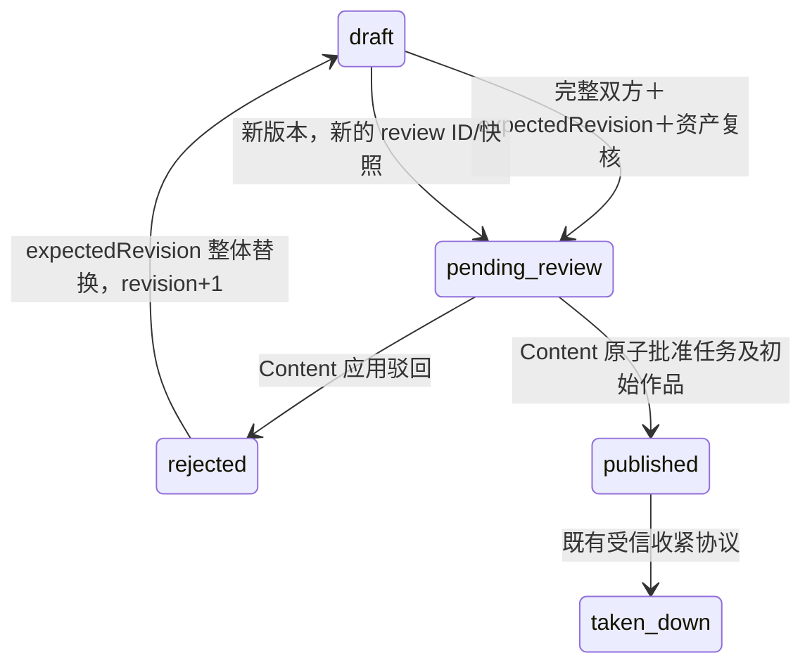

# Moderation：初始任务送审与最小审核闭环

日期：2026-10-16。**Human Design**：本轮 4A～4D 指令、PRD S2/S4 与过审即展示约束。下述数据结构、RPC、租约、超时及兼容策略均为 **Agent Self-Claimed 实现方案**，不是额外已批准产品规则。

本文保留阶段四、五历史记录；2026-10-23 的单件追加作品审核增量及升级限制见第 13 节。历史“仅初始包”的范围说明不代表阶段六的现有接口。

## 1. 基线与范围

Asset PR #27 已于 2026-10-16 合入上游 dev（`b2a7399`）；从该提交建立 `backend/feat-moderation-review`。旧 Content `ApplyAssetReview` 仅是受信决定应用端，不是案件系统。当前切片只处理任务及其 human/agent 初始作品整体送审；不实现独立追加投稿、举报、审计平台、自动审核/病毒扫描、Voting、Discovery、Challenge 完整联调、前端或公网部署。

Content 独占草稿、不可变送审快照、投稿状态和展示状态；Moderation 独占案件、管理员决定、投递状态与 Content 执行回执；Asset 只拥有文件、归属和可用状态，**不增加审核状态**。各服务独立 schema、owner/runtime；无跨 schema 查询/FK，无数据库事务内 RPC。

## 2. 送审与修改规则

- 草稿允许不齐双方；送审必须至少一件 human 和一件 agent，沿用作品来源/显式 cloudUse 约束；cloudUse=false 不阻止展示，不能要求云端授权来送审。
- 送审不递增内容 revision；以 `(task_id, revision)` 唯一。重复送审找回该版本的快照和当前审核结果，包括已驳回后工作副本已变动的旧版本重试，不新建案件。
- pending_review 不允许编辑：不另留可编辑工作副本；快照绝不可修改。驳回后 PUT 产生新 revision 并回 draft，再显式 POST 送审；旧快照和案件保留。published/taken_down 不通过此入口编辑或重提。
- 送审前在事务外读取版本并复核所有 file 资产归属/ready；事务内重新锁定作者行并核对 revision/状态，写快照、pending 状态及 outbox。验证期间发生编辑必须 409，而不能冻结未复核的新内容。
- 已 ready 资产的内容不可变。没有资产删除 API；未来引入资产删除时需另外协调引用，不能把当前复核解释为永久权限。

## 3. 权威记录与可靠投递

Content 新增迁移 `004_task_reviews.sql`（不改 001～003）：task_drafts 状态扩展；`review_requests` 保存完整快照、预分配稳定 entry ID、当前审核结果；`review_outbox` 保存待建案消息、尝试次数/租约；`review_decision_receipts` 保存决定请求摘要和稳定执行回执。快照/作者/版本不能由 runtime 更新。

Moderation 独立迁移：`reviews` 以 review ID 及 `(task_id, submission_revision)` 唯一建案，保存不可变 Content 快照、决定、管理员/时间、Content 回执；`decision_outbox` 保存待应用意图及租约。owner 迁移校验和保护，runtime 仅必要列权限，不 DDL、不跨库。

双方用单条 `UPDATE ... FROM (SELECT ... FOR UPDATE SKIP LOCKED)` 领取，持久化随机 lease token 和到期时间；提交领取后再 RPC。只持当前 token 的 worker 可以确认投递，超时或崩溃由到期租约恢复。RPC 关闭自动重试；后台用同一消息/决定 ID 至少一次重试。响应丢失由接收方唯一约束/回执找回，不重建案件或重复应用。

### Outbox worker 调度与失败记录（2026-10-19）

Content → Moderation 与 Moderation → Content 使用同一 `platform.RunOutbox` 管理 1 秒轮询、每轮最多 7 秒、服务取消和结构化日志；每轮仍只调用一次模块投递操作，各副本仍由数据库租约协调，**不连续扫积压、不并行消费、不增加新的退避策略**。下游 RPC 的 5 秒预算、领取/确认 SQL、消息幂等、回执校验与 `blocked` 判定继续由所属服务处理；共享 runner 不决定哪些错误可重试。

- 没有待办、租约已被其他执行者接管、正常服务关闭均不记错误日志。
- 可重试技术失败记 `WARN`，包括链路、阶段、结果分类、gRPC code、格式受限的稳定错误 reason，以及已知的待办 ID。数据库 cause 以 SQLSTATE/约束名记录，避免把 SQL 详情或行数据写入日志；不符合稳定 reason 格式的异常消息统一记为 `unspecified`。
- 业务不可恢复冲突只有在 `blocked` 状态和 outbox 变更确认提交后才记 `ERROR`；未能提交 blocked 的故障仍按可重试技术失败记 `WARN`。不记录审核正文、完整快照、凭据或原始下游响应体。
- 执行结果仍以现有 outbox、租约与审核状态为准；本轮不新增数据库字段。若以后需要查询最近失败，应评估为 outbox 增加 `last_attempt_at`、`last_error_stage`、受控分类码等字段，明确保留/覆盖策略和清理周期，并经迁移、runtime 最小权限和双副本恢复验收后实施。不得保存作品正文或不受控的完整异常详情。

建案请求只接受 mTLS content，载荷来自已持久化快照。管理员决定先锁案件，保存唯一决定及 outbox，不在事务里调用 Content。相同 decision/reason 重试返回同一案件，不重写原 reviewer；不同决定/理由 409。Content 核对 review ID、task ID、submission revision、当前 pending 状态，并在同事务应用状态/展示和回执。旧决定精确重放只返回旧回执，不重新打开资源。不可恢复的版本冲突标记 blocked；不能谎称已生效。

批准理由可选，提供时原样保存于 Moderation 并随 outbox 传给 Content，参与决定幂等比较及执行回执摘要；缺省/空理由仍兼容。驳回理由仍必填且不能全为空白。两种理由均要求有效 UTF-8、无 NUL、最多 4000 **UTF-8 字节**（不是 4000 个字符），不截断。Content 草稿的 `rejectionReason` 仍只用于驳回，不以批准理由冒充驳回状态。新增 `002_approval_reason.sql` 替换理由 CHECK，保留 001 及校验和；先迁移再滚动服务，旧案件/理由不改写。002 后就绪才放行。以上为 **Agent Self-Claimed** 兼容实现。

## 4. HTTP / RPC 契约

| HTTP | RPC / 调用方 | 身份、幂等、超时 |
| --- | --- | --- |
| POST `/api/me/tasks/{taskId}/review-requests` | Content.RequestTaskReview / gateway | 网站＋Origin/CSRF，`{expectedRevision}`，task+revision 自然幂等；5 秒 |
| 内部建案 | Moderation.CreateReviewCase / content | mTLS content；review ID＋task/revision，同 ID 异快照409；5秒 |
| GET `/api/admin/reviews?status=pending&limit=20&cursor=...` | Moderation.ListReviews / gateway | 管理员网站断言，limit1～100；只返回初始任务案件；5秒 |
| GET `/api/admin/reviews/{reviewId}` | Moderation.GetReview / gateway | 管理员网站断言；2秒 |
| POST `/api/admin/reviews/{reviewId}/decision` | Moderation.DecideReview / gateway | 管理员网站＋CSRF，approve可选理由、reject必填非空理由；2秒持久化；待投递202，确认应用后200 |
| 内部决定应用 | Content.ApplyReviewDecision / moderation | mTLS moderation；不可变 decision ID/哈希，确切送审版本；5秒 |
| 内部快照读取 | Content.GetReviewSnapshot / moderation | mTLS moderation，只读已送审版本；2秒 |
| GET `/api/admin/reviews/{reviewId}/assets/{assetId}/content` | Asset.DownloadReviewAsset → Content.CheckReviewAssetAccess | gateway mTLS＋Asset方法专用管理员网站断言；Content只查确切 pending 快照引用，不回调Asset；流15分钟，权限子预算2秒 |

现有 Review `status` 保持 pending/approved/rejected，只有 Content 回执确认后才从 pending 变终态；增加 `decision`、`deliveryState` 和 `applicationRevision` 区分未决定/待投递/已应用/冲突。不把内部 outbox 状态冒充审核完成。GET 读取无写副作用。列表固定 created_at DESC,id DESC，游标带版本和管理员/有效status scope，不是授权凭据；重复/未知参数、损坏/过长游标400，空cursor第一页，末页null。不查totalCount，完整快照按Proto字节预算分页。

未登录401，非管理员/MCP/CSRF403；本人资源越权与不存在统一404；非法输入400；缺双方422；版本/状态/幂等冲突409；依赖不可用503。服务与方法白名单默认拒绝，Identity每次复核当前网站会话/角色。请求不能指定author/owner/role/reviewer。

待审文件必须同时满足当前管理员会话、确切review/asset绑定、仍pending和Asset ready。打开对象后再次查权限，再发送首帧；不发永久URL，不走所有者绕过，不缓存授权。审核后从待审入口拒绝；已批准文件走既有公开入口。已发出的字节无法收回。

## 5. ApplyAssetReview 兼容过渡

保留所有既有Proto字段/编号、旧决定回执和已审核快照；不修改003迁移。正式送审过的任务不允许通过旧RPC首次批准或重新批准，防止绕过案件/旧决定恢复展示；已有精确回执仍可找回，收紧（下架/撤销）仍按原revision和来源版本执行。旧3C任务可继续旧协议维护；旧RPC首次批准未送审草稿现在返回409 formal_review_required，原3C首次批准测试改为明确的旧已部署快照/回执升级夹具，正式新批准由独立的真实Moderation测试覆盖。但不能通过新送审入口把已展示任务当成新草稿复活。新批准只由 ApplyReviewDecision 复制**已送审快照**，而不是临时读取当前草稿。旧客户端/旧服务滚动期间不双发决定；先迁移和授权，再滚动Content，再启Moderation投递。

## 6. 失败与恢复矩阵

| 故障 | 持久事实 / 恢复 |
| --- | --- |
| Asset复核失败 | 保留原草稿，无快照/outbox |
| Content提交后HTTP丢失 | 原版本重试找回review ID |
| Moderation停机 | Gateway保持就绪，登录/草稿/上传继续可用，审核列表/详情/决定503；Content送审保持pending，outbox租约后重试 |
| 建案成功响应丢失 | 相同快照重试找回同一案件 |
| 两管理员并发相反决定 | 案件行锁；恰一个决定，另一个409 |
| 决定持久化后Content停机 | deliveryState=pending；不称已批准；恢复重投 |
| Content应用成功回执丢失 | 同decision ID找回同一回执，无重复应用 |
| 领取者崩溃 | 租约到期由其他副本接管；旧token不能确认新领取 |
| 驳回后新版本送审，旧决定迟到 | 精确回执只查回，异请求/错版本409，不影响新版本 |
| 批准后下架，批准重放 | 原回执，不恢复展示；新下载404 |
| Identity/Content权限检查不可用 | 文件/审核接口拒绝，不用缓存放行 |

## 7. 部署和验收边界

`cmd/moderation` 独立进程（非platform），MODERATION_DATABASE_URL_FILE owner/runtime、IDENTITY_TARGET、CONTENT_TARGET、mTLS moderation证书；gateway与Content配置MODERATION_TARGET。Content outbox与Moderation决定worker各随两个副本运行。readiness不将互相业务投递形成依赖环：Content不依赖Moderation健康；Moderation就绪依赖本地DB及Identity连接，Content不可用时保留待办。kind注册Moderation依赖Identity/Content，gateway再依赖Moderation；NetworkPolicy显式开放Content↔Moderation、gateway→Moderation、Asset→Content、Moderation→Identity。不开通Moderation直读Asset数据库。

**Agent Self-Claimed 故障隔离修正（2026-10-17）**：上述 catalog 依赖是部署排序，不等于请求期全局 readiness 依赖。Gateway 不因 Moderation 不健康退出 Service endpoints，只由相应审核 RPC 返回 503；Content 送审只依赖本地事务及必要身份/资产复核，不等待 Moderation。没有放宽 Identity、Content、Asset 的既有就绪策略，也不缓存审核授权。验收通过一次性私有 NodePort → 正常 Service → ready EndpointSlices，停机后等待探针窗口、核对两个 Gateway ready endpoint，并用新 TCP 连接验证登录发起/会话/草稿/实际上传完成/送审和审核503；不能用 port-forward 代替该故障隔离验收。Content 停机的回执恢复子测试仍使用诊断 port-forward，不声明 Content 故障时全局 Gateway 可用。

隔离 validator 为 Identity 注入一次性合成 OAuth client 配置，仅检查停机前后的登录流程落库/302 授权跳转，不跟随跳转、不调用 Google 换码，不读取实际 OAuth 凭据，也不把它称为真人 Google 登录成功。初次新增验收因原 fixture 未配置 OAuth 在该断言返回503；保留失败记录，补齐上述前置条件后重跑，不降低302判据。

先跑专用PostgreSQL＋正式mTLS＋真实Identity/HTTP集成，再运行一次性namespace内**真实Moderation Pod**的kind验收；测试证书直调不能替代。验收覆盖本轮4D矩阵、租约过期、丢响应、停机恢复、角色/CSRF、待审文件隔离、运行账号跨schema/DDL拒绝。

4A～4D 已完成本地实现与验证；本地验证不等于已合入、远端 CI、生产部署或公网发布。公开任务/作品详情不在本切片；最多声明“审核及过审文件链路完成”，不能声明“公开内容浏览完成”。

## 8. 技术参考（Agent Self-Claimed）

- [PostgreSQL 18 SELECT](https://www.postgresql.org/docs/18/sql-select.html) 官方文档的 SKIP LOCKED queue 用法；仅用于领取，不用于用户一致读取。
- [Transactional Outbox](https://microservices.io/patterns/data/transactional-outbox.html) / [Idempotent Consumer](https://microservices.io/patterns/communication-style/idempotent-consumer.html) 模式：业务状态和待发送记录同事务，接收方仍必须去重；不是恰好一次投递，不引入消息中间件。

## 9. 阶段 4A～4D 实际验收记录（2026-10-16）

以下是本地实际结果；新增数据模型、租约、超时、测试组织和 kind 验证方式均为 **Agent Self-Claimed** 实现方案：

| 验收层 | 结果 | 证据 |
| --- | --- | --- |
| Proto / 生成 | PASS | `buf lint`、`buf generate` 均退出 0；独立临时目录重新生成与 `backend/gen` 差异退出 0；`buf breaking --against upstream/dev` 退出 0。 |
| Go 单元与构建 | PASS | `gofmt -l cmd internal`、`go vet ./...`、`go build ./cmd/...` 均退出 0；普通测试 134 项通过，race 测试 134 项通过。 |
| 真实 PG/S3/mTLS/HTTP | PASS | 临时 PostgreSQL 18 与 SeaweedFS 4.13；最终全量集成退出 0，250 项通过、无 skip/fail；Moderation 专项 45 项通过。凭据和容器已清理。 |
| 真实 Moderation kind | PASS | `python3 -u ops/lab/validate_modules.py` 退出 0；一次性 namespace 已清理；真实 Moderation 两副本通过送审、停机恢复、管理员待审文件读取、驳回重提、并发决定、回执重放、过审文件读取。 |
| 网络与部署控制 | PASS | kind 网络探针、失败 rollout 回滚、迁移失败重试、重复完整部署均通过；共享命名空间资源快照未被验证过程改写。 |
| 根目录检查 | PASS | `npm run check`、`npm run build:docs`、`npm test`、Python unittest（27 项）、`npm run ci`、`git diff --check` 均退出 0。 |

### 证据边界与剩余事项

- 已验证的是本地一次性 kind lab、临时真实 PostgreSQL/S3、真实 mTLS 和真实 Moderation Pod；没有执行公网部署，也没有声称远端 GitHub CI 已通过。
- 以上为修复前的历史验收：2026-10-17 定向审查发现 Gateway 故障隔离和批准理由兼容缺口，原 port-forward 验收不能排除前者。是否可提交审查以本次修复后的新增验证记录为准。当前工作区仍未 commit/push/创建 PR；正式发布状态仍是 `unpublished`。
- 公开任务/作品详情、追加投稿、举报/审计平台、自动审核/病毒扫描、Voting、Discovery、Challenge 完整业务联调和生产对象存储 HA 不在本阶段。

## 10. 两项审查问题修复与重新验收（2026-10-17）

**Agent Self-Claimed 实现与测试方案**：移除 Gateway 对 Moderation 的全局 readiness 健康检查，保留审核 RPC fail closed；支持并持久化批准理由，Content 同步验证并纳入回执摘要；新增 Moderation 002 迁移（不改001）及带旧案件升级测试。新增 UTF-8/NUL/4000字节边界、批准理由回读/原样重试/异理由409测试。顺带修正既有 Asset 集成夹具浅拷贝 Proto mutex，使用 `proto.Clone`，无业务行为改动。

证据目录：`/tmp/hw-moderation-fix-20261017/`。以下命令均已退出：

| 命令 / 范围 | 退出码与结果 |
| --- | --- |
| `buf lint`；`buf generate`（正式buf.gen.yaml） | 各0；版本固定的go run插件，正常本地Go缓存；未用临时生成插件 |
| 独立临时输出 `buf generate --output …` 后 `diff -qr gen …/gen` | 0，重新生成完全一致；本次修复未改Proto字段/编号 |
| `buf breaking --against '../.git#ref=HEAD,subdir=backend'` | 0；兼容基线为当前HEAD，不冒称远端CI |
| `git diff --exit-code -- gen` | **1**：整个阶段4的生成代码仍未提交、相对HEAD有预期增量；这不是独立重新生成不一致 |
| `gofmt -l cmd internal`；`go vet ./...`；`go build ./cmd/...` | 各0；gofmt输出为空 |
| `go test -json ./... -count=1`；`go test -race -json ./... -count=1` | 各0；各135测试/子测试通过，无skip/fail |
| `go vet -tags=integration ./...`；`go vet -tags=lab ./internal/identity` | 修正上述既有夹具copylock后各0；保留初次失败记录 |
| 真实临时PG18/S3：`go test -race -json -tags=integration -p=1 ./... -count=1 -timeout=120s` | 0；251测试/子测试通过，无skip/fail；夹具修正后完整重跑同样通过 |
| 真实审核专项：`go test -race -json -tags=integration ./internal/identity -run '^TestModeration(HTTPOutbox\|IdentityAuthorization\|ApprovalMigration)$' -count=3 -timeout=120s` | 0；48测试/子测试通过，无skip/fail；覆盖旧理由约束复现→002升级、历史保留、重复迁移及新约束 |
| `npm run ci`（check/build:docs/Node test/Python unittest） | 0；5个Node、27个Python测试通过 |
| `python3 -m py_compile ops/lab/validate_modules.py`；OpenAPI YAML解析；`git diff --check` | 各0 |
| `sg docker -c 'umask 022; DOCKER_CONFIG="$HOME/.config/human-worth/lab/docker" python3 -u ops/lab/validate_modules.py'` | **0**；4项真实kind业务测试通过，网络允许/拒绝、失败rollout回退、失败迁移同SHA重试及重复完整部署通过 |

最终 kind namespace `human-worth-verify-c778d351` 已删除。Moderation 专项62.59秒：停掉两个真实 Moderation Pod，等待15秒探针窗口，确认两个 Gateway ready endpoints，再用每请求新TCP的 HTTPS NodePort/Service 链路检查会话/草稿/完整文件上传/登录发起/持久送审成功、审核列表503；恢复后自动投递，带中文批准理由完成审核、回读与幂等重试，过审文件读取成功。Content停机子测试仍是诊断port-forward，不扩大声明。首次kind因缺合成OAuth配置退出1，记录保留于 `kind-attempt1.log`；补齐隔离前置条件后完整重跑退出0，未掩盖失败。

本地必要验证为 **PASS，可提交复审**。没有使用临时GOCACHE（`/home/cherry/.cache/go-build`）；临时测试数据库/S3容器、凭据、namespace均已清理，未改产品数据。未commit/push/创建PR、未部署公网，未进行真人Google登录或新增公网验收，生产S3 HA/远端GitHub CI仍不在本轮证据内。

## 11. 2026-10-19 共享 outbox runner 与失败日志（Agent Self-Claimed）

Content 与 Moderation 的后台循环现统一调用 `internal/platform.RunOutbox`；各自投递实现返回操作阶段、已知审核 ID、结果分类及内部错误类型信息。`DeliverReview` / `DeliverDecision` 保留供既有调用方使用的布尔结果包装，模块 SQL、租约、RPC 和回执逻辑仍各自维护。Content 在确认 UPDATE 后检查影响行数；陈旧租约记录为 `lease_lost`，不误记为已投递。

runner 保持 1 秒轮询、7 秒单轮 deadline、每 tick 调用一次；无待办、租约丢失和服务取消不产出错误日志。技术错误以 `WARN outbox_delivery_failed` 记录，含链路、阶段、结果、gRPC code、稳定错误信息和可用的审核 ID。PostgreSQL cause 只输出 SQLSTATE/约束名，避免 SQL 行详情。Moderation 仅在 `delivery_state=blocked` 与 outbox `blocked` 的事务提交成功后，输出 `ERROR outbox_delivery_blocked`；blocked 持久化/提交失败仍是 `WARN` 技术错误。无迁移或新字段。

失败观察暂用结构化日志。后续若需查询型运维界面，可评估为 outbox 增加最近尝试时间、失败阶段与受控错误分类等列；届时需定义覆盖/保留语义、清理周期与最小列权限，并测试双副本恢复。当前不保存正文或完整异常详情。

本地验证：`go test -race ./... -count=1`、`go vet ./...`、`go vet -tags=integration ./...`、`go build ./cmd/...` 均退出 0；`go test -race -tags=integration ./internal/identity -run '^TestModerationHTTPOutbox$' -count=1 -timeout=180s -v` 使用一次性 PostgreSQL 18 退出 0。新增真实数据库场景在下游返回可阻塞业务冲突时，等 outbox 和 review 均提交 blocked 后由 runner 写出结构化 `ERROR`，并核对日志审核 ID、阶段及持久状态。`internal/platform` 单元测试覆盖技术失败 `WARN`、blocked `ERROR`、空队列/服务关闭静默及数据库错误详情脱敏。根目录 `npm run ci` 退出 0（5 个 Node、27 个 Python 测试），文档链接与 `git diff --check` 通过。测试 PostgreSQL 与私有 DSN 已清理。

以上是本地代码、真实 PostgreSQL/mTLS 服务集成与项目检查；没有运行 kind、远端 GitHub CI、自动 Deploy Action 或公网部署。本次无 Proto/schema/前端改动，也未引入积压加速、并行消费或退避策略。

## 12. 阶段五公开浏览衔接（2026-10-17，Agent Self-Claimed）

本次开始已fetch并确认本模块通过PR #28进入 `origin/dev` / `upstream/dev` 的 `e2466a3`；本文阶段四当时未提交/未合入的记录属于历史证据。阶段五在此基线上扩展Content公开投影，不改变Moderation案件、理由、outbox、回执或批准权限。公开读取不依赖Moderation在线，也不读取本schema。

[Content阶段五](backend-content.md#10-阶段五公开任务详情与过审作品分页2026-10-17未发布)记录字段来源、nullable历史时间和只读分页。Content首次正式批准现在同事务记录真实publishedAt/approvedAt，旧记录不伪造回填；审批时间与Moderation决定持久化时间是不同事件。旧决定重放只找回回执，不恢复已下架任务或撤销作品。

现有 `TestKindModerationDeployment` 扩展在真实Moderation批准后验证普通公开详情/分页/S3文件；停Moderation时使用正常Service/NodePort验证可读，双Content Pod定向探针只作正向跨副本验证，不冒充Service故障隔离。具体运行结果见Content验收记录，不用历史阶段四PASS替代。

2026-10-22 恢复整合：以PR #30后的dev `665bf4d` 为基线移植封存第五阶段；保留共享outbox runner、可靠投递/回执及技术错误分类，不改Moderation schema/协议/业务实现。Content新增批准时间写入与公开只读投影，无需Moderation在线。Service故障断言严格沿用503/504对应的不可用/deadline分类；本次结果见 [Content恢复整合](backend-content.md#11-第五阶段恢复整合2026-10-22未发布)，原第11节及此前阶段验收记录保留。

## 13. 阶段六：单件追加作品审核（2026-10-23，未发布）

基线为 PR #31 squash 后的 `origin/dev@dc8e5758926b685e8bc4152190ddf82fce7abbbd`，任务分支 `backend/feat-additional-entry-review`。**Human Design**：任意网站用户向可见任务追加一件 human 或 agent 作品，只审新作品，原任务不重审；本轮明确保留 TaskSubmission、旧 RPC/字段/编号及回执语义，新增独立 EntrySubmission/快照/决定接口。以下数据库组织、校验和测试实现为 **Agent Self-Claimed**。

### 共享协议与 Moderation 行为

| 接口 / 字段 | 实际语义 |
| --- | --- |
| Moderation.CreateEntryReviewCase | 只接受 content mTLS；请求 snapshot 为 Content 已持久化的 EntryReviewSnapshot；同 review ID、entry/revision 和相同完整快照重试找回原案件，身份/快照冲突 AlreadyExists |
| Review.entry_snapshot（12） | 独立追加作品的不可变快照；旧 snapshot（2）保持 ReviewSnapshot 类型，追加案件中为 NULL/未设置 |
| Review.entry_receipt（13） | 独立 ApplyEntryReviewDecisionResponse；旧 receipt（10）保持原类型，追加案件中为 NULL/未设置 |
| ListReviews / GetReview / DecideReview | 沿用管理员网站断言、CSRF、理由约束与行锁；列表混合 task/entry 案件，原排序、status 筛选、游标及 2 MiB Protobuf 分页预算保持 |
| Content.ApplyEntryReviewDecision | moderation mTLS；decision_id、review_id、task_id、entry_id、submission_revision、outcome、reason，以及必填 snapshot_sha256 |
| 新决定回执 | decision_id/review_id/entry_id/revision/state；批准 state 必须为 approved，驳回必须为 rejected。旧 Task 批准仍为 published |

EntrySnapshot 校验 review/entry/task ID、账号、正版本、origin=additional、state=pending_review、相同 review 绑定、单件 human/agent 内容、合法创建/更新时间、无先前批准/驳回结果，以及 512 KiB Protobuf 上限。不套用初始包必须齐备 human＋agent 的要求；完整作品、资产归属/ready 和父任务可见性由 Content 在送审事务边界负责。

建案时对完整 EntryReviewSnapshot 执行 `proto.MarshalOptions{Deterministic:true}` 后 SHA-256，保存原始 32 字节 snapshot_hash。投递使用该已保存摘要的小写 64 字符 hex；不重算当前工作副本，不把 JSON 字符串哈希当作协议摘要，也不调用 Content 的当前稿件接口。Content 的 GetEntryReviewSnapshot 保持独立读取协议，本 worker 无需额外回调它。服务版本/快照字段扩展仍须遵守下方升级顺序，不能把 deterministic 序列化误作任意版本之间的通用规范化格式。

读取根据数据库 object_kind 只填充对应快照和回执字段。未决定时 reason/reviewer/decided_at/decision_id/receipt 的 SQL NULL 保持未设置；不构造空 TaskSubmission 来伪装追加案件，不把 entry 回执反序列化成旧 task 类型。管理员决定一旦持久化仍保持 status=pending、deliveryState=pending，只有 Content 回执核对成功并提交后才变为 approved/rejected。

### 迁移与运行权限

新增 `internal/moderation/migrations/003_entry_reviews.sql`，001/002 及校验和不变：

- `object_kind` 为 task/entry，默认 task，历史案件自动获得 task 类型。
- `object_id` 为 STORED 生成列：task 取 task_id，entry 取不可变 snapshot.submission.id。旧服务省略新列的 INSERT 仍有正确对象身份，runtime 无法写入/修改生成列。
- 用 `UNIQUE(object_kind,object_id,submission_revision)` 替换原 `UNIQUE(task_id,submission_revision)`；同任务多个 entry 的 revision=1 不再冲突，同一 entry/revision 仍唯一，review ID 和 decision ID 继续全局唯一。
- 新增追加案件身份 CHECK，约束 entry ID、parent task、origin、review ID 与版本和快照一致；原快照、hash、理由、决定、时间和回执原样保留。
- Ready 要求 003 已应用；grants 保留列级 UPDATE 白名单，不给 object_kind/object_id、snapshot/hash、来源版本、created_at 或历史回执重写权限。无跨 schema 查询/FK，无新运行账号、证书、数据库连接或队列服务。

### 投递、下架与混合升级

复用现有 decision_outbox、DeliverDecision / RunDelivery 与 platform.RunOutbox；task/entry 共用队列，领取后按类型分发到相应 Content RPC。仍为 1 秒 tick、单轮 7 秒、下游 5 秒、15 秒租约；RPC 不持数据库事务锁，原 decision ID、原因及摘要至少一次重试。回执核对全部标识、被审核版本及对应终态，错误/空回执按可重试技术错误处理，不误记 applied。

| 结果 | 持久状态和恢复 |
| --- | --- |
| Unavailable / DeadlineExceeded / Canceled / Internal 等技术错误 | pending，租约到期重试；WARN，不能因升级或通信失败永久丢弃决定 |
| Unimplemented | 同样技术重试，等待旧 Content/Moderation 实例升级；不得 blocked。Content → Moderation 新建案方向的对应分类由 Content worker 维护 |
| Aborted / AlreadyExists / InvalidArgument / FailedPrecondition 业务冲突 | review.delivery_state 和 outbox.blocked 同事务提交后才输出 blocked/ERROR；事务提交失败仍是可重试 WARN |
| 父任务下架后批准，Content 返回 FailedPrecondition task_not_accepting_entries | blocked；不重发新 decision、不改原决定，不恢复任务展示 |
| 下架后的驳回 | Content 仍可接受原因反馈；本模块照常投递 reject 并等待 rejected 回执，不自行以父任务下架阻止驳回 |
| Content 成功但响应丢失 / worker 崩溃 | 原 ID/摘要重试，取 Content 原回执；旧租约不能确认新持有者的投递 |
| blocked 状态/COMMIT 故障 | review 与 outbox 一起回滚；不输出已持久化 blocked 的错误结论 |

**必须按顺序升级**：先执行 Content 006、Moderation 003 owner 迁移及各自 grants；再滚动全部 Content、Moderation 及相关 Gateway 兼容实例，确认都支持新增字段/RPC；最后开放新增 Gateway 投稿/重提入口及新建案流量。迁移可兼容旧 Task 写入，不代表旧二进制能解释追加案件：旧 Moderation 读取 entry JSON 或旧 Gateway 忽略 entry_snapshot 都不具备完整语义。不能让旧实例处理新增案件，也不能仅依赖旧实例的历史 readiness 检查来宣称已兼容。

既有待审文件 HTTP/Asset 流协议无需由 Moderation 扩展。Content 对 entry 快照、当前 pending 状态与可见父任务做权威判断；Asset 继续复核当前管理员和 ready、打开对象后再次授权。父任务下架时待审文件入口拒绝，并不妨碍管理员通过案件详情决定驳回。公开展示、撤销及旧回执重放不恢复展示仍由 Content 负责。

### 本轮验证与边界

修改范围仅 `internal/moderation`、`ops/moderation/grants.sql` 与本文；Proto/生成代码、Content、Gateway、contract 的协作修改不由本模块代写。

2026-10-23 使用一次性 PostgreSQL 18.4 实际执行：

| 命令 | 退出码 / 证据范围 |
| --- | --- |
| `go test -race ./internal/moderation` | 0；单件快照边界、服务身份、摘要、approve/reject 回执逐字段校验及理由/游标回归 |
| `go vet -tags=integration ./internal/moderation` | 0 |
| `go test -race -tags=integration ./internal/moderation -count=1 -v -timeout=120s` | 0；真实 owner/runtime、001/002→003 升级与重复迁移、历史 NULL 映射和记录不变、旧 INSERT 唯一性、最小权限、混合分页、同父多件/新版本/幂等冲突、稳定投递请求、租约恢复/陈旧确认、技术错误含 Unimplemented、错误回执、blocked COMMIT 故障及并发相反决定 |
| `go test -race -tags=integration ./internal/identity -run '^TestModeration(HTTPOutbox\|IdentityAuthorization\|ApprovalMigration)$' -count=1 -v -timeout=180s` | 0；旧任务审核真实 HTTP/Identity/mTLS/Content/Asset/FileStorage 回归与历史迁移测试 |

新增 Moderation 数据库测试使用受控 Identity/Content 客户端来注入响应和错误，不将其称为新追加作品的完整 HTTP/真实 Content/S3/kind 验收。旧审核真实链路回归证明旧 Task 行为，不替代新追加链路验收。新 Gateway/Content 联调、kind、远端 CI 和公网发布仍需按阶段六整体交付分别验证；未 commit/push/创建 PR 或部署。

阶段六整体最终验收（2026-10-23）：上述“联调/kind仍需验证”是模块交接时状态，现由完整Identity真实HTTPS/mTLS/PG/S3链路及5项kind业务补齐；其中新增单件闭环56.86秒、真实Moderation任务/公开浏览回归91.41秒，全量validator退出0（730.31秒），网络、故障与重复部署也通过。正常Service/NodePort验证Moderation停机不移除Gateway端点，真实Pod完成建案/决定/回执，驳回历史与旧决定重放安全。完整命令、556项计数边界、修复前失败及资源清理见Content第12节，不将本模块受控下游客户端测试冒称为该真实链路。仍未发布公网、未commit/push/PR。

## 第七阶段目录投递协作（2026-10-25，Agent Self-Claimed）

Moderation案件/决定/投递数据和Proto不变；只有Content完成“意图→Voting冻结→本地应用→完整目录激活→持久确认”才返回正式成功应用回执。Voting故障或Content意图未完成，原Moderation outbox保持待处理，不把决定已持久化或本地approved状态冒称最终公开完成。终态协议冲突由Content持久blocked并保留收紧，后续重试明确冲突后沿用Moderation既有blocked机制；技术故障继续原租约重投，不在事务中等待跨服务RPC。原驳回、管理员理由、待审文件授权与单件历史不变。真实Pod故障恢复及本轮实际结果见[Voting记录](backend-voting.md)，不替代或覆盖第四～六阶段历史验收。
